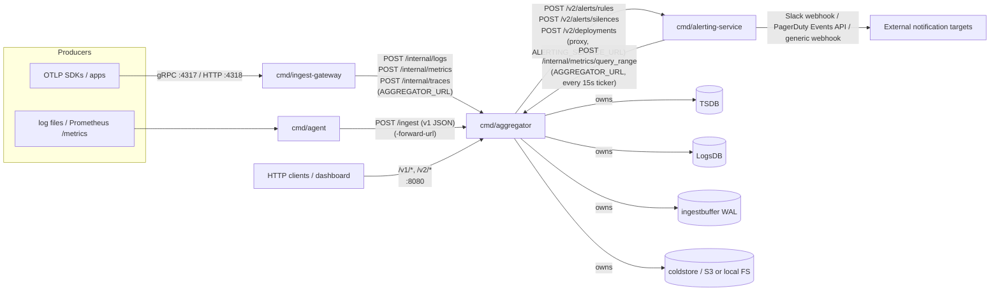

# Codebase Reference — custom-log-aggregator

> Extremely detailed reference documentation for every `internal/` package and every `cmd/`
> binary. Generated by reading the actual source; signatures are copied verbatim, behavioral
> descriptions are derived from reading the implementation and tests, not inferred from names.

## 1. System Overview

`custom-log-aggregator` is a from-scratch observability platform in Go: it ingests logs, metrics,
and traces (via a JSON v1 API, a JSON v2 API, and native OTLP gRPC/HTTP), stores them in
purpose-built embedded storage engines (an embedded TSDB for metrics, an embedded LogsDB for
logs), exposes two query languages (a PromQL-like `metricsql` for metrics, a pipelined `pipeql`
for logs), and layers rule-based alerting (grouping/routing/silencing/anomaly detection),
semantic vector search over log messages, rule/statistics-based AIOps root-cause correlation,
continuous CPU profiling, and RBAC/multi-tenancy on top.

It began life as a single binary (`cmd/aggregator`) and has since been split into **three
independently deployable services** plus a lightweight shipping agent:

| Binary | Role |
|---|---|
| `cmd/aggregator` | Owns all storage (TSDB, LogsDB, ingestbuffer, cold storage) and serves the full v1+v2 HTTP API. Everything else talks to it over the network. |
| `cmd/ingest-gateway` | Standalone OTLP receiver (gRPC `:4317`, HTTP `:4318`). Decodes OTLP exactly as before, but forwards decoded records to the aggregator over HTTP instead of writing to a local buffer. |
| `cmd/alerting-service` | Standalone rule-based alert engine (rules, grouping, routing, silencing, deploy correlation). Periodically queries the aggregator's TSDB over HTTP and dispatches notifications (Slack/PagerDuty/webhook). Stateless with respect to storage. |
| `cmd/agent` | Lightweight log-tailing + Prometheus-scrape shipping agent that forwards batches to the aggregator's `/ingest` (v1) endpoint. Independent of the 3-way split above. |

### 3-service architecture



**Key env vars that wire the network topology** (see `docker-compose.yml` and each `cmd/*/main.go`):

| Var | Read by | Purpose |
|---|---|---|
| `AGGREGATOR_URL` | `cmd/ingest-gateway`, `cmd/alerting-service` | Base URL of the aggregator (`http://aggregator:8080` in compose) that both services call over HTTP. |
| `ALERTING_SERVICE_URL` | `cmd/aggregator` (`internal/api`) | Base URL of the alerting-service (`http://alerting-service:8083` in compose) that `/v2/alerts/*` and `/v2/deployments` proxy to. |
| `CLA_OTLP_GRPC_ADDR` / `CLA_OTLP_HTTP_ADDR` | `cmd/ingest-gateway` | Listen addresses for the OTLP receivers (default `:4317` / `:4318`). |
| `ALERTING_SERVICE_ADDR` | `cmd/alerting-service` | Listen address for its own HTTP API (default `:8083`). |
| `CLA_HTTP_ADDR` | `cmd/aggregator` | Listen address for the combined v1+v2 API (default `:8080`). |

The aggregator exposes a set of **internal, unauthenticated, service-to-service endpoints** under
`/internal/*` specifically for this split: `POST /internal/logs`, `POST /internal/metrics`,
`POST /internal/traces` (written to by `cmd/ingest-gateway` via `internal/ingestgateway.ForwardSink`),
and `POST /internal/metrics/query_range` (read by `cmd/alerting-service` via
`internal/alertingsvc`'s `httpDataSource`, which implements `metricsql.DataSource` over HTTP).
These routes are unauthenticated because they're meant to be reachable only over the private
docker/network topology between services, not exposed publicly the way `/v1/*` and `/v2/*` are.

Statistical anomaly detection (`ObserveMetric`/`AddAnomalyDetector`), which feeds the AIOps
spike/anomaly feed synchronously off the live ingest stream, stayed inside `cmd/aggregator`
(`internal/platform/consumer.go`) rather than moving to `cmd/alerting-service` — it's tightly
coupled to the write path by design (needs to see every point as it lands), whereas rule
evaluation is a periodic, read-only, poll-based concern that is a natural fit for a separate
service.
</content>

---

## 2. Per-Package Reference

### Index

| Package | Section |
|---|---|
This section documents every internal/ package (~30) and cmd/ binary (4) in depth: path, purpose, and per significant type/function the real signature plus behavioral explanation.


## internal/querylang/metricsql

The `metricsql` package implements a small PromQL-like query language for querying time-series metrics. It provides a lexer, recursive-descent parser, AST, and evaluator supporting instant-vector and range-vector (matrix) selectors with label matchers, aggregations (`sum`/`avg`/`min`/`max`/`count`/`quantile`), functions (`rate`, `irate`, `avg_over_time`, `max_over_time`, `min_over_time`, `sum_over_time`, `percentile`), and binary arithmetic/comparison operators, all evaluated against a pluggable `DataSource` backend.

### Files

| File | Purpose |
|---|---|
| `ast.go` | Defines the `Expr` AST node types (literals, selectors, calls, aggregates, binary expressions). |
| `datasource.go` | Defines `Point`, `Series`, and the `DataSource` interface metricsql queries against. |
| `eval.go` | Evaluator: walks the AST against a `DataSource` to produce instant/range vectors. |
| `lexer.go` | Hand-written lexer turning a query string into a `[]Token`. |
| `parser.go` | Recursive-descent parser building the `Expr` AST, plus `ParseDuration`. |
| `token.go` | `TokenType` enum, `Token` struct, package doc comment. |
| `metricsql_test.go` | Lexer/parser/evaluator tests using an in-memory fake `DataSource`. |

### Types and Functions

#### AST (ast.go)

```go
type Expr interface { exprNode() }
```
Marker interface implemented by every AST node evaluable to an instant vector, range vector, or scalar: `*NumberLiteral`, `*VectorSelector`, `*MatrixSelector`, `*Call`, `*AggregateExpr`, `*BinaryExpr`.

```go
type NumberLiteral struct { Val float64 }
type VectorSelector struct {
	Metric        string
	LabelMatchers map[string]string
}
type MatrixSelector struct {
	Vector *VectorSelector
	Range  time.Duration
}
type Call struct {
	Func string
	Args []Expr
}
type AggregateExpr struct {
	Op    string
	Param Expr // used only by quantile; nil otherwise
	Expr  Expr
	By    []string
}
type BinaryExpr struct {
	Op  string
	LHS Expr
	RHS Expr
}
```
`VectorSelector` selects an instant vector: metric name + equality label matchers, e.g. `http_requests_total{service="checkout"}`. `MatrixSelector` adds a lookback window, e.g. `[5m]`. `Call` is a function invocation like `rate(...)` or `percentile(95, ...)`. `AggregateExpr` groups by `By` labels and reduces each group. `BinaryExpr` applies arithmetic (`+ - * /`) or comparison (`> < >= <= == !=`) operators; comparison operators filter the left-hand vector (Prometheus's non-`bool` filtering semantics), not producing booleans.

#### Datasource (datasource.go)

```go
type Point struct { T int64; V float64 }
type Series struct { Labels map[string]string; Points []Point }
type DataSource interface {
	QueryRange(matchers map[string]string, start, end int64) ([]Series, error)
}
```
`matchers` always includes `__name__` plus any label matchers; `start`/`end` are inclusive unix seconds. Implemented by both `internal/platform.metricsqlDataSource` (in-process, wraps `tsdb.Store`) and `internal/alertingsvc.httpDataSource` (over HTTP, for the standalone alerting-service).

#### Lexer (lexer.go)

```go
func Lex(input string) []Token
```
Never errors — malformed input surfaces as unexpected tokens the parser later rejects. Handles single/two-char operator tokens, quoted strings with escapes, `[...]` captured whole as a single `TokDuration`, digit runs with optional duration-unit suffix (`m`,`s`,`h`,`d`,`w`,`y`,`ms`) becoming `TokNumber` or `TokDuration`, and letter/`_`/`:`-starting runs becoming `TokIdent` (except case-insensitive `by` → `TokBy`). Unknown characters silently skipped.

```go
func isDurationUnitStart(r rune) bool
func isValidDurationUnit(u string) bool
```
Helpers deciding whether a digit run should attempt to consume a trailing duration-unit suffix.

#### Token (token.go)

```go
type TokenType int // TokEOF, TokIdent, TokNumber, TokString, TokDuration, TokLBrace/RBrace, TokLParen/RParen, TokLBracket/RBracket, TokComma, TokEQ/NEQ/EQEQ/GT/LT/GE/LE, TokPlus/Minus/Mul/Div, TokBy
type Token struct { Type TokenType; Text string; Pos int }
func (t Token) String() string
```

#### Parser (parser.go)

```go
var aggregateOps = map[string]bool{...}   // sum, avg, min, max, count, quantile
var callFuncs    = map[string]bool{...}   // rate, irate, avg_over_time, max_over_time, min_over_time, sum_over_time, percentile
type Parser struct { toks []Token; pos int }
func Parse(tokens []Token) (Expr, error)
```
Entry point: parses via `parseExpr`, requires `TokEOF` remains, else errors `"unexpected token ... after expression"`.

```go
func (p *Parser) parseExpr() (Expr, error)          // comparison ops, lowest precedence
func (p *Parser) parseAdditive() (Expr, error)       // +/-
func (p *Parser) parseMultiplicative() (Expr, error) // */÷
func (p *Parser) parseUnary() (Expr, error)          // leading -
func (p *Parser) parsePrimary() (Expr, error)
```
Standard recursive-descent precedence chain, all left-associative. `parseUnary` negates a `*NumberLiteral` in place or wraps as `0 - operand`. `parsePrimary` dispatches `TokIdent` followed by `TokLParen` to `parseAggregate`/`parseCall` based on `aggregateOps`/`callFuncs` lookup, else falls to `parseSelector`.

```go
func (p *Parser) parseAggregate(op string) (Expr, error)
func (p *Parser) parseLabelList() ([]string, error)
func (p *Parser) parseCall(name string) (Expr, error)
func (p *Parser) parseSelector() (Expr, error)
```
`parseAggregate` parses `<op>(<expr>[, <param>]) [by (labels)]`; for `quantile` the phi param comes first syntactically. `parseSelector` parses `metric{label="val",...}[range]`, converting to `*MatrixSelector` via `ParseDuration` if a `[...]` suffix is present.

```go
func ParseDuration(s string) (time.Duration, error)
```
Parses Prometheus-style durations (`"5m"`, `"500ms"`, `"1y"`=365 days); splits numeric prefix from unit suffix.

#### Evaluator (eval.go)

```go
const instantLookback = 5 * 60 // seconds, mirrors PromQL's default staleness window
type Evaluator struct { DS DataSource; EvalTime int64 }
func Eval(expr Expr, ds DataSource, evalTime int64) ([]Series, error)
```
Returns an instant vector for every expression type except a bare top-level `*MatrixSelector`, which returns the raw range vector.

```go
func (e *Evaluator) evalRangeVector(ms *MatrixSelector) ([]Series, error)
func (e *Evaluator) evalVectorSelector(vs *VectorSelector) ([]Series, error)
```
`evalVectorSelector` queries `[EvalTime-instantLookback, EvalTime]`, then per series finds the latest point with `T<=EvalTime`, dropping series with no qualifying point (sample staleness).

```go
func (e *Evaluator) evalCall(c *Call) ([]Series, error)
func computeRate(points []Point) float64
func computeIRate(points []Point) float64
```
`computeRate` sums `cur-prev` pairwise, but counts `cur` itself as the increase on counter reset (`cur<prev`) — PromQL-style. `computeIRate` uses only the last two samples.

```go
func avgPoints/sumPoints/maxPoints/minPoints(points []Point) float64
func interpolatedPercentile(vals []float64, frac float64) float64
```
`interpolatedPercentile` computes linear-interpolation quantiles (numpy-default style); returns `math.NaN()` for empty input.

```go
func (e *Evaluator) evalAggregate(a *AggregateExpr) ([]Series, error)
func groupKey(labels map[string]string, by []string) (string, map[string]string)
```
Groups input series by `groupKey` (deterministic sorted-label string) in first-seen order, emitting one `Series` per group.

```go
func (e *Evaluator) evalBinary(b *BinaryExpr) ([]Series, error)
func isScalar(series []Series) bool
func applyArith(op string, lhs, rhs []Series, lhsScalar, rhsScalar bool, evalTime int64) ([]Series, error)
func applyCompare(op string, lhs, rhs []Series, lhsScalar, rhsScalar bool) ([]Series, error)
func labelKey(labels map[string]string) string
```
`applyArith` covers scalar-scalar/vector-scalar/scalar-vector/vector-vector; vector-vector joins only matching label sets (indexed via `labelKey`, dropping unmatched series). `applyCompare` *filters* (keeps original series if comparison holds) rather than transforming values.

### Tests

`metricsql_test.go` uses a `fakeDataSource`. Covers: lexer token sequence for labeled selector; parse of vector/matrix selectors; nested `sum(rate(...)) by (service)`; quantile param parsing; percentile 2-arg call; comparison-vs-division precedence; `rate()` with counter reset; `irate()`; interpolated percentile; sum-by aggregation; quantile aggregation; vector/vector binary arithmetic join; alerting-style comparison filtering; avg/max_over_time; deterministic ordering (no drops/dupes for a bare selector).

## internal/querylang/pipeql

The `pipeql` package implements a small pipelined log-query language (Splunk SPL / Kusto style): a query is a `search` stage (fetching an initial record set from a pluggable `LogSource`) followed by zero or more `|`-chained stages — `filter`, `stats`, `sort`, `limit` — ending in either a raw record table or a grouped statistics table. Provides a lexer, recursive-descent parser, AST, and a stage-by-stage executor.

### Files

| File | Purpose |
|---|---|
| `ast.go` | Defines `Stage` and `BoolExpr` AST node types and the top-level `Pipeline`. |
| `executor.go` | `Run`/`Executor`: executes a parsed `Pipeline` stage-by-stage against a `LogSource`. |
| `lexer.go` | Hand-written lexer turning a pipeline string into a `[]Token`. |
| `logsource.go` | Defines `LogRecord` and the `LogSource` interface pipeql queries against. |
| `parser.go` | Recursive-descent parser building the `Pipeline`/`Stage`/`BoolExpr` AST. |
| `token.go` | `TokenType` enum, `Token` struct, package doc comment. |
| `pipeql_test.go` | Lexer/parser/executor tests using an in-memory fake `LogSource`. |

### Types and Functions

#### AST (ast.go)

```go
type Stage interface { stageNode() }
type SearchStage struct { Star bool; Filters map[string]string; Keywords []string }
type FilterStage struct { Expr BoolExpr }
type AggFunc string
const (AggCount AggFunc = "count"; AggSum="sum"; AggAvg="avg"; AggMin="min"; AggMax="max"; AggP50="p50"; AggP95="p95"; AggP99="p99")
type AggCall struct { Func AggFunc; Field string; As string }
type StatsStage struct { Aggs []AggCall; By []string }
type SortStage struct { Desc bool; Field string }
type LimitStage struct { N int }
type BoolExpr interface { boolNode() }
type AndExpr struct{ LHS, RHS BoolExpr }
type OrExpr  struct{ LHS, RHS BoolExpr }
type CompareOp string // "=", "!=", ">", "<", ">=", "<="
type Condition struct { Field string; Op CompareOp; Value string }
type KeywordExpr struct { Word string }
type Pipeline struct { Stages []Stage }
```
`SearchStage` is always first; `Star` means bare `search *` (ignoring `Filters`/`Keywords`). `AggCall.As` defaults to a rendering like `"p95(latency_ms)"`. There is no logical NOT support — only `AndExpr`/`OrExpr`/`Condition`/`KeywordExpr` exist despite the doc comment mentioning NotExpr.

#### Lexer (lexer.go)

```go
func Lex(input string) []Token
func isWordChar(r rune) bool // letters, digits, _, /, -
```
Simpler token set than metricsql (no braces/brackets/duration). Bare unquoted words lex as `TokIdent` unless they look numeric.

#### Parser (parser.go)

```go
var aggFuncNames = map[string]AggFunc{...}
type Parser struct { toks []Token; pos int }
func Parse(tokens []Token) (*Pipeline, error)
```
Parses the first stage, requires it's a `*SearchStage`; loops consuming `|`-separated subsequent stages; requires `TokEOF` at the end.

```go
func (p *Parser) parseSearchStage() (Stage, error)
```
`TokString` → keyword; `TokIdent = value` → filter; bare `TokIdent` → free keyword term.

```go
func (p *Parser) parseFilterStage() (Stage, error)
func (p *Parser) parseOrExpr() (BoolExpr, error)   // lowest precedence
func (p *Parser) parseAndExpr() (BoolExpr, error)
func (p *Parser) parseBoolPrimary() (BoolExpr, error)
func (p *Parser) parseCompareOp() (CompareOp, error)
```
Standard `or`/`and` precedence chain; `parseBoolPrimary` handles parenthesized sub-expressions, `TokString` → `*KeywordExpr`, `TokIdent op value` → `*Condition`.

```go
func (p *Parser) parseStatsStage() (Stage, error)
func (p *Parser) parseAggCall() (AggCall, error)
func (p *Parser) parseFieldList() ([]string, error)
```
Parses `<agg>(<field?>)[, ...] [by (f1,f2)]`.

```go
func (p *Parser) parseSortStage() (Stage, error)  // optional asc/desc + optional field
func (p *Parser) parseLimitStage() (Stage, error) // requires TokNumber
```

#### Executor (executor.go)

```go
type Result struct {
	IsStats bool
	Records []LogRecord
	StatsFields []string
	StatsRows   []map[string]any
}
func Run(pipeline string, src LogSource, start, end int64) (Result, error)
type Executor struct { Source LogSource; Start, End int64 }
func (ex *Executor) Execute(p *Pipeline) (Result, error)
```
Requires first stage `*SearchStage`, calls `Source.Search(filters, keywords, Start, End)`. Iterates remaining stages via type switch: `*FilterStage` errors if already in stats mode; `*StatsStage` errors if a stats stage already ran (only one supported); `*SortStage`/`*LimitStage` operate on whichever mode is active.

```go
func filterRecords(records []LogRecord, expr BoolExpr) []LogRecord
func evalBool(expr BoolExpr, r LogRecord) bool
func evalCondition(c *Condition, r LogRecord) bool
func getField(r LogRecord, name string) (any, bool)
```
`evalCondition`: missing field → always `false` (even for `!=`). Numeric comparison if both sides parse as numbers, else Go-native string comparison (lexicographic `<`/`>` for non-numeric fields, not an error). `getField` case-insensitively resolves well-known fields (`time`/`_time`, `host`, `service`, `level`, `message`/`msg`), falls back to `r.Fields[name]` (case-sensitive).

```go
func computeStats(records []LogRecord, st *StatsStage) ([]string, []map[string]any, error)
func sumF/minF/maxF(vals []float64) float64
func percentile(vals []float64, frac float64) float64
```
Groups by `By` field values (joined `\x1f`, first-seen order preserved). Per-group aggregates: `count`, `sum`, `avg`, `min`, `max`, percentiles via the same linear-interpolation algorithm as metricsql (returns `0` for empty input, not `NaN`).

```go
func sortRecords(records []LogRecord, st *SortStage)
func sortStatsRows(rows []map[string]any, fields []string, st *SortStage)
func compareAny(a, b any) int
```
Raw-record sort defaults field to `"_time"`; stats-row sort defaults to the last aggregation column. `compareAny` numeric if both parse, else lexicographic.

### Tests

`pipeql_test.go` uses a `fakeLogSource` with a 6-record fixture across `checkout`/`cart` services. Covers: 3-stage parse structure; `search *` + sort desc + limit; boolean `and` builds `*AndExpr`; per-host error counts via stats; numeric stats with interpolated `p95`; keyword search; `and`/`or` filter combination; ascending sort + limit; `sum`/`avg`/`min`/`max` stats aggregation.

## internal/tsdb

`internal/tsdb` is a small embedded time-series storage engine (inspired by Prometheus TSDB / InfluxDB / Elasticsearch doc-values) that buffers appended samples in memory in time-bounded chunks, flushes closed chunks to immutable columnar segment files on disk, resolves queries through an in-memory inverted label index combined with per-segment doc-value block indexes to skip irrelevant data, periodically compacts and applies retention to segments in the background, and caps runaway label cardinality via a rollup limiter.

### Files

| File | Purpose |
|---|---|
| `types.go` | Core domain types (`Point`, `Series`, `SeriesID`), canonical series-ID encoding/decoding, label-matcher evaluation, `ErrNotFound`. |
| `encoding.go` | Delta-of-delta timestamp codec and XOR+varint value codec used inside segment blocks. |
| `chunk.go` | `chunkBuffer`, the mutable in-memory per-time-window write buffer. |
| `compactor.go` | `Compactor`: merges/dedups small segments and expires old ones per a retention window. |
| `index.go` | `LabelIndex`: in-memory inverted index from label name/value to series IDs, with gob persistence. |
| `regex.go` | Cached regexp compilation shared by label-matcher evaluation. |
| `segment.go` | Immutable columnar on-disk segment file format: writer, reader, doc-value block index. |
| `store.go` | `Store`: the package's main entry point wiring together buffering, segments, index, limiter, compactor. |
| `tsdb_test.go` | End-to-end tests covering append/query round-trips, compaction/dedup, doc-value skipping, cardinality rollup, retention. |

### types.go

```go
type Point struct { Time int64; Value float64 } // unix-nanosecond timestamp
type Series struct { Labels map[string]string; Points []Point }
type SeriesID string // canonical "name1=value1,name2=value2,..." (names sorted)
func seriesIDFromLabels(labels map[string]string) SeriesID
func labelsFromSeriesID(id SeriesID) map[string]string
func matchesLabels(labels map[string]string, matchers map[string]string) bool
type ErrNotFound struct { Matchers map[string]string }
```
`matchesLabels`: a leading `~` on a matcher value triggers regex matching via `compileCached`, otherwise exact equality; returns false eagerly on any failed/missing match.

### encoding.go

Columnar block codec: timestamps via delta-of-delta ("Gorilla"/Prometheus-style) zig-zag varints, values via XOR-of-previous-bit-pattern uvarints.

```go
func encodeTimestamps(ts []int64) []byte
func decodeTimestamps(buf []byte, n int) ([]int64, error)
func encodeValues(vals []float64) []byte
func decodeValues(buf []byte, n int) ([]float64, error)
```
First timestamp raw varint, second a raw delta, every subsequent one a double-delta zig-zag varint — regularly spaced series collapse to ~1 byte/point. Values: first raw 8-byte bit pattern, subsequent XORed against previous, uvarint-encoded — near-identical values compress to ~1 byte.

### chunk.go

```go
type chunkBuffer struct { start, end int64; series map[SeriesID][]Point; points int }
func newChunkBuffer(start, end int64) *chunkBuffer
func (c *chunkBuffer) add(id SeriesID, p Point)
func (c *chunkBuffer) sortedSeries() map[SeriesID][]Point
```
Mutable in-memory write buffer for one `[start,end)` time window; `add` tolerates out-of-order insertion (no sort-on-insert); `sortedSeries` produces a sorted copy ready for `writeSegment`.

### segment.go

Immutable, columnar on-disk format: fixed header, concatenated per-series data blocks, a per-series doc-value index (min/max time, min/max value, offset/length, point count), fixed 16-byte footer for direct seek to the index — letting `Store.Query` skip decoding blocks whose time range can't intersect the query window.

```go
const (segmentMagic uint32 = 0x54534431; segmentFooterMagic = 0x54534446; segmentVersion uint8 = 1; footerSize = 16)
type blockIndexEntry struct { SeriesID SeriesID; MinTime, MaxTime int64; MinValue, MaxValue float64; Offset uint64; Length uint32; NumPts uint32 }
type segmentHeader struct { Version uint8; SeriesCount uint32; MinTime, MaxTime int64 }
func writeSegment(path string, series map[SeriesID][]Point) (err error)
```
Writes header, then per-series data blocks (sorted series-ID order via `sortSeriesIDs`, encoded via `encodeTimestamps`/`encodeValues`) while accumulating `blockIndexEntry`s, then the index section, then the footer. Uses named return + deferred close so a close error only surfaces if no earlier error occurred. Callers must pre-sort each series' points ascending.

```go
type segmentReader struct { path string; header segmentHeader; index []blockIndexEntry; decodedBlocks *counter }
func openSegmentReader(path string, decodedBlocks *counter) (*segmentReader, error)
func (r *segmentReader) readBlock(entry blockIndexEntry) ([]Point, error)
type counter struct { mu sync.Mutex; n int64 }
func sortSeriesIDs(ids []SeriesID)
```
`openSegmentReader` reads only header+footer+index sections — never touches data, so reopening a store with many segments is cheap. `readBlock` is the expensive path doc-value skipping avoids; `counter` lets tests observe how many blocks were actually decoded (proves skipping worked).

### index.go

```go
type LabelIndex struct {
	mu       sync.RWMutex
	inverted map[string]map[string]map[SeriesID]struct{}
	labels   map[SeriesID]map[string]string
}
func NewLabelIndex() *LabelIndex
func (idx *LabelIndex) Add(id SeriesID, labels map[string]string)
func (idx *LabelIndex) Remove(id SeriesID)
func (idx *LabelIndex) Resolve(matchers map[string]string) []SeriesID
```
`Resolve` is the core query-resolution algorithm: with no matchers returns all IDs; otherwise builds a per-matcher `matchSet` (regex-scan for `~pattern`, direct lookup for exact) and intersects sets across matchers, short-circuiting to `nil` on empty intersection — classic AND-of-inverted-lists.

```go
func (idx *LabelIndex) Cardinality(name string) int
func (idx *LabelIndex) Save(path string) error
func LoadLabelIndex(path string) (*LabelIndex, error)
```
`Save` gob-encodes only `labels` (inverted structure rebuilt cheaply); `LoadLabelIndex` tolerates a missing file and replays through `Add`.

### regex.go

```go
func compileCached(pattern string) (*regexp.Regexp, error)
```
Memoizing cache over `regexp.Compile` (RW-mutex-guarded map).

### compactor.go

```go
type Compactor struct {
	store *Store
	MaxMergeSpan time.Duration       // default 4x ChunkDuration
	MinSegmentsToMerge int           // default 2
	cancel context.CancelFunc
	done   chan struct{}
}
func NewCompactor(store *Store) *Compactor
func (c *Compactor) RunOnce(ctx context.Context) error
```
Runs `compactOnce` then `applyRetention`; safe alongside `Append`/`Query` since segments are immutable and swaps happen under the store lock.

```go
func (c *Compactor) compactOnce(ctx context.Context) error
func (c *Compactor) mergeGroup(group []segMeta) error
```
Sorts segments by `minTime`, greedily groups adjacent segments whose span stays within `MaxMergeSpan`. `mergeGroup` decodes every block from every segment in the group (in `minTime` order) and folds points into `merged[SeriesID][Time]Value` — a later segment's value for a shared `(series,timestamp)` overwrites an earlier one (last-write-wins dedup). Writes one new segment, atomically swaps bookkeeping, deletes old files.

```go
func (c *Compactor) applyRetention(ctx context.Context) error
```
No-op if `Retention<=0`. Computes `cutoff = globalMax - Retention`; any segment with `maxTime < cutoff` is expired: `OnExpireSegment` invoked, bookkeeping removed, file deleted. Explicitly documented as leaving orphaned label-index entries behind (index bloat, not corruption — queries for gone series just return no points).

```go
func (c *Compactor) Start(ctx context.Context, interval time.Duration)
func (c *Compactor) Stop()
```

### cardinality.go

```go
const rolledUpValue = "_other_"
type CardinalityLimiter struct {
	mu sync.Mutex
	threshold int
	seen    map[string]map[string]struct{}
	rollups map[string]int64
	total   int64
}
func NewCardinalityLimiter(threshold int) *CardinalityLimiter
func (c *CardinalityLimiter) Admit(labels map[string]string) map[string]string
```
Run on every `Store.Append` (never mutates input): a previously-seen value passes through; an unseen value passes through and is recorded if under threshold; once threshold reached, unseen values are rewritten to `"_other_"` and rollup counters incremented. Bounds index growth by collapsing excess distinct values into one bucket.

### store.go

```go
type Options struct {
	Dir string
	ChunkDuration time.Duration        // default 2h
	MaxChunkPoints int
	CardinalityThreshold int            // default 1<<30
	Retention time.Duration
	OnExpireSegment func(segmentPath string, minTime, maxTime int64)
}
type Store struct {
	mu sync.RWMutex
	opts Options
	index *LabelIndex
	limiter *CardinalityLimiter
	active map[int64]*chunkBuffer
	segments []string
	readers map[string]*segmentReader
	decoded *counter
	seq uint64
	closed bool
}
func NewStore(opts Options) (*Store, error)
```
Validates/creates `Dir`, loads persisted `LabelIndex` (`index.gob`), scans `Dir` for `*.seg` files (sorted lexically = chronologically, zero-padded filenames), initializes a fresh `CardinalityLimiter`.

```go
func (s *Store) Append(labels map[string]string, t int64, v float64) error
```
Rejects if closed; runs `labels` through `limiter.Admit`; computes canonical `SeriesID`, registers in the label index; floor-divides `t` by `ChunkDuration` to find the chunk window (with negative-timestamp correction); appends the point; force-flushes if `MaxChunkPoints` exceeded; opportunistically flushes any other chunk whose window has fully closed relative to `t`.

```go
func (s *Store) flushChunkLocked(start int64) error
func (s *Store) FlushAll() error
func (s *Store) Query(matchers map[string]string, start, end int64) ([]Series, error)
```
`Query` resolves matchers via `index.Resolve` (returns `*ErrNotFound` if empty), scans overlapping active chunks directly, then on-disk segments: skips whole segments whose header range doesn't overlap the query, then skips individual index entries by wanted-series and time-range overlap (the doc-value skip), only calling `readBlock` for survivors. Filters points to `[start,end]`, drops empty series, sorts remaining points.

```go
func (s *Store) readerCache(path string) (*segmentReader, error)
func (s *Store) invalidateReader(path string)
```
Opens/caches `segmentReader`s guarded by a package-level `readerCacheMu` (separate from `s.mu`), so concurrent readers of different files don't serialize on the store lock; invalidated after compaction replaces a file.

```go
func (s *Store) DecodedBlocks() int64
func (s *Store) Limiter() *CardinalityLimiter
func (s *Store) Index() *LabelIndex
func (s *Store) replaceSegmentsLocked(oldPaths []string, newPath string)
func (s *Store) removeSegmentLocked(path string)
func (s *Store) Close() error
func (s *Store) segmentTimeRange(path string) (min, max int64, err error)
```
`replaceSegmentsLocked`/`removeSegmentLocked` used by the compactor/retention (callers must hold `s.mu` write lock). `Close` flushes all chunks, marks closed (idempotent), persists the label index.

### Tests

`tsdb_test.go` covers: append/query round-trip pre- and post-flush with regex matcher support and `ErrNotFound`; compaction merging overlapping segments with last-write-wins dedup on duplicate `(series,timestamp)`; doc-value skipping (`DecodedBlocks()==1` not 20 for a narrow query over 20 single-point series); cardinality limiter rollup (`Cardinality`, `RollupCount`, `TotalRollups`, queryable via `_other_`); retention expiring old segments with `OnExpireSegment` firing and file actually deleted.

## internal/coldstore

The `coldstore` package implements cold-tier log storage: a self-describing columnar on-disk archive format (Parquet-ish, with dictionary encoding and row-group min/max statistics for pushdown skipping), a `Blobstore` abstraction with a local filesystem implementation and a hand-rolled S3-compatible implementation (including a from-scratch AWS SigV4 signer), and an `Archiver` that glues encoding and storage together with a key convention (`service/YYYY/MM/DD/segment-min-max.col`) that itself doubles as a coarse time index for query pushdown.

### Files

| file | purpose |
|---|---|
| `archiver.go` | Encodes row batches to the columnar format, uploads under a time-ranged key convention, answers predicate queries via key-range pushdown + row-group pushdown |
| `blobstore.go` | Defines the `Blobstore` interface and the local-filesystem `FSBlobstore` implementation |
| `columnar.go` | The columnar archive file format itself: `Writer`/`Reader`, row-group encoding/decoding, dictionary encoding, footer stats, predicate evaluation |
| `s3.go` | `S3Blobstore`: S3-compatible REST client (PUT/GET/List) with hand-implemented SigV4 request signing |
| `archiver_test.go`, `columnar_test.go`, `fsblobstore_test.go`, `s3_test.go` | Round-trip, pushdown-skip, and SigV4-known-vector tests |

### archiver.go

```go
type Archiver struct { Store Blobstore; Service string; TimeField string } // TimeField defaults to "timestamp"
func rowTime(row map[string]any, field string) (int64, bool)
func segmentKey(service string, minTime, maxTime int64) string
```
`rowTime` extracts a unix-seconds timestamp from `int64`/`int`/`float64` (truncated)/`string` (parsed as int, then RFC3339). `segmentKey` builds `"<service>/<YYYY>/<MM>/<DD>/segment-<minTime>-<maxTime>.col"`, date derived from `minTime` UTC.

```go
func (a *Archiver) ArchiveSegment(ctx context.Context, path string, rows []map[string]any) error
```
Writes `rows` as a single row group to a temp file, scans for min/max `TimeField` (falls back to `time.Now()`), reads the temp file back and `Put`s at `segmentKey(...)`. Errors on empty `rows`.

```go
func (a *Archiver) QueryPushdown(ctx context.Context, prefix string, predicates []Predicate) ([]map[string]any, error)
func (a *Archiver) downloadAndFilter(ctx context.Context, key string, predicates []Predicate) ([]map[string]any, error)
```
Two-level pushdown: `Store.List(prefix)` enumerates candidates; time-field predicates derive an inclusive `[timeLo,timeHi]` window; each key matched against a regex recovering embedded `segMin`/`segMax` from the filename, skipping segments entirely outside the window without downloading. Surviving keys go through `downloadAndFilter` (download → temp file → `Open` → `Reader.Filter`) for row-group-level pushdown.

### blobstore.go

```go
type Blobstore interface {
	Put(ctx context.Context, key string, data io.Reader) error
	Get(ctx context.Context, key string) (io.ReadCloser, error)
	List(ctx context.Context, prefix string) ([]string, error)
}
type FSBlobstore struct { RootDir string }
func NewFSBlobstore(dir string) (*FSBlobstore, error)
func (fs *FSBlobstore) resolve(key string) (string, error)
```
`resolve` joins `key` under `RootDir` after `filepath.Clean("/" + key)`, neutralizing `../` traversal.

```go
func (fs *FSBlobstore) Put/Get(ctx, key, ...) 
func (fs *FSBlobstore) List(_ context.Context, prefix string) ([]string, error)
func (fs *FSBlobstore) Delete(_ context.Context, key string) error
func DefaultBlobstore(dir string) (Blobstore, error)
```
`List`: if `prefix` resolves to an existing directory, walks it fully; otherwise walks its parent and filters by basename prefix. `Delete` is not part of the `Blobstore` interface — wired directly into `internal/lifecycle` deletion for local deployments via a type-assertion. `DefaultBlobstore` is the fallback constructor when no S3 config is present.

### columnar.go

File format: `[RowGroup 0]...[RowGroup N-1][Footer JSON][footerLen uint32][magic "CLA1"]`. Each row group is `[compressedLen u32][rawLen u32][gzip(raw)]`. Footer carries per-row-group, per-column min/max stats enabling row-group skipping without decompression.

```go
type Predicate struct { Column string; Op string; Value any } // eq, ne, gt, gte, lt, lte
type ColStat struct { Type byte; Count int; HasStat bool; MinNum, MaxNum float64; MinStr, MaxStr string; MinBool, MaxBool bool }
type RowGroupMeta struct { Offset int64; CompLen, RawLen uint32; RowCount int; ColStats map[string]ColStat }
type Footer struct { TotalRows int; RowGroups []RowGroupMeta }
```
`ColStat.HasStat==false` when a column had zero non-null values in that group.

```go
type Writer struct { ... }
func NewWriter(path string) (*Writer, error)
func (w *Writer) WriteBatch(rows []map[string]any) error
func (w *Writer) Close() (Footer, error)
```
Each `WriteBatch` call writes exactly one row group (no cross-call merging). Column set is the sorted union of keys for deterministic ordering. `Close` serializes `Footer` to JSON, appends `[footerLen][magic]`.

```go
func extractColumn(rows []map[string]any, name string) (byte, []bool, []any, ColStat)
func encodeStringColumn(buf *bytes.Buffer, values []any) byte
```
Column type decided by first non-nil value; a later type mismatch coerces the column to `typeString`, retroactively stringifying prior values. `encodeStringColumn` builds a first-seen-order dictionary; chooses dict encoding when `len(order)<=65535 && len(order)*2 < len(values)+1` (low-cardinality threshold).

```go
type Reader struct { f *os.File; Footer Footer; DecodedRowGroups int; SkippedRowGroups int }
func Open(path string) (*Reader, error)
func (r *Reader) Filter(predicates []Predicate) ([]map[string]any, error)
func rowGroupMayMatch(rg RowGroupMeta, predicates []Predicate) bool
```
`Open` reads the trailing 8 bytes for `footerLen`/magic, validates, JSON-unmarshals the footer. `Filter` AND-semantics: `rowGroupMayMatch` decides skip/decode per row group (incrementing `SkippedRowGroups`/`DecodedRowGroups`); decoded groups filtered row-by-row via `rowMatches`. `rowGroupMayMatch` is the core pushdown logic: missing/no-stat columns conservatively can't skip (except for `ne`); numeric via `numRangeCouldMatch`, strings via `strRangeCouldMatch`; bools never skip; type-mismatched predicate values conservatively don't skip.

### s3.go

```go
type S3Blobstore struct {
	Endpoint, Bucket, AccessKey, SecretKey, Region string
	Client *http.Client
	Now func() time.Time
}
func (s *S3Blobstore) Put/Get/List(ctx, ...)
func (s *S3Blobstore) sign(req *http.Request, body []byte) error
```
`Put` buffers the entire body via `io.ReadAll` (needed since SigV4 requires a payload hash before sending). `List` uses S3 ListObjectsV2 (`?list-type=2&prefix=...`), parses XML, returns sorted keys. `sign` implements hand-rolled SigV4 per request: timestamps → payload SHA256 hash → canonical request (method+URI+query+canonical headers+signed-header list+payload hash) → string-to-sign → 4-step HMAC-SHA256 signing-key derivation (`kDate→kRegion→kService→kSigning`) → final signature → `Authorization` header. No AWS SDK dependency.

```go
func canonicalURIPath(p string) string
func canonicalQueryString(u *url.URL) string
func canonicalHeaders(req *http.Request) ([]string, string)
```
`canonicalHeaders` signs a fixed allowlist only: `host`, `x-amz-date`, `x-amz-content-sha256`, plus `range` if present — does not sign arbitrary custom headers.

### Tests

- **archiver_test.go**: archives two disjoint-time segments; asserts a time-bound predicate excludes the non-overlapping segment via key-range pushdown; asserts a non-time predicate returns matches from both segments via row-level filtering.
- **columnar_test.go**: round-trip encode/decode across string/number/bool columns; dictionary encoding correctness at 100 rows/2 distinct values; row-group skipping via stats (`DecodedRowGroups==1`, `SkippedRowGroups==9` for an `eq` predicate across 10 disjoint-range groups); no-predicate full scan decodes everything.
- **fsblobstore_test.go**: Put/Get/List with narrow/broad prefix filtering; Get on missing key errors.
- **s3_test.go**: `TestSigV4KnownVector` reproduces AWS's official worked SigV4 example and asserts the exact expected `Authorization` header — validates the signer's canonical-request/string-to-sign/key-derivation chain against an independent reference. `TestS3BlobstorePutGetList` is an `httptest`-based end-to-end Put/Get/List against a fake S3 API.
</content>


## internal/alerting

The v2 alert engine implements a Prometheus/Alertmanager-inspired pipeline: statically- or dynamically-defined `Rule`s are evaluated on each tick via an injected `Evaluator` closure (so the package has no dependency on the query language), breaches are gated by a "for" duration, resulting `Alert`s are annotated with deploy-correlation root-cause hints, filtered through maintenance `Silence`s, batched by an Alertmanager-style `Grouper`, routed through a matcher-tree `Router`, and dispatched to pluggable `Notifier`s (Slack, PagerDuty, generic webhook) with retry/backoff. `Engine` is the single orchestrating type that wires all these pieces together and exposes `Evaluate` as its tick entrypoint.

### Files

| file | purpose |
|---|---|
| types.go | Core domain types: `Rule`, `Alert`, `DeploymentEvent`, `Silence`, `Route` (routing tree), `NotifiedGroup`, plus label-key/dedupe helpers |
| engine.go | `Engine`: ties rules, anomaly detectors, grouper, router, silencer, correlator together; `Evaluate` is the tick entrypoint |
| anomaly.go | `AnomalyDetector` interface plus `ZScoreDetector` (sliding-window z-score) and `EWMADetector` (exponentially-weighted moving average) implementations |
| anomaly_test.go | Tests for both detectors flagging injected spikes and not false-positiving on baseline data |
| correlate.go | `DeployCorrelator`: finds nearest prior deployment for a service and annotates alerts with a root-cause hint |
| correlate_test.go | Tests correlator lookup/lookback/annotation behavior plus a full-engine integration test |
| grouper.go | `Grouper`: batches alerts by group-by labels + receiver, flushing by size or window elapsed |
| grouper_test.go | Tests size-threshold flush, window-elapsed flush, and group-key isolation |
| router.go | `Notifier` interface, `SlackNotifier`/`PagerDutyNotifier`/`WebhookNotifier`, shared retry helper, and `Router` (matcher-tree resolution + dispatch) |
| router_test.go | Tests payload shapes for Slack/PagerDuty, retry-then-succeed and give-up-after-max-attempts, routing-tree precedence, and dispatch delivery |
| silence.go | `Silencer`: tracks maintenance `Silence`s and reports whether alert labels are currently suppressed |
| silence_test.go | Tests silence suppression, auto-expiry, `ExpireOld` pruning, and full-engine suppression integration |
| rule_test.go | Tests `Rule`'s "for" duration gating end-to-end through `Engine.Evaluate`; defines shared `captureNotifier` test double |

### Types and Functions

#### types.go

```go
type Rule struct {
	ID          string
	Name        string
	Expr        string
	For         time.Duration
	Labels      map[string]string
	Annotations map[string]string
	Severity    string
	Evaluator   func(now int64) (value float64, matched bool, err error)
}
```
Represents either a static-threshold or expression-based rule uniformly; the actual condition logic lives entirely in the injected `Evaluator` closure, invoked with the current logical unix-second time on every engine tick. This indirection is what decouples `internal/alerting` from `internal/querylang`.

```go
type Alert struct {
	RuleID      string
	Name        string
	Labels      map[string]string
	Annotations map[string]string
	Severity    string
	Value       float64
	StartsAt    time.Time
}
func (a Alert) Fingerprint() string
```
`Fingerprint` returns a stable, order-independent string key built from the alert's labels (via `labelsKey`), used for grouping/silence identity comparisons.

```go
type DeploymentEvent struct {
	Service string
	Time    int64
	Version string
}
```
Fed into `DeployCorrelator` by CI/CD or a deployment tracker; `Time` is unix seconds.

```go
type Silence struct {
	ID        string
	Matchers  map[string]string
	StartsAt  time.Time
	EndsAt    time.Time
	CreatedBy string
	Comment   string
}
func (s Silence) active(t time.Time) bool
```
`active` is a half-open interval check `[StartsAt, EndsAt)` — a silence starting exactly `t` is active, one ending exactly at `t` is not.

```go
type Route struct {
	Matchers map[string]string
	Receiver string
	Continue bool
	Children []*Route
}
func (r *Route) matches(labels map[string]string) bool
func (r *Route) resolveReceivers(labels map[string]string) []string
```
`matches` requires every key/value in `Matchers` to be present and equal in `labels` (empty matcher map matches everything). `resolveReceivers` recursively walks children depth-first: it collects receivers from the first matching child, and only continues to sibling children if that child has `Continue: true`; if no child matched at all, it falls back to the current node's own `Receiver`. This implements Alertmanager's "deepest match wins, unless `continue`" semantics. Results are de-duplicated via `dedupe`.

```go
type NotifiedGroup struct {
	GroupKey string
	Receiver string
	Alerts   []Alert
	Reason   string
}
func (g NotifiedGroup) Summary() string
```
`Summary` produces a short human string: the single alert's name if there's exactly one, otherwise a count plus an alphabetically-sorted list of distinct alert names with `(xN)` suffixes for repeats — used as the Slack/PagerDuty message title.

```go
func labelsKey(labels map[string]string) string
func dedupe(in []string) []string
```
`labelsKey` sorts label keys and concatenates `k=v,` pairs into a canonical string — the basis for fingerprints and group keys. `dedupe` preserves first-seen order while removing duplicates via a seen-set.

#### engine.go

```go
type Engine struct {
	mu sync.Mutex
	rules      []*Rule
	ruleState  map[string]*ruleBreachState
	detectors  map[string]AnomalyDetector
	grouper    *Grouper
	router     *Router
	silencer   *Silencer
	correlator *DeployCorrelator
}
func NewEngine(grouper *Grouper, router *Router, silencer *Silencer, correlator *DeployCorrelator) *Engine
```
Any of `grouper`/`router`/`silencer`/`correlator` may be `nil`, letting callers (and tests) exercise pieces in isolation — e.g. passing `nil` grouper makes `Evaluate` skip grouping/routing entirely and return `nil`.

```go
type ruleBreachState struct {
	firstBreach int64
	firing      bool
}
```
Tracks, per rule ID, the unix-second timestamp the rule first started matching (0 = not currently breached) and whether it has cleared the "for" gate.

```go
func (e *Engine) AddRule(r *Rule)
func (e *Engine) AddAnomalyDetector(name string, d AnomalyDetector)
func (e *Engine) ObserveMetric(name string, t int64, v float64) (isAnomaly bool, score float64)
func (e *Engine) AddDeployment(evt DeploymentEvent)
func (e *Engine) AddSilence(s Silence)
```
Straightforward registration/delegation methods, all mutex-guarded. `ObserveMetric` looks up a named detector and forwards to its `Observe`; returns `(false, 0)` if no detector is registered under that name (silent no-op rather than error).

```go
func (e *Engine) Evaluate(now int64) []NotifiedGroup
```
The tick entrypoint. For each rule: calls `Evaluator(now)`; on error, skips the rule this tick (state untouched). If not matched, resets `firstBreach`/`firing` to zero/false (breach state doesn't survive a gap). If matched, sets `firstBreach` on first breach and computes `breachedFor = now - firstBreach`; if that's still `< rule.For` it skips emitting an alert this tick (still gating). Once past the "for" gate, marks `firing = true`, builds an `Alert` via `buildAlert`, runs it through the correlator (if any) to attach `likely_cause_deploy`, then checks the silencer — silenced alerts are dropped before ever reaching the grouper. Non-silenced alerts are added to the grouper under the *first* matched receiver name (or empty string if none/no router). After all rules are processed, it flushes the grouper (`Flush(nowT)`, only if grouper is non-nil) and dispatches each returned group through the router, ignoring dispatch errors (`_ = e.router.Dispatch(...)`). Returns whatever groups were flushed+dispatched this tick.

```go
func (e *Engine) buildAlert(rule *Rule, val float64, startsAt time.Time) Alert
```
Deep-copies `rule.Labels`/`rule.Annotations` into new maps so downstream mutation (e.g. by the correlator) never mutates the rule's own template maps.

```go
func (e *Engine) IsFiring(ruleID string) bool
```
Reports the current `firing` flag for a rule ID — true only once the "for" gate has been cleared and remains true until the condition clears on a subsequent tick.

#### anomaly.go

```go
type AnomalyDetector interface {
	Observe(t int64, v float64) (isAnomaly bool, score float64)
}
```
Uniform streaming interface consumed by `Engine.ObserveMetric`.

```go
type ZScoreDetector struct { ... }
func NewZScoreDetector(windowSize int, threshold float64) *ZScoreDetector
func (z *ZScoreDetector) Observe(_ int64, v float64) (bool, float64)
func meanStd(xs []float64) (mean, std float64)
```
`NewZScoreDetector` clamps `windowSize` to at least 2, and derives `minSamples = min(windowSize, 10)` (also clamped ≥2) as the warm-up requirement before flagging begins. `Observe` computes the z-score of the *new* point `v` against the mean/std of the window as it stood **before** `v` is appended — this is deliberate: a single spike is measured purely against prior "normal" behavior rather than partially absorbing itself into its own baseline. After scoring, `v` is appended and the window is trimmed to `windowSize` (a ring-buffer-like slice trim). `isAnomaly` requires `std > 0` (guards div-by-zero/degenerate flat series) and `|score| > threshold`.

```go
type EWMADetector struct { ... }
func NewEWMADetector(alpha, threshold float64) *EWMADetector
func (e *EWMADetector) Observe(_ int64, v float64) (bool, float64)
```
`NewEWMADetector` defaults `alpha` to 0.3 if given an out-of-range `(0,1]` value, and hardcodes a `warmup` of 5 observations. `Observe`: on the very first call it just initializes `ewma = v`, `ewmVariance = 0` and returns `(false, 0)` (no scoring possible with zero history). On subsequent calls it computes `diff = v - ewma`, scores against the current `ewmVariance` (if `>0`), flags only once `seen > warmup` and `|score| > threshold`, then updates the EWMA mean and exponentially-weighted variance using the standard smoothing recurrence — critically using the **pre-update** `diff` for the variance update, meaning the current point still contributes to shifting the baseline going forward (unlike `ZScoreDetector` which uses a hard window, this adapts continuously in O(1) memory).

```go
func meanStd(xs []float64) (mean, std float64)
```
Simple two-pass population mean/std (not sample std, divides by `n` not `n-1`); returns `(0,0)` for an empty slice.

#### correlate.go

```go
type DeployCorrelator struct {
	mu       sync.Mutex
	lookback time.Duration
	events   map[string][]DeploymentEvent
}
func NewDeployCorrelator(lookback time.Duration) *DeployCorrelator
func (c *DeployCorrelator) AddDeployment(e DeploymentEvent)
```
`AddDeployment` inserts into the per-service slice via manual insertion sort (shifting via `copy`) to keep it ascending by `Time`; comment explicitly notes this trades asymptotic efficiency for simplicity since deployment volume is expected to be low.

```go
func (c *DeployCorrelator) NearestPriorDeploy(service string, atUnix int64) (DeploymentEvent, bool)
```
Scans the sorted per-service slice; breaks early once `e.Time > atUnix` (relies on ascending sort), skips entries older than `atUnix - lookback`, and tracks the latest (i.e., time-wise nearest) qualifying entry. Returns `ok=false` if nothing qualifies.

```go
func (c *DeployCorrelator) Correlate(alert *Alert, now int64)
```
Reads `alert.Labels["service"]`; no-ops if absent. Otherwise looks up the nearest prior deploy and, if found, sets `alert.Annotations["likely_cause_deploy"]` (lazily allocating the map) to a formatted string like `"checkout deployed version v9 100s before alert"`. Mutates the alert in place — this is how `Engine.Evaluate` attaches the hint before silencing/grouping.

#### grouper.go

```go
type Grouper struct {
	mu        sync.Mutex
	groupBy   []string
	window    time.Duration
	sizeLimit int
	groups    map[string]*group
}
type group struct {
	key      string
	receiver string
	created  time.Time
	alerts   []Alert
}
func NewGrouper(groupBy []string, window time.Duration, sizeLimit int) *Grouper
```
`sizeLimit <= 0` disables the size-based flush trigger, leaving only the window trigger (or immediate flush — see `Flush`).

```go
func (g *Grouper) Add(a Alert, receiver string)
```
Computes a group key from the group-by labels plus receiver (via `groupKey`), creates the group on first insert (seeding `created` from `a.StartsAt`, falling back to `time.Now()` if that's zero), and appends the alert.

```go
func (g *Grouper) Flush(now time.Time) []NotifiedGroup
```
Iterates all pending groups; a group is flushed if `sizeLimit > 0 && len(alerts) >= sizeLimit` (reason `"size_threshold"`), else if `window > 0 && now.Sub(created) >= window` (reason `"window_elapsed"`), else — notably — if `window <= 0` it flushes immediately every call, also tagged `"window_elapsed"` (this is the "pass-through / size-only mode" used e.g. by tests with `window=0`). Flushed groups are removed from `g.groups` and returned as copies (`append([]Alert(nil), grp.alerts...)` to avoid aliasing).

```go
func (g *Grouper) Pending() int
func (g *Grouper) groupKey(labels map[string]string, receiver string) string
```
`groupKey` builds a sub-map of only the configured `groupBy` label keys plus a synthetic `"__receiver__"` entry, then reuses `labelsKey` for a canonical string — so alerts differing only in non-grouped labels collapse into the same group.

#### router.go

```go
type Notifier interface {
	Notify(ctx context.Context, group NotifiedGroup) error
}
type RetryConfig struct {
	MaxAttempts int
	BaseDelay   time.Duration
}
func defaultRetryConfig() RetryConfig
func doWithRetry(ctx context.Context, cfg RetryConfig, fn func() error) error
```
`defaultRetryConfig` returns `{MaxAttempts: 3, BaseDelay: 50ms}`. `doWithRetry` clamps `MaxAttempts` to ≥1, retries `fn` with delay doubling each time (simple exponential backoff, no jitter), and respects context cancellation via `select` on `ctx.Done()`/`time.After(delay)` between attempts. On final failure it wraps the last error with an attempt count.

```go
type SlackNotifier struct { WebhookURL string; Client *http.Client; Retry RetryConfig }
func NewSlackNotifier(webhookURL string) *SlackNotifier
func buildSlackPayload(g NotifiedGroup) slackPayload
func (s *SlackNotifier) Notify(ctx context.Context, g NotifiedGroup) error
```
`buildSlackPayload` builds a top-level `text` (`"[receiver] summary"`) plus Slack Block Kit `section` blocks: one bolded summary block, then one `mrkdwn` block per alert showing name/severity/value, appending a `likely_cause_deploy` line if that annotation is present. `Notify` marshals to JSON, POSTs via `doWithRetry`, treats any non-2xx status as an error (retryable), and discards the response body.

```go
type PagerDutyNotifier struct { RoutingKey, Source, Endpoint string; Client *http.Client; Retry RetryConfig }
func NewPagerDutyNotifier(routingKey, source string) *PagerDutyNotifier
func pagerDutySeverity(sev string) string
func buildPagerDutyPayload(g NotifiedGroup, source string) pagerDutyPayload
func (p *PagerDutyNotifier) Notify(ctx context.Context, g NotifiedGroup) error
```
Defaults `Endpoint` to PagerDuty's Events API v2 enqueue URL. `pagerDutySeverity` maps only the exact strings `critical/error/warning/info` through unchanged and normalizes anything else (including empty) to `"warning"`. `buildPagerDutyPayload` sets `EventAction: "trigger"`, uses the group key as `DedupKey` (so repeated notifications for the same group coalesce on PagerDuty's side), and takes severity from the *first* alert in the group only.

```go
type WebhookNotifier struct { URL string; Client *http.Client; Retry RetryConfig }
func NewWebhookNotifier(url string) *WebhookNotifier
func (w *WebhookNotifier) Notify(ctx context.Context, g NotifiedGroup) error
```
Simplest notifier: POSTs the raw `NotifiedGroup` JSON-marshaled as-is, same retry/status-check pattern as the others.

```go
type Router struct {
	Root      *Route
	receivers map[string]Notifier
}
func NewRouter(root *Route, receivers map[string]Notifier) *Router
func (r *Router) MatchReceivers(labels map[string]string) []string
func (r *Router) Dispatch(ctx context.Context, g NotifiedGroup) error
```
`MatchReceivers` delegates to `Root.resolveReceivers`, returning `nil` if `Root` is `nil`. `Dispatch` uses `g.Receiver` directly if already set (i.e. the group was pre-assigned a receiver by the grouping stage), otherwise re-resolves receivers from the first alert's labels; for each matched receiver name found in `r.receivers`, it clones the group (`gg := g`) with `Receiver` overwritten and calls `Notify`, continuing through all matched receivers even on error but returning only the first error encountered.

### Tests

- `anomaly_test.go`: `TestZScoreDetectorFlagsInjectedSpike`/`TestEWMADetectorFlagsInjectedSpike` inject a large synthetic spike into a deterministic (non-random, triangle-wave-based) baseline series and assert the detector flags exactly that index with a score exceeding the threshold. `TestZScoreDetectorNoFalsePositivesOnBaseline`/`TestEWMADetectorNoFalsePositivesOnBaseline` assert no anomalies fire on pure baseline noise.
- `correlate_test.go`: `TestDeployCorrelatorPicksNearestPriorDeploy` verifies multiple deploys resolve to the closest-preceding one and future deploys are excluded. `TestDeployCorrelatorRespectsLookbackWindow` checks lookback boundary behavior. `TestDeployCorrelatorAnnotatesAlert`/`NoAnnotationWhenNoServiceLabel` check the annotation mutation. `TestEngineAttachesDeployCorrelation` is a full-engine integration test asserting the `likely_cause_deploy` annotation survives through `Engine.Evaluate` end to end.
- `grouper_test.go`: `TestGrouperBatchesBySizeThreshold` verifies no flush below the size threshold and exactly-once flush at threshold with all 50 alerts. `TestGrouperFlushesOnWindowElapsed` checks time-based flushing. `TestGrouperSeparatesDifferentGroupKeys` verifies alerts with different group-by label values land in separate groups and don't leak across group boundaries.
- `router_test.go`: `TestSlackNotifierPayloadShape`/`TestPagerDutyNotifierPayloadShape` assert exact JSON payload contents delivered to a mock HTTP server. `TestNotifierRetriesOnFailureThenSucceeds`/`TestNotifierGivesUpAfterMaxAttempts` verify retry counts against a flaky mock server. `TestRoutingTreeMatcherPrecedence` table-tests deepest-match-wins routing semantics across a 3-level tree. `TestRouterDispatchSendsToMatchedReceiver` checks dispatch delivers to the right notifier.
- `silence_test.go`: `TestSilencerSuppressesMatchingActiveAlert` checks matcher-subset suppression logic. `TestSilenceAutoExpires` checks the half-open `[StartsAt,EndsAt)` boundary without explicit removal. `TestSilencerExpireOldPrunesState` checks `ExpireOld` return count and post-prune state. `TestEngineSuppressesFiringAlertDuringSilence` is a full-engine test verifying a rule that would fire is suppressed during a silence window and fires again after expiry.
- `rule_test.go`: `TestRuleForDurationGating` drives `Engine.Evaluate` across several logical ticks to verify no alert is emitted before breach, none before the "for" duration elapses, exactly one once it elapses, and that the breach state resets (and `IsFiring` flips back false) once the condition clears. Also defines the shared `captureNotifier` test double used across the package's other test files.

## internal/alertingsvc

This is the new package produced by a 3-way service split that lets `cmd/alerting-service` run as a standalone process instead of alert evaluation living in-process inside `cmd/aggregator`. It provides an HTTP `Server` that wraps an `internal/alerting.Engine`, exposing the same `/v2/alerts/rules`, `/v2/alerts/silences`, and `/v2/deployments` JSON API previously served directly by the aggregator's `internal/api/v2.go`, plus a background `StartTicker` loop that periodically calls `Engine.Evaluate`. Rule `Evaluator` closures built by this service satisfy their TSDB data needs over the network by POSTing to the aggregator's `/internal/metrics/query_range` endpoint via `httpDataSource`, rather than through an in-process `*tsdb.Store` pointer as before.

### Files

| file | purpose |
|---|---|
| datasource.go | `httpDataSource`: adapts the aggregator's HTTP `/internal/metrics/query_range` endpoint to the `metricsql.DataSource` interface |
| server.go | `Server`: HTTP handlers for rules/silences/deployments, wraps `alerting.Engine` |
| ticker.go | `StartTicker`: background goroutine that periodically calls `Engine.Evaluate` |

No `_test.go` files exist in this package — it is untested.

### Types and Functions

#### datasource.go

```go
type httpDataSource struct {
	baseURL string
	client  *http.Client
}
func newHTTPDataSource(baseURL string) *httpDataSource
```
Unexported adapter type constructed with `http.DefaultClient`. Mirrors the shape of `internal/platform/adapters.go`'s in-process `metricsqlDataSource` but backed by an HTTP call, since alerting-service and the aggregator (which owns the TSDB) are now separate processes.

```go
type queryRangeRequest struct {
	Matchers map[string]string `json:"matchers"`
	Start    int64             `json:"start"`
	End      int64             `json:"end"`
}
func (d *httpDataSource) QueryRange(matchers map[string]string, start, end int64) ([]metricsql.Series, error)
```
Implements `metricsql.DataSource`. Marshals `matchers`/`start`/`end` into a JSON body, `POST`s to `baseURL + "/internal/metrics/query_range"` with `Content-Type: application/json`, treats any non-2xx response as an error (wrapped with context via `fmt.Errorf`), and decodes the response body directly as `[]metricsql.Series`. This is the exact mechanism by which the alerting-service ticker's rule evaluations reach the aggregator's TSDB — every single anomaly/threshold rule evaluation on every engine tick round-trips over HTTP through this function.

#### server.go

```go
type Server struct {
	engine     *alerting.Engine
	dataSource metricsql.DataSource
	mux        *http.ServeMux
	mu    sync.Mutex
	rules map[string]RuleView
}
func NewServer(engine *alerting.Engine, aggregatorURL string) *Server
func (s *Server) Handler() http.Handler
func (s *Server) routes()
```
`NewServer` takes an already-wired `alerting.Engine` (grouper/router/silencer/correlator assembled by `cmd/alerting-service/main.go`) and the aggregator's base URL, builds the `httpDataSource` from it, initializes an empty `rules` registry, and calls `routes()` to register handlers on a fresh `http.ServeMux`. `Handler()` exposes the mux for use with `http.Server` / test servers. `routes()` registers, using Go 1.22+ method-pattern mux syntax:
- `GET /healthz` → inline 200 handler
- `GET /v2/alerts/rules` → `listRules`
- `POST /v2/alerts/rules` → `createRule`
- `POST /v2/alerts/silences` → `createSilence`
- `POST /v2/deployments` → `recordDeployment`

```go
type RuleView struct {
	ID       string            `json:"id"`
	Name     string            `json:"name"`
	Expr     string            `json:"expr"`
	For      time.Duration     `json:"for"`
	Severity string            `json:"severity"`
	Labels   map[string]string `json:"labels,omitempty"`
}
func (s *Server) listRules(w http.ResponseWriter, r *http.Request)
```
Because `alerting.Engine` has no rule-listing API (rule state lives behind opaque `Evaluator` closures), `Server` maintains its own parallel `rules map[string]RuleView` registry alongside the engine purely for introspection/listing purposes. `listRules` snapshots this map under lock and writes it as a JSON array.

```go
type createRuleRequest struct {
	ID          string            `json:"id"`
	Name        string            `json:"name"`
	Expr        string            `json:"expr"`
	ForSeconds  int64             `json:"for_seconds"`
	Severity    string            `json:"severity"`
	Labels      map[string]string `json:"labels"`
	Annotations map[string]string `json:"annotations"`
}
func (s *Server) createRule(w http.ResponseWriter, r *http.Request)
```
Decodes the request body; if `ID` is empty, generates one via `util.NewID("rule")`. Parses `Expr` once via `metricsql.Parse(metricsql.Lex(spec.Expr))`, returning `400` on parse failure. Builds an `Evaluator` closure that, on every invocation, calls `metricsql.Eval(expr, ds, now)` against the captured `httpDataSource` — i.e. the parsed AST is cached in the closure but every tick still round-trips to the aggregator over HTTP for fresh data. The evaluator takes the *last point* of the *first* returned series as the value (`series[0].Points[n-1].V`), and reports `matched=true` whenever any series with at least one point comes back (an empty result yields `matched=false`, not an error) — note this means "matched" here is essentially "data exists," not a threshold comparison; any actual thresholding must be encoded in the metricsql expression itself. Constructs an `alerting.Rule` from the spec and evaluator and calls `s.engine.AddRule(rule)`, then stores/returns a `RuleView` mirror of it.

```go
func (s *Server) createSilence(w http.ResponseWriter, r *http.Request)
```
Decodes directly into `alerting.Silence` (JSON shape unchanged from the pre-split API) and calls `s.engine.AddSilence(sil)`, echoing the silence back as JSON.

```go
func (s *Server) recordDeployment(w http.ResponseWriter, r *http.Request)
```
Decodes an anonymous struct `{Service, Version string; Time time.Time}`; if `Time` is the zero value, defaults it to `time.Now().UTC()`. Converts to `alerting.DeploymentEvent` (unix seconds) and calls `s.engine.AddDeployment`, responding `{"ok": true}`.

```go
func decodeBody(r io.Reader, v any) error
func writeJSON(w http.ResponseWriter, v any)
```
Trivial JSON decode/encode helpers; `writeJSON` sets `Content-Type: application/json` and ignores encode errors.

#### ticker.go

```go
func StartTicker(ctx context.Context, engine *alerting.Engine, interval time.Duration)
```
Launches a goroutine running a `time.Ticker` at `interval`; on each tick it calls `engine.Evaluate(now.Unix())` and logs a line per flushed/dispatched group via `g.Summary()`. Exits cleanly when `ctx` is cancelled (`ticker.Stop()` deferred). This is a direct relocation of the previous in-process `internal/platform/alert_ticker.go`'s `startAlertTicker` — the only behavioral difference from before the split is that the `Engine`'s rules now resolve their data via `httpDataSource` (network) instead of an in-process `*tsdb.Store`, which is invisible to this ticker loop since it only calls `engine.Evaluate`.

### Tests

None. There are no `_test.go` files under `internal/alertingsvc/` — HTTP handler routing, request/response JSON shapes, the `httpDataSource` network adapter, and the ticker loop are all currently untested at the package level.

## internal/aiops

This package implements rule-and-statistics-based root-cause correlation (explicitly documented as *not* a trained ML model) that explains detected metric anomalies by correlating them against known deployments and log-volume spikes within a sliding time window. Given parallel slices of `Anomaly`, `Deployment`, and `LogSpike` records, `Correlate` produces `RootCauseHypothesis` records with an explicit, deterministic confidence score (nearest-preceding-deploy exponential decay plus log-spike proximity boosts) and human-readable evidence strings, sorted by descending confidence.

### Files

| file | purpose |
|---|---|
| correlate.go | `Correlate` and all its scoring/matching helpers; the entire correlation engine |
| doc.go | Package doc comment explaining the deterministic scoring model design intent |
| correlate_test.go | Tests nearest-deploy selection, log-spike corroboration, window/temporal exclusion, related-service heuristic, and confidence-based sort ordering |

### Types and Functions

#### correlate.go

```go
type Anomaly struct {
	Service string
	Metric  string
	Time    int64
	Score   float64
}
type Deployment struct {
	Service string
	Time    int64
	Version string
}
type LogSpike struct {
	Service        string
	Time           int64
	Count          int
	SampleMessages []string
}
type RootCauseHypothesis struct {
	Service    string
	Time       int64
	Confidence float64
	Evidence   []string
}
```
Plain input/output data structures; `Time` fields are unix seconds throughout. `RootCauseHypothesis.Confidence` is a value in `[0,1]`.

```go
func Correlate(anomalies []Anomaly, deploys []Deployment, spikes []LogSpike, window time.Duration) []RootCauseHypothesis
```
The package's sole exported entrypoint. Defaults `window` to 15 minutes if `<= 0`. For each anomaly, seeds an evidence list with a description of the anomaly itself, then looks for the nearest preceding deployment (`nearestPriorDeploy`) — if found, adds its exponentially-decayed confidence contribution (`deployConfidenceDecay`) and an evidence line. Separately, `correlatedLogSpikes` finds all qualifying log spikes and sums their confidence boosts plus evidence lines. **Anomalies with no correlated signal at all are silently dropped** (`len(evidence) <= 1` means only the self-description line exists) rather than emitted with zero confidence. Total confidence is clamped to a max of 1 and rounded to 2 decimals (`round2`). Results are sorted: confidence descending, then service ascending, then time ascending, for deterministic output ordering when confidences tie.

```go
func nearestPriorDeploy(an Anomaly, deploys []Deployment, windowSecs float64) (Deployment, float64, bool)
```
Linear scan filtering by matching `Service`, requiring `deploy.Time <= an.Time` (deploys after the anomaly are never causal and are skipped), requiring the distance to be `<= windowSecs`, and tracking the minimum such distance. Returns `(deploy, distance, found)`.

```go
func deployConfidenceDecay(distSecs, windowSecs float64) float64
```
`baseWeight = 0.7`; returns `0.7 * exp(-3 * fraction)` where `fraction = distSecs/windowSecs`. At `fraction=0` (deploy immediately preceding) this gives the full 0.7; at `fraction=1` (deploy at the edge of the window) it decays to `0.7*e^-3 ≈ 0.035`. The 0.7 cap intentionally leaves headroom so a deploy alone can never reach full 1.0 confidence — log-spike corroboration is needed to push it higher. Returns 0 if `windowSecs <= 0` (guards div-by-zero).

```go
func correlatedLogSpikes(an Anomaly, spikes []LogSpike, windowSecs float64) ([]string, float64)
```
Iterates all spikes, keeping only those on a "related" service (`isRelatedService`) within `windowSecs` of the anomaly time (using **absolute** distance — unlike deploys, log spikes can occur either slightly before or after the anomaly and still count as corroborating). Weight per spike is `0.3 * (1 - dist/windowSecs)`, clamped to `>= 0` — linear decay, closer spikes contribute more, up to 0.3 each (multiple qualifying spikes can stack additively, unbounded until the final `Correlate`-level clamp to 1). Evidence text distinguishes `"same service"` vs `"related service"` and includes the first sample log message if present.

```go
func isRelatedService(a, b string) bool
func prefixBeforeDash(s string) (string, bool)
```
`isRelatedService` returns true trivially for identical services, otherwise compares the hyphen-delimited prefix of each name via `prefixBeforeDash` (e.g. `"payment-api"` and `"payment-db"` share prefix `"payment"`). This is explicitly documented in `doc.go` as a simple heuristic stand-in, not a real service-dependency graph. `prefixBeforeDash` returns `("", false)` if there's no dash or the dash is the first character (`i <= 0`).

```go
func formatDuration(secs float64) string
func formatTime(unixSecs int64) string
func round2(v float64) float64
```
Formatting/rounding helpers: `formatDuration` converts a float seconds value to a `time.Duration` string rounded to the nearest second; `formatTime` renders unix seconds as RFC3339 UTC; `round2` rounds to 2 decimal places via `math.Round(v*100)/100`.

#### doc.go

Package doc comment (no code) explicitly stating this is a rule-and-statistics correlator, not an ML model, and summarizing the two signal types (nearest preceding deploy with time-decay, and log spikes on the same/related service as corroboration) and that everything is deterministic given its inputs — an explicit design trade-off against a black-box ML approach.

### Tests

`correlate_test.go` contains:
- `TestCorrelatePicksNearestPrecedingDeploy`: three deploys at different distances plus one on a different service; asserts only the nearest-in-window deploy (`v1.2.4`, 2 min before) appears in evidence, and the far-outside-window (`v1.0.0`) and farther-but-in-window (`v1.2.3`) ones do not.
- `TestCorrelateAttachesLogSpikeEvidence`: asserts both deploy and log-spike evidence lines appear, that an unrelated service's spike is excluded, and that spike-corroborated confidence strictly exceeds the deploy-only confidence for the same anomaly.
- `TestCorrelateIgnoresDeployAfterAnomaly`: a deploy occurring after the anomaly produces zero hypotheses (deploy alone, no other evidence, and it's excluded as non-causal).
- `TestCorrelateIgnoresOutOfWindowSignals`: both a deploy and a spike 1 hour before with a 5-minute window produce no hypothesis.
- `TestCorrelateRelatedServiceHeuristic`: a spike on `"payment-db"` correlates to an anomaly on `"payment-api"` and evidence text explicitly says `"related service"`.
- `TestCorrelateSortedByConfidenceDescending`: two anomalies on different services with deploys at different distances; asserts the closer-deploy (higher confidence) result sorts first.

## internal/lifecycle

Implements a hot→warm→delete data-retention daemon for on-disk log segments. Registered `Policy` records (matched to segments by selector, first-match-wins) define per-segment age thresholds; a `Manager` periodically lists all known segments via an injected `Lister` closure and invokes injected `ArchiveFunc`/`DeleteFunc` callbacks exactly once each as segments cross their `HotRetention` and `TotalRetention` age thresholds, tracking already-archived/deleted state in memory to guarantee idempotency across repeated ticks.

### Files

| file | purpose |
|---|---|
| lifecycle.go | `Policy`, `SegmentMeta`, `Manager`, and the full scheduling/matching/archiving/deletion logic |
| lifecycle_test.go | Tests the archive/delete decision matrix, exactly-once archiving, first-match-wins policy precedence, non-matching-selector skip, and hot-segment no-op |

### Types and Functions

#### lifecycle.go

```go
type Policy struct {
	Name           string
	Selector       map[string]string
	HotRetention   time.Duration
	WarmRetention  time.Duration
	TotalRetention time.Duration
}
```
`WarmRetention` is documented as informational/for-validation only — the doc comment is explicit that the authoritative expiry cutoff is always `TotalRetention`, not `HotRetention + WarmRetention`; nothing in the code actually reads `WarmRetention`.

```go
type SegmentMeta struct {
	Path    string
	Service string
	Tenant  string
	MinTime int64
	MaxTime int64
}
type Lister func() []SegmentMeta
type ArchiveFunc func(segmentPath string) error
type DeleteFunc func(key string) error
```
`Lister` is called fresh once per `RunOnce` call (no caching) — so segment inventory changes (e.g. after archival removes a segment from the hot tier) are picked up naturally on the next call. `DeleteFunc`'s `key` parameter is documented as either the segment path or its cold-storage object key depending on how archival relocated it.

```go
type Manager struct {
	lister  Lister
	archive ArchiveFunc
	delete  DeleteFunc
	mu       sync.Mutex
	policies []Policy
	archived map[string]bool
	deleted  map[string]bool
}
func NewManager(lister Lister, archive ArchiveFunc, delete DeleteFunc) *Manager
func (m *Manager) RegisterPolicy(p Policy)
```
`archived`/`deleted` are the idempotency guards, keyed by `SegmentMeta.Path`, persisted across `RunOnce` calls for the lifetime of the `Manager`. `RegisterPolicy` appends under lock; order of registration is significant (first-match-wins).

```go
func (m *Manager) matchPolicy(seg SegmentMeta) *Policy
func selectorMatches(selector, fields map[string]string) bool
```
`matchPolicy` builds a `{"service": seg.Service, "tenant": seg.Tenant}` field map and returns a pointer into `m.policies` for the first policy whose selector matches (`nil` if none match — such segments are then fully skipped by `RunOnce`). `selectorMatches` treats an empty string or literal `"*"` selector value as a wildcard (skip that key entirely); otherwise requires the field to exist and exactly equal the wanted value. An **empty selector map** matches everything (the loop body never executes, so it trivially returns true) — this is how a catch-all policy is expressed.

```go
func (m *Manager) RunOnce(ctx context.Context, now int64) (moved, deleted int, err error)
```
Lists segments, then iterates each under the manager's lock (holding the lock for the whole scan — so `RunOnce` calls fully serialize against each other and against registration). Checks `ctx.Done()` per-segment for early cancellation, returning partial counts and `ctx.Err()`. Skips segments matched by no policy. Computes `age = now - seg.MaxTime` (a segment's age is defined by its *newest* data point, not oldest). Three-way branch:
- `age >= TotalRetention`: delete path — skipped if already in `m.deleted`; on `delete()` error, returns immediately with counts so far (does not continue the loop — a delete failure aborts the whole `RunOnce` call); marks deleted and increments count.
- `age >= HotRetention` (else-if, so this only applies when not already past total retention): archive path — same already-archived guard, same fail-fast-on-error behavior, marks archived and increments `moved`.
- else: segment is still hot, left untouched, no callback invoked.

Note the ordering means a segment that has aged straight past `TotalRetention` without ever ticking through `RunOnce` while in the "warm" range will be deleted directly, never archived first — archival is opportunistic per-tick, not guaranteed to happen before deletion.

```go
func (m *Manager) Start(ctx context.Context, tickInterval time.Duration)
```
Blocking loop (not a goroutine spawn itself — caller must `go` it if needed) running `RunOnce(ctx, time.Now().Unix())` on every ticker fire, ignoring all three return values (`_, _, _ =`), until `ctx` is cancelled.

### Tests

`lifecycle_test.go` contains:
- `TestRunOnceDecisionMatrix`: four segments at four different ages (1h/6h/48h/48h-but-unmanaged-service) against a single policy with `HotRetention=2h, TotalRetention=24h`; asserts exactly the 6h segment is archived, the 48h managed segment is deleted, and both the 1h (hot) and unmatched-service segments are touched by neither callback.
- `TestWarmSegmentArchivedExactlyOnce`: calls `RunOnce` three times in a row on a static warm segment and asserts the archive callback fires exactly once total (verifies the `archived` map idempotency guard).
- `TestFirstMatchWinsPrecedence`: registers a narrow `service=checkout,tenant=acme` policy (aggressive, `TotalRetention=24h`) before a broader `service=checkout` catch-all (`TotalRetention=100h`); a 30h-old segment matching both should be deleted under the *first*-registered policy's rules, proving later-registered broader policies never get consulted once an earlier one matches.
- `TestNonMatchingSelectorSkipped`: a segment whose service doesn't match any registered policy results in zero calls to either callback and zero moved/deleted counts.
- `TestHotSegmentUntouched`: a 1-minute-old segment under a 2-hour `HotRetention` policy triggers no callbacks and zero counts.
</content>


## internal/otlp

Package `otlp` implements a native OpenTelemetry Protocol ingestion path: a gRPC receiver (the standard `LogsService`/`MetricsService`/`TraceService` `Export` RPCs) and an OTLP/HTTP receiver (`POST /v1/{logs,metrics,traces}` accepting protobuf or JSON), both decoding onto a small neutral internal representation (`Log`, `Metric`, `Span`) and handing records to a pluggable `Sink`. It deliberately avoids the generated `go.opentelemetry.io/proto/otlp` Go types (not vendored in this environment) and instead hand-decodes the wire-format subset it needs using `google.golang.org/protobuf/encoding/protowire`'s low-level tag/varint/length-delimited primitives, forward-compatible with unknown fields since it simply ignores field numbers it doesn't recognize.

### Files

| file | purpose |
|---|---|
| `types.go` | Neutral internal representation (`KeyValue`, `Resource`, `Log`, `Metric`, `Span`) and the `Sink` interface that decouples decoding from storage. |
| `wire_decode.go` | Hand-rolled protobuf wire-format decoder for `ExportLogsServiceRequest` / `ExportMetricsServiceRequest` / `ExportTraceServiceRequest`, using `protowire` primitives directly (no codegen). |
| `json_decode.go` | OTLP/HTTP JSON decoding (the protojson-shaped wire form: int64/fixed64 as strings, bytes as base64) reusing the same neutral types. |
| `grpc_server.go` | Hosts the three OTLP gRPC `Export` services on a raw-byte-passthrough `grpc.Server` (no generated service stubs), decoding via `wire_decode.go` and dispatching to `Sink`. |
| `http_server.go` | OTLP/HTTP receiver: `net/http` mux serving `/v1/logs`, `/v1/metrics`, `/v1/traces`, dispatching to protobuf or JSON decode based on `Content-Type`. |
| `otlp_test.go` | Hand-rolled protobuf encoders (mirroring the decoders) used to build synthetic OTLP payloads, plus round-trip decode tests and end-to-end gRPC/HTTP receiver tests. |

### Types and Functions

#### types.go

```go
type KeyValue struct {
	Key   string
	Value any // string, bool, int64, float64, []byte, or nil
}
type Resource struct { Attributes []KeyValue }
type Log struct {
	Timestamp          time.Time
	ObservedTimestamp  time.Time
	SeverityNumber     int32
	SeverityText       string
	Body               string
	Attributes         []KeyValue
	ResourceAttributes []KeyValue
	TraceID            string // hex-encoded
	SpanID             string // hex-encoded
}
type Metric struct {
	Name, Description, Unit string
	Timestamp          time.Time
	Value              float64
	IsMonotonicSum     bool
	Labels             []KeyValue
	ResourceAttributes []KeyValue
}
type Span struct {
	TraceID, SpanID, ParentSpanID string
	Name          string
	Kind          int32
	StartTime, EndTime time.Time
	Duration      time.Duration
	StatusCode    int32
	StatusMessage string
	Attributes, ResourceAttributes []KeyValue
}
type Sink interface {
	IngestLog(Log) error
	IngestMetric(Metric) error
	IngestSpan(Span) error
}
```
These types are the seam between wire decoding and storage: every decode function (protobuf or JSON) produces slices of these regardless of transport, and only Histogram/Sum/Gauge data points are represented for metrics (Histogram/ExponentialHistogram/Summary are dropped since `Metric` has no shape for them). `Sink` is implemented both by `internal/ingestgateway.ForwardSink` (this repo) and, historically, by an in-process publisher in `internal/platform`.

#### wire_decode.go — core wire walker

```go
type field struct {
	num protowire.Number
	typ protowire.Type
	raw []byte // for BytesType: payload
	u64 uint64 // decoded varint/fixed value
}
func walkFields(b []byte, fn func(f field) error) error
```
Parses a buffer as a flat sequence of protobuf wire fields, decoding each field's tag then, per wire type, consuming a varint/fixed32/fixed64/length-delimited value via `protowire.Consume*`. `StartGroupType` fields are skipped entirely (`ConsumeFieldValue`) since groups are deprecated and unused in OTLP. Any other wire type is a hard error. This is the single primitive every other decode function in the file is built from, called recursively for nested messages by passing `f.raw` back into `walkFields`.

```go
func fixed64Time(nanos uint64) time.Time
```
Converts OTLP's `fixed64` nanosecond timestamp fields to `time.Time` in UTC; returns the zero `time.Time` for `nanos == 0` (OTLP's "unset" convention) rather than the 1970 epoch.

```go
func decodeAnyValue(b []byte) (any, error)
func decodeKeyValue(b []byte) (KeyValue, error)
func decodeAttributes(attrs *[]KeyValue, raw []byte) error
func decodeResource(b []byte) (Resource, error)
func hexID(b []byte) string
```
`decodeAnyValue` handles OTLP `AnyValue` field numbers 1 (string), 2 (bool), 3 (int64), 4 (double), 7 (bytes); array/kvlist composite values (fields 5/6) are silently skipped since the neutral representation has no nested-value type. `decodeKeyValue`/`decodeAttributes`/`decodeResource` build up `Resource.Attributes` incrementally as `walkFields` calls back per repeated field occurrence. `hexID` hex-encodes trace/span IDs, returning `""` for empty input rather than an empty hex string.

```go
func DecodeExportLogsServiceRequest(b []byte) ([]Log, error)
func decodeResourceLogs(b []byte, out *[]Log) error
func decodeScopeLogs(b []byte, resAttrs []KeyValue, out *[]Log) error
func decodeLogRecord(b []byte, resAttrs []KeyValue) (Log, error)
```
Walks the standard OTLP `ExportLogsServiceRequest → repeated ResourceLogs → repeated ScopeLogs → repeated LogRecord` nesting, flattening every `LogRecord` into a `Log` with the enclosing `Resource`'s attributes copied by reference into `ResourceAttributes` (same slice shared across all logs in that resource — callers must not mutate it). `decodeLogRecord` maps field numbers: 1=`time_unix_nano`, 11=`observed_time_unix_nano`, 2=`severity_number`, 3=`severity_text`, 5=`body` (AnyValue, coerced to string via `fmt.Sprint` if non-string), 6=`attributes`, 9=`trace_id`, 10=`span_id`.

```go
func DecodeExportMetricsServiceRequest(b []byte) ([]Metric, error)
func decodeResourceMetrics(b []byte, out *[]Metric) error
func decodeScopeMetrics(b []byte, resAttrs []KeyValue, out *[]Metric) error
func decodeMetric(b []byte, resAttrs []KeyValue, out *[]Metric) error
func decodeNumberDataPoint(b []byte, resAttrs []KeyValue) (Metric, error)
```
`decodeMetric` collects both Gauge (field 5) and Sum (field 7) data points into separate `[][]byte` slices, then decodes each as a `Metric`, propagating the metric's `Name/Description/Unit` onto every resulting point and, for Sum points, the `is_monotonic` flag (Sum sub-field 3) onto `IsMonotonicSum`. `decodeNumberDataPoint` reads `time_unix_nano` (3), `as_double` (4, IEEE754 bits via `math.Float64frombits`), `as_int` (6, `sfixed64` reinterpreted as `int64`→`float64`), and `attributes` (7) into `Labels`. Histogram/ExponentialHistogram/Summary metric types are never inspected, so those data points are simply dropped.

```go
func DecodeExportTraceServiceRequest(b []byte) ([]Span, error)
func decodeResourceSpans(b []byte, out *[]Span) error
func decodeScopeSpans(b []byte, resAttrs []KeyValue, out *[]Span) error
func decodeSpan(b []byte, resAttrs []KeyValue) (Span, error)
```
`decodeSpan` reads trace_id(1)/span_id(2)/parent_span_id(4)/name(5)/kind(6)/start_time(7)/end_time(8)/attributes(9), and nested `status` message (15) with sub-fields message(2)/code(3). After decoding, if both `StartTime` and `EndTime` are non-zero, `Duration` is computed as their difference — this happens in Go, not from any wire field, so a record with only one of the two timestamps set silently gets a zero `Duration`.

#### json_decode.go

```go
type jsonAnyValue struct { StringValue *string; BoolValue *bool; IntValue *string; DoubleValue *float64; BytesValue *string }
func (v jsonAnyValue) toAny() any
```
Mirrors protojson's encoding convention where `int64`/`fixed64` fields serialize as JSON strings (not numbers, to avoid float64 precision loss) and `bytes` fields as base64 strings. `toAny` picks whichever pointer field is non-nil, in the order string/bool/int/double/bytes; a malformed base64 `bytesValue` falls back to returning the raw string rather than erroring.

```go
func decodeIDField(s string) string
func looksLikeID(b []byte) bool
```
Accepts either base64 (the protojson-standard encoding for `trace_id`/`span_id`) or hex (used by some hand-written test payloads/SDKs) and normalizes to hex output (matching `hexID` in the protobuf path). `looksLikeID` is a heuristic guard: it only trusts a base64 decode if it produces exactly 16 bytes (trace ID) or 8 bytes (span ID), preventing a hex string from being accidentally mis-decoded as base64 and silently corrupted.

```go
func DecodeExportLogsServiceRequestJSON(b []byte) ([]Log, error)
func DecodeExportMetricsServiceRequestJSON(b []byte) ([]Metric, error)
func DecodeExportTraceServiceRequestJSON(b []byte) ([]Span, error)
```
Each uses `encoding/json` to unmarshal into a parallel tree of `json*` structs (`jsonExportLogsServiceRequest` etc., tagged with protojson's lowerCamelCase field names) and then flattens into the same neutral `Log`/`Metric`/`Span` types the protobuf path produces, so `Sink` implementations don't need to know which transport/encoding a record arrived through. Timestamps go through `nanosToTime`, which parses the JSON string as `int64` nanoseconds and returns zero-value `time.Time` on empty string or parse failure (never errors the whole decode).

#### grpc_server.go

```go
type rawMessage struct{ data []byte }
type rawCodec struct{}
func (rawCodec) Marshal(v any) ([]byte, error)
func (rawCodec) Unmarshal(data []byte, v any) error
func (rawCodec) Name() string { return "proto" }
```
`rawCodec` implements `grpc/encoding.Codec` as an identity pass-through instead of real protobuf marshaling, letting a standard `*grpc.Server` be run without any generated `.pb.go` message types. It's installed per-server via `grpc.ForceServerCodec` (not registered globally via `encoding.RegisterCodec`) specifically to avoid clobbering the real `"proto"` codec any other gRPC client/server sharing the process might need — a deliberate scoping choice called out in the comments.

```go
type Receiver struct { grpcServer *grpc.Server; httpServer *httpServer }
func NewReceiver() *Receiver
func (r *Receiver) Start(addr string, sink Sink) error
func (r *Receiver) Stop()
```
`Start` builds a `grpc.Server` with the raw codec forced, manually constructs three `grpc.ServiceDesc`s (one each for `LogsService`, `MetricsService`, `TraceService`) with a single `Export` `MethodDesc` apiece — again bypassing codegen — registers them, and blocks in `Serve`. `Stop` is graceful (`GracefulStop`) and also stops the HTTP receiver if one was started via `StartHTTP`.

```go
func exportHandler(sink Sink, decode func(sink Sink, body []byte) error) grpc.MethodHandler
```
Builds a `grpc.MethodHandler` closure: decodes the raw incoming bytes into a `rawMessage`, invokes `decode` (one of `decodeAndIngestLogs`/`Metrics`/`Spans`), and on success returns an empty `rawMessage` — which, since an empty proto3 message serializes to zero bytes, is wire-compatible with a genuine empty `ExportXServiceResponse`. On decode error it wraps as a gRPC `codes.InvalidArgument` status. It correctly threads through any configured `grpc.UnaryServerInterceptor` if present.

```go
func decodeAndIngestLogs(sink Sink, body []byte) error
func decodeAndIngestMetrics(sink Sink, body []byte) error
func decodeAndIngestSpans(sink Sink, body []byte) error
```
Thin glue: decode the request body via the corresponding `wire_decode.go` function, then loop calling `sink.IngestLog/Metric/Span` for each record, returning on the first error (so a partial batch can partially ingest before failing — no atomicity guarantee across a batch).

#### http_server.go

```go
type httpServer struct{ srv *http.Server }
func (h *httpServer) stop()
func (r *Receiver) StartHTTP(addr string, sink Sink) error
```
Registers three routes on a fresh `http.ServeMux`, each built via the generic `otlpHTTPHandler` below, and blocks in `ListenAndServe`, treating `http.ErrServerClosed` (from a graceful `Shutdown`) as a non-error return.

```go
func otlpHTTPHandler[T any](sink Sink, decodePB func([]byte) (T, error), decodeJSON func([]byte) (T, error), ingest func(Sink, T) error) http.HandlerFunc
```
A generic handler factory parameterized over the decoded record type `T` (`[]Log`, `[]Metric`, or `[]Span`). Rejects non-POST with 405. Reads the body with a 64 MiB cap (`io.LimitReader`) to bound memory on a hostile/misbehaving client. Chooses `decodeJSON` if `Content-Type` contains `"json"`, otherwise `decodePB` — covering `application/x-protobuf`, `application/protobuf`, and an unset Content-Type, per the OTLP/HTTP spec's protobuf-is-default rule. On decode or ingest failure, responds 400/500 with the error text in the body (not spec-compliant `Status` protobuf, but sufficient for this receiver's purposes). On success: 200, and if the request was JSON, writes back a literal `{}` body (an empty JSON response object); for protobuf, an empty response body is correct since an empty `ExportXServiceResponse` proto3 message is zero bytes.

### Tests

`otlp_test.go` builds a small parallel set of hand-rolled protobuf *encoders* (`appendTag`, `appendString`, `appendVarint`, `appendFixed64`, `appendMessage`, `encodeKeyValue`, `encodeLogRecord`, `encodeExportLogsRequest`, `encodeNumberDataPoint`, `encodeExportMetricsRequest`, `encodeSpan`, `encodeExportTraceRequest`) mirroring the decoders, so tests never depend on real OTLP SDK output.

- `TestDecodeExportLogsServiceRequest_RoundTrip` — encodes a log record with a resource attribute, body, severity, trace/span IDs, decodes it, and asserts every field (body text, severity text/number, hex trace/span ID, timestamp, resource + log attributes) round-trips exactly.
- `TestDecodeExportMetricsServiceRequest_RoundTrip` — encodes a Gauge data point with a label, asserts name/value/labels decode correctly.
- `TestDecodeExportTraceServiceRequest_RoundTrip` — encodes a span with a status, asserts name, status code/message, and that `Duration` is computed as `end - start`.
- `TestDecodeExportLogsServiceRequestJSON` — builds a JSON payload matching protojson shape (string timestamps, nested `stringValue`), asserts JSON decode produces the same neutral `Log` fields as the protobuf path.
- `TestGRPCReceiver_ExportLogs` — spins up a real `Receiver` on a loopback TCP port, dials with a real `grpc.ClientConn` using `rawCodec`, invokes the `LogsService/Export` method by its full method-name string, and asserts the record reaches a `memSink` (a small in-memory `Sink` implementation defined in the test file, guarded by a mutex). Includes retry loops for the listener/dial race.
- `TestHTTPReceiver_ExportLogsProtobuf` — spins up the HTTP receiver, POSTs an encoded logs request with `Content-Type: application/x-protobuf`, asserts 200 and that the record reached the sink.

## internal/logsdb

Package `logsdb` implements a small embedded full-text log search engine modeled loosely on Elasticsearch's "logsdb" index mode: documents are buffered in memory and, on flush, physically re-sorted by `(Host, Time)` before being written to a compressed, block-structured segment file with an accompanying inverted index for keyword/tag/field lookups, with regex/wildcard as a full-scan fallback.

### Files

| file | purpose |
|---|---|
| `doc.go` | Package doc comment plus the `LogDoc` document type and its deep-clone helper. |
| `store.go` | `Store`: buffering, auto-flush, segment lifecycle, cross-segment+buffer search dispatch, retention, compression stats. |
| `segment.go` | On-disk segment file format: sorted/blocked/gzip-compressed writer, footer (block offsets + inverted index) reader, per-block/per-ordinal random access. |
| `query.go` | `Query` type, glob-to-regex translation, post-filter re-check logic. |
| `tokenize.go` | Simple lowercase alnum tokenizer used both at index time and query time. |
| `store_test.go` | Integration tests over `Store` (keyword/tag/field/regex/wildcard search, sort order, compression, retention, reopen, concurrency). |

### Types and Functions

#### doc.go

```go
type LogDoc struct {
	ID, Time int64...
	Host, Service, Level, Message, TraceID, SpanID string
	Tags   map[string]string
	Fields map[string]any
	Raw    string
}
func (d LogDoc) clone() LogDoc
```
`Time` is stored as `int64` Unix nanoseconds (not `time.Time`) so it sorts and compares as a plain integer. `clone()` deep-copies the `Tags` and `Fields` maps (shallow value copy otherwise) so a caller mutating a map it passed into `Append`, or a map in a result the store returned, cannot corrupt the store's internal buffered/indexed state — called on every `Append`.

#### store.go

```go
type Config struct {
	Dir string
	MaxBufferedDocs int // default 1000
	BlockSize       int // default 128
	Retention       time.Duration // 0 = disabled
}
type Store struct { /* ... */ }
func NewStore(cfg Config) (*Store, error)
```
`NewStore` creates `cfg.Dir` if missing, then scans it for `*.seg` files, sorts their names lexically (segment filenames are zero-padded `seg-%08d.seg` so lexical sort == creation order), and opens each via `openSegment` — this is how a restarted process recovers prior state without replaying raw documents, only footers.

```go
func (s *Store) OnExpireSegment(fn func(path string, minTime, maxTime int64))
func (s *Store) Append(doc LogDoc) error
```
`Append` assigns `doc.ID` via `util.NewID("log")` and `doc.Time` via `time.Now().UnixNano()` if unset, clones the doc, appends to the in-memory buffer under a write lock, and — if the buffer just reached `MaxBufferedDocs` — triggers a synchronous `Flush()` (so `Append` can block on I/O when it crosses the threshold). Returns `logsdb: store is closed` after `Close`.

```go
func (s *Store) Flush() error
```
Swaps out the buffer under lock (`docs := s.buffer; s.buffer = nil`), computes the next zero-padded segment filename, and calls `writeSegment`. On write failure, it restores the docs to the front of any newly-buffered docs (`s.buffer = append(docs, s.buffer...)`) so nothing is lost on a transient error. No-ops if the buffer is empty.

```go
func (s *Store) Search(q Query) ([]LogDoc, error)
func (s *segment) search(q Query) ([]LogDoc, error)
```
`Search` calls `q.compile()` once, snapshots the segment list and buffer under a read lock, then iterates segments calling `seg.search`, short-circuiting once `q.Limit` results are collected. The still-buffered (not-yet-flushed, hence unsorted/unindexed) docs are always linearly scanned via `q.matchesPostFilter`, appended after all segment results. `segment.search` builds a set of candidate ordinals by intersecting inverted-index postings for every indexable clause (`Keyword`, each `Tags` k/v, each `Fields` k/v) via `intersect`/`intersectSorted`; if there are zero indexable clauses (pure regex/wildcard query) it falls back to `allDocs()` filtered by `matchesPostFilter`. If there are indexable clauses but the final candidate set is empty, it returns `nil, nil` immediately.

```go
func normalizeKeyword(kw string) string
func intersectSorted(a, b []int32) []int32
```
`normalizeKeyword` tokenizes the keyword and takes only the *first* token (so a multi-word `Keyword` string is effectively reduced to matching just the first word against the index — a documented simplification). `intersectSorted` does a classic merge-based sorted-list intersection in O(len(a)+len(b)), relying on postings already being in increasing-ordinal order.

```go
func (s *Store) CompressionStats() []SegmentStats
func (s *Store) RunRetention(now time.Time) error
func (s *Store) Close() error
```
`RunRetention` no-ops if `Retention &lt;= 0`; otherwise partitions segments into keep/expired by comparing footer.MaxTime against `now.Add(-Retention)`, invokes the registered `onExpire` hook per expired segment before removing its file. `Close` flushes any remaining buffer then marks the store closed.

#### segment.go

```go
type segmentFooter struct {
	DocCount, BlockSize int
	BlockOffsets []int64
	Index        map[string][]int32
	MinTime, MaxTime int64
	RawBytes, CompressedBytes int64
}
```
Inverted index uses three term namespaces: `msg:<token>`, `tag:<key>=<value>`, `field:<key>=<value>`. Postings are doc ordinals — a document's position within the segment's globally `(Host,Time)`-sorted sequence.

```go
func writeSegment(dir, name string, docs []LogDoc, blockSize int) (*segment, error)
```
(1) copies/sorts docs by `(Host, Time)` — the "LogsDB-style" co-location that groups near-identical template-shaped log lines so gzip has more redundancy per block; (2) chunks into fixed-size blocks; (3) per block, JSON-marshals, gzip-compresses independently, writes `[4-byte length][compressed bytes]`, records block offset; (4) updates footer min/max time and appends doc ordinals to inverted-index postings; (5) gob-encodes footer, appends; (6) writes 8-byte trailer with footer offset, syncs. Independent per-block compression enables random access without decompressing the whole file.

```go
func openSegment(path string) (*segment, error)
```
Reads only the last 8 bytes (trailer) to get the footer offset, reads the footer bytes, gob-decodes — never touches document bytes, so reopening is cheap.

```go
func (s *segment) readBlock(blockIdx int) ([]LogDoc, error)
func (s *segment) docsByOrdinals(ordinals []int32) ([]LogDoc, error)
func (s *segment) allDocs() ([]LogDoc, error)
```
`readBlock` opens a fresh `*os.File` per call (safe for concurrent `Search` goroutines). `docsByOrdinals` groups requested ordinals by block, calling `readBlock` at most once per distinct block.

#### query.go

```go
type Query struct {
	Keyword string
	Tags, Fields map[string]string
	Regex, Wildcard string
	Limit int
	regex *regexp.Regexp
}
```
All non-zero fields combine with AND semantics. `compile()` compiles `Regex` directly, or `Wildcard` via `globToRegex` with a case-insensitive prefix. `matchesPostFilter` is the authoritative full-document re-check applied after index narrowing (or full scan). `globToRegex` anchors with `^...$`, translates `*`→`.*` and `?`→`.`, escapes everything else literally.

#### tokenize.go

```go
func tokenize(msg string) []string
func uniqueTokens(msg string) []string
```
`tokenize` is an ASCII-only splitter: keeps `a-z`/`0-9`, lowercases `A-Z` inline, treats everything else as a delimiter — no stemming, no Unicode beyond ASCII.

### Tests

`store_test.go` uses a `newTestStore` helper and covers: keyword search round trip; tag/field AND filters; regex/wildcard (full-scan fallback + case-insensitivity); search across buffered+flushed docs; segment sort order by `(Host,Time)`; compression stats (`Ratio > 1.0` empirically validating sort-before-compress); retention expiry with `OnExpireSegment` hook; reopen recovering footer-only state; ID/time auto-population; concurrent append+search race safety; glob-to-regex escaping; deterministic segment file paths.

## internal/ingestbuffer

Package `ingestbuffer` implements a Kafka-like, partitioned, append-only, on-disk commit-log buffer sitting between HTTP/OTLP ingestion and downstream processing/storage. Its `Buffer` type provides partitioned WAL segments with sequential per-partition offsets and consumer offset commit/replay; priority-aware backpressure that sheds `"debug"`-priority traffic first once a partition's backlog crosses a configured depth; per-tenant token-bucket rate limiting combined with deterministic shuffle-shard partition assignment so no single tenant can monopolize or starve the shared partition pool; and HA semantics via fsync-on-write WAL entries replicated to a pluggable `Replicator` set, requiring a quorum of durable acks before `Publish` returns success.

### Files

| file | purpose |
|---|---|
| `types.go` | Package doc, `Message`, `BackpressurePolicy`, `Config`. |
| `errors.go` | Sentinel errors returned by `Buffer` operations. |
| `wal.go` | WAL record framing/encoding/decoding, `WAL` (single-partition append-only fsync log) with crash-safe replay/truncation. |
| `partition.go` | `partition`: owns one WAL + its replicators + live subscriber channels; message envelope framing; publish/subscribe/commit/depth mechanics. |
| `replicator.go` | `Replicator` interface and `dirReplicator`, a local-directory stand-in for a remote replica AZ. |
| `shuffleshard.go` | Deterministic shuffle-sharding algorithm (`shuffleShard`) and `tenantRouter`, which round-robins a tenant's publishes across its shard. |
| `tokenbucket.go` | Per-tenant token-bucket rate limiter. |
| `buffer.go` | `Buffer`: the public API tying partitions, routing, rate limiting, and backpressure together (`New`, `Publish`, `Subscribe`, `Commit`, `Depth`, `Close`). |
| `ingestbuffer_test.go` | Integration tests covering publish/subscribe/replay, commit/depth, backpressure (reject and block policies), rate limiting, shuffle-shard determinism, replication quorum, closed-buffer rejection, and WAL durability across reopen. |

### Types and Functions

#### types.go

```go
const PriorityDebug = "debug"
type Message struct {
	Partition int
	Offset    int64
	TenantID  string
	Priority  string
	Payload   []byte
	Timestamp time.Time
}
type BackpressurePolicy int
const (
	PolicyReject BackpressurePolicy = iota
	PolicyBlock
)
type Config struct {
	Dir               string
	Partitions        int
	ShardSize         int
	MaxPartitionDepth int
	Policy            BackpressurePolicy
	ReplicaDirs       []string
	TenantRateLimit   float64
	TenantBurst       float64
	SubscriberBuffer  int
}
```
`PolicyReject` makes `Publish` return `ErrBackpressure` immediately for non-debug messages once over threshold; `PolicyBlock` makes it block (subject to ctx cancellation) until the backlog drains. Debug-priority messages are *always* dropped (`ErrDropped`) under backpressure regardless of policy — a deliberate design choice. `ReplicaDirs` empty defaults to a single local replica at `Dir/replica-0` (quorum size 1, i.e. effectively no HA).

#### errors.go

```go
var (
	ErrBackpressure     = errors.New("ingestbuffer: backpressure: partition over threshold")
	ErrDropped          = errors.New("ingestbuffer: message dropped under backpressure (low priority)")
	ErrRateLimited      = errors.New("ingestbuffer: rate limited")
	ErrQuorumFailed     = errors.New("ingestbuffer: failed to reach replica quorum")
	ErrClosed           = errors.New("ingestbuffer: buffer is closed")
	ErrUnknownPartition = errors.New("ingestbuffer: unknown partition")
)
```
Plain sentinel errors, compared with `==` (not `errors.Is`) throughout the test suite.

#### wal.go — WAL file format

**On-disk record framing** (one record per `WAL.Append` call):
```
[8 bytes offset, big-endian uint64]
[4 bytes payload length, big-endian uint32]
[payload ... N bytes]
[4 bytes CRC32 (IEEE) of payload, big-endian]
```
`walHeaderSize = 12` (8+4), `walTrailerSize = 4`. The WAL file is a back-to-back concatenation of these records with no file-level header. The CRC32 covers only the payload, so a corrupted length field would misread the payload boundary and fail the CRC check.

```go
func encodeWALRecord(offset int64, payload []byte) []byte
type walEntry struct { Offset int64; Payload []byte }
func decodeWALStream(r io.Reader) ([]walEntry, error)
```
`decodeWALStream` reads records sequentially: on a short/failed read or CRC mismatch, it stops and returns everything decoded *so far* as a successful result (`nil` error) — the standard WAL-recovery assumption that a truncated/corrupt tail can only result from a crash mid-write of the *last* record.

```go
type WAL struct {
	mu         sync.Mutex
	file       *os.File
	nextOffset int64
}
func openWAL(path string) (*WAL, error)
```
Opens/creates the file, replays it fully via `decodeWALStream` to determine `nextOffset`, then **truncates the file to the exact byte length of the valid entries** — physically discards any corrupt/partial trailing bytes left by a crash, so a subsequent `Append` lands cleanly. Seeks to EOF afterward.

```go
func (w *WAL) Append(payload []byte) (int64, []byte, error)
```
Under `w.mu`: assigns `offset = w.nextOffset`, encodes the full framed record, writes, then `Sync()`s (fsync) before incrementing `nextOffset` and returning. The fsync is unconditional and synchronous — every `Append` blocks on disk durability before returning. Returns the raw encoded record bytes so callers can forward identical framed bytes to replicas without re-encoding.

```go
func (w *WAL) ReadFrom(fromOffset int64) ([]walEntry, error)
func (w *WAL) NextOffset() int64
func (w *WAL) Close() error
```
`ReadFrom` decodes the *entire* stream every call (no incremental/indexed seek), seeks back to EOF afterward, then filters to entries `>= fromOffset`. Used both for consumer replay and full log recovery.

#### partition.go — message envelope + partition mechanics

**Envelope wire format** (what's stored as a WAL record's `payload`):
```
[2 bytes tenantID length, BE uint16][tenantID bytes]
[2 bytes priority length, BE uint16][priority bytes]
[8 bytes unixNano timestamp, BE uint64]
[payload bytes ...]
```
```go
func encodeEnvelope(tenantID, priority string, ts time.Time, payload []byte) []byte
func decodeEnvelope(b []byte) (tenantID, priority string, ts time.Time, payload []byte, err error)
```
`decodeEnvelope` validates length prefixes defensively at each step, returning `"ingestbuffer: corrupt envelope"` on any short read — a second integrity layer above the WAL's CRC32.

```go
type partition struct {
	id          int
	wal         *WAL
	replicators []Replicator
	quorum      int
	mu              sync.Mutex
	committedOffset int64
	subs            []chan Message
}
func newPartition(id int, wal *WAL, replicators []Replicator) *partition
```
`quorum = (1+len(replicators))/2 + 1` — majority of (primary + N replicas). `committedOffset` starts at `-1`.

```go
func (p *partition) publish(tenantID, priority string, payload []byte) (int64, error)
```
Publish mechanics: (1) encode envelope; (2) `wal.Append` — durable, quorum-counted "ack #1"; (3) if replicators exist, fan out `Replicate(rec)` concurrently via goroutines + buffered result channel, counting one more ack per nil-error result; (4) if total `acks < quorum`, return `(offset, ErrQuorumFailed)` — the offset was already durably written locally even on quorum failure; (5) on success, `broadcast` to live subscribers, return `(offset, nil)`.

```go
func (p *partition) broadcast(msg Message)
```
Non-blocking fan-out: `select` with `default` means a full subscriber channel simply misses the message rather than blocking `publish` — trades live-delivery completeness for publish latency, relying on subscribers re-subscribing from an offset to catch up via WAL replay.

```go
func (p *partition) depth() int64
func (p *partition) commit(offset int64)
func (p *partition) committed() int64
```
`depth()` = `wal.NextOffset() - (committedOffset + 1)`, clamped to 0 — the backpressure/backlog metric `Buffer.Publish` checks against `MaxPartitionDepth`. `commit` is monotonic-only.

```go
func (p *partition) subscribe(fromOffset int64, bufSize int) (<-chan Message, error)
```
Subscribe mechanics: creates a buffered channel (default 64), registers it in `p.subs` under lock (starts receiving live broadcasts immediately), then spawns a background goroutine that replays `wal.ReadFrom(fromOffset)` and pushes entries via a **blocking** send (unlike `broadcast`). Because registration happens before replay starts, there's a documented small window where a message could be delivered both via replay and live broadcast — an at-least-once duplicate-delivery tradeoff; offset is the intended dedup key.

```go
func (p *partition) close() error
```
Closes every subscriber channel and clears `p.subs`, then closes the WAL file.

#### shuffleshard.go — shuffle-sharding algorithm

```go
func shuffleShard(tenantID string, shardSize, totalPartitions int) []int
```
(1) hash `tenantID` with 64-bit FNV-1a to get a stable per-tenant seed; (2) seed `math/rand.Rand` with that hash; (3) compute `rng.Perm(totalPartitions)` — a deterministic random permutation; (4) the tenant's shard is the first `shardSize` elements. `totalPartitions<=0` returns nil; `shardSize<=0 || shardSize>totalPartitions` clamps to `totalPartitions` (no isolation). Because the seed is purely a function of `tenantID`, the same tenant always maps to the identical shard with zero coordination between instances/restarts. A noisy tenant can only degrade the few other tenants sharing one of its `shardSize` partitions.

```go
type tenantRouter struct {
	shardSize, totalPartitions int
	mu       sync.Mutex
	shards   map[string][]int
	counters map[string]*uint64
}
func newTenantRouter(shardSize, totalPartitions int) *tenantRouter
func (t *tenantRouter) partitionFor(tenantID string) int
```
Lazily computes and memoizes a tenant's shard on first call, with a dedicated atomic counter. Does `atomic.AddUint64(counter, 1)` and indexes `shard[n % len(shard)]` — round-robining sequential publishes for one tenant evenly across all partitions in its shard. The shard-computation lock is only held for lookup/create; the actual increment happens outside the lock.

#### tokenbucket.go

```go
type tokenBucket struct {
	mu       sync.Mutex
	rate, burst, tokens float64
	lastFill time.Time
	now      func() time.Time
}
func newTokenBucket(rate, burst float64) *tokenBucket
func (b *tokenBucket) Allow() bool
```
Classic continuous-refill token bucket: starts full. `Allow()` computes elapsed time, adds `elapsed*rate` tokens (capped at burst), consumes one token if available. `burst<=0` coerced to 1. One bucket exists per tenant, created lazily under `Buffer.mu`, so a noisy tenant's exhausted bucket has zero effect on any other tenant.

#### buffer.go — Buffer: the public API

```go
type Buffer struct {
	cfg        Config
	partitions []*partition
	router     *tenantRouter
	mu           sync.Mutex
	tokenBuckets map[string]*tokenBucket
	closed bool
	replicaHandles []*dirReplicator
}
func New(cfg Config) (*Buffer, error)
```
Validates `Partitions > 0`; defaults `ShardSize` to `Partitions`, `MaxPartitionDepth` to 10000, `TenantRateLimit` to `1e9`, `TenantBurst` to equal `TenantRateLimit`. Defaults `ReplicaDirs` to `[Dir/replica-0]`. For each partition: creates `Dir/partition-<i>/`, opens (or reopens+replays) `wal.log`, and for every replica dir creates a `dirReplicator`. Reopening `New` on a pre-existing `Dir` transparently recovers all prior WAL state and offsets.

```go
func (b *Buffer) Publish(ctx context.Context, tenantID, priority string, payload []byte) error
```
Publish API mechanics: (1) closed check → `ErrClosed`; (2) tenant token-bucket check — no token → `ErrRateLimited`, checked before any partition/backpressure logic; (3) `router.partitionFor(tenantID)` picks target partition; (4) backpressure loop: while `p.depth() >= MaxPartitionDepth`, debug priority → `ErrDropped` immediately (always shed, ignoring Policy); else `PolicyReject` → `ErrBackpressure` immediately; else (`PolicyBlock`) poll every 5ms with `select` on `ctx.Done()`; (5) once under threshold, delegate to `p.publish(...)`.

```go
func (b *Buffer) Subscribe(partitionIdx int, fromOffset int64) (<-chan Message, error)
func (b *Buffer) Commit(partitionIdx int, offset int64) error
func (b *Buffer) CommittedOffset(partitionIdx int) (int64, error)
func (b *Buffer) Depth(partitionIdx int) (int64, error)
func (b *Buffer) PartitionFor(tenantID string) int
func (b *Buffer) Close() error
```
All bounds-check `partitionIdx` against `ErrUnknownPartition`. There is no consumer-group/rebalancing concept — callers must know which partition(s) they own. `PartitionFor` exposes routing decisions for tests/observability but consumes another round-robin slot (side-effectful). `Close` is idempotent, closes every partition and replica handle, returns the first error but attempts all.

### Tests

`ingestbuffer_test.go` covers: publish/subscribe replay with offset filtering; commit advancing offset and depth; backpressure dropping debug first vs. rejecting others under `PolicyReject`; block policy unblocking after commit (polling mechanics end-to-end); token-bucket rate limiting isolated per tenant; shuffle-shard determinism and bounded/unique partition indices; quorum requiring N replicas (verified on disk); publish rejected on closed buffer; WAL surviving reopen (crash/restart durability).

## internal/ingestgateway

Package `ingestgateway` is a new package produced by a 3-way service split of what used to be a single monolithic ingestion+storage process. It implements `otlp.Sink` by forwarding translated domain objects over HTTP to `cmd/aggregator`'s internal, unauthenticated, service-to-service endpoints (`POST /internal/logs`, `/internal/metrics`, `/internal/traces`), instead of publishing directly onto a local `ingestbuffer.Buffer` the way the old (now removed/`internal/platform`-owned) `platformSink` did. This is precisely the component that lets `cmd/ingest-gateway` run as an independently deployable binary while `cmd/aggregator`'s buffer, stream processor, and storage engines remain untouched.

### Files

| file | purpose |
|---|---|
| `forwardsink.go` | `ForwardSink`: the sole type in the package — translates `otlp.Log/Metric/Span` into `domain` types and POSTs JSON to the aggregator's internal HTTP endpoints. |

### Types and Functions

```go
type ForwardSink struct {
	AggregatorURL string
	Client        *http.Client
}
func NewForwardSink(aggregatorURL string) *ForwardSink
```
`NewForwardSink` sets `Client` to `http.DefaultClient`; the struct field is otherwise exported so callers/tests can inject a custom `*http.Client`.

```go
func attrString(kvs []otlp.KeyValue, key string) string
func attrsToTags(kvs []otlp.KeyValue) map[string]string
```
`attrString` linearly scans for `key`, returning `""` if absent *or* not string-typed (no fallback stringification). `attrsToTags` converts every kv pair via `fmt.Sprint(kv.Value)`, returning `nil` for empty input.

```go
type internalLogRequest struct {
	Entry    domain.LogEntry `json:"entry"`
	Priority string          `json:"priority"`
}
```
Mirrors `internal/api.internalLogRequest`'s JSON shape exactly since `Priority` isn't a field on `domain.LogEntry` itself.

```go
func (s *ForwardSink) IngestLog(l otlp.Log) error
```
Extracts `tenant.id`/`service.name` via `attrString`, builds a `domain.LogEntry` with a fresh `util.NewID("log")`, maps `SeverityText`→`Level`, `Body`→`Message`, carries `TraceID`/`SpanID` through, converts `Attributes`→`Tags`. Priority: `l.SeverityNumber > 0 && l.SeverityNumber < 9` (OTLP DEBUG range) → `"debug"`, else `"info"` — the sole priority-classification logic in the forwarding path, not distinguishing WARN/ERROR/FATAL from INFO. Posts to `/internal/logs`.

```go
func (s *ForwardSink) IngestMetric(m otlp.Metric) error
func (s *ForwardSink) IngestSpan(sp otlp.Span) error
```
`IngestMetric` builds a `domain.MetricPoint` with fresh ID; note `IsMonotonicSum` is **not** carried over (dropped silently). `IngestSpan` derives `Status` as `"error"` if `sp.StatusCode != 0` else `"ok"` (a binary collapse of OTLP's richer status-code space).

```go
func (s *ForwardSink) post(path string, body any) error
```
JSON-marshals, POSTs with `context.Background()` (not a caller-supplied context), `Content-Type: application/json`. Any network error or non-2xx response is wrapped and returned — **fail-closed**: errors propagate back to the OTLP gRPC/HTTP handler (gRPC `InvalidArgument`/HTTP 500), so a downed aggregator causes OTLP exporters to see failed exports rather than silent data loss.

```go
var _ otlp.Sink = (*ForwardSink)(nil)
```

### Tests

No `_test.go` file exists in this package — `ForwardSink` is untested at the unit level.

## internal/storage

Package `storage` is the original v1 disk-backed store: a single-process, in-memory-indexed, JSONL-append-only persistence layer for logs and metrics, predating the `logsdb`/`ingestbuffer` split. It is a flat, non-partitioned, non-compressed, always-fully-loaded-into-memory design.

### Files

| file | purpose |
|---|---|
| `store.go` | `Store` interface and its only implementation `DiskStore`: JSONL-backed append+search for logs and metrics, loaded fully into memory on open. |

### Types and Functions

```go
type Store interface {
	AppendLog(domain.LogEntry) error
	AppendMetric(domain.MetricPoint) error
	SearchLogs(query string, tags map[string]string, limit int) ([]domain.LogEntry, error)
	QueryMetrics(metric string, start, end time.Time, tags map[string]string) ([]domain.MetricPoint, error)
	Series(metric string, start, end time.Time, tags map[string]string) ([]domain.MetricPoint, error)
	Snapshot() Snapshot
}
type Snapshot struct { LogCount, MetricCount int }
```
`Series` is a distinct interface method from `QueryMetrics` but `DiskStore.Series` simply delegates to `QueryMetrics`.

```go
type DiskStore struct {
	mu         sync.RWMutex
	logs       []domain.LogEntry
	metrics    []domain.MetricPoint
	index      map[string][]int
	seen       map[string]struct{}
	dir, logPath, metricPath string
}
func NewDiskStore(dir string) (*DiskStore, error)
```
Creates `dir`, sets JSONL paths, and calls `s.load()` to hydrate everything fully into memory before returning — the entire dataset lives in RAM for the process lifetime.

```go
func (s *DiskStore) AppendLog(entry domain.LogEntry) error
```
Dedupes by `entry.ID` via a `seen` set — already-seen IDs are silent no-ops (idempotent append for at-least-once delivery). Otherwise appends and indexes every tokenized word of `entry.Message` plus every `key=value` tag pair into a single flat `s.index` map with no namespace prefix (unlike `logsdb`'s prefixed namespacing — a tag value equal to a message word could collide). Appends as one JSON line via `appendJSONL`.

```go
func (s *DiskStore) AppendMetric(point domain.MetricPoint) error
```
Same ID-based dedup; metrics get **no index at all** — `QueryMetrics` is always a full linear scan.

```go
func (s *DiskStore) SearchLogs(query string, tags map[string]string, limit int) ([]domain.LogEntry, error)
```
Two-tier strategy: exact single-token index lookup (`s.index[strings.ToLower(query)]`) first; if zero results, falls back to a full reverse-chronological linear scan with `strings.Contains`. Results always sorted by `Time` descending regardless of path. `limit<=0` defaults to 50.

```go
func tokens(text string) []string
```
Lowercases then splits on a rune predicate with an **operator-precedence bug**: due to `&&` binding tighter than `||`, digits (ASCII below `'a'`) always hit the first clause and are treated as delimiters even though the intent was to preserve them — unlike `logsdb.tokenize`, which correctly keeps digits. Numeric tokens are silently stripped by `DiskStore`'s tokenizer.

```go
func matchTags(have, want map[string]string) bool
func appendJSONL(path string, v any) error
```
`appendJSONL` opens with `O_APPEND`, JSON-encodes with a trailing newline, and does **not** call `Sync()` — unlike `ingestbuffer`'s WAL, no fsync durability guarantee.

```go
func (s *DiskStore) load() error
func (s *DiskStore) loadLogs() error
func (s *DiskStore) loadMetrics() error
```
Both treat a missing file as success; rebuild `index`/`seen` identically to `Append*` as each line is scanned — the in-memory index is always a derived cache, never itself persisted.

### Tests

No `_test.go` file exists for this package.

## internal/queue

Package `queue` is the original v1 file-backed queue: a single-segment, JSONL-per-line, fan-out pub/sub queue used to decouple ingestion from downstream consumers before `internal/ingestbuffer` replaced it. No partitioning, no offsets/commit tracking, no replication — durability is a single fsynced append-only file, delivery is via unbounded best-effort channel fan-out.

### Files

| file | purpose |
|---|---|
| `queue.go` | `Envelope` and the `Queue` interface. |
| `file_queue.go` | `FileQueue`: the only `Queue` implementation, JSONL-file-backed with in-process channel fan-out and file replay. |

### Types and Functions

```go
type Envelope struct {
	Log    *domain.LogEntry
	Metric *domain.MetricPoint
}
type Queue interface {
	EnqueueLog(domain.LogEntry) error
	EnqueueMetric(domain.MetricPoint) error
	Subscribe() <-chan Envelope
}
```
`Envelope` is a tagged-union-by-nil-pointer with no explicit discriminant field on the public type itself.

```go
type item struct {
	Type   domain.EntryType    `json:"type"`
	Log    *domain.LogEntry    `json:"log,omitempty"`
	Metric *domain.MetricPoint `json:"metric,omitempty"`
}
type FileQueue struct {
	mu          sync.Mutex
	file        *os.File
	writer      *bufio.Writer
	subscribers []chan Envelope
	segmentPath string
}
func NewFileQueue(dir string, _ int64) (*FileQueue, error)
```
Takes a second `int64` parameter that's explicitly unused — likely a vestigial segment-size/rotation argument never wired up (this implementation has exactly one segment, never rotated). Opens `dir/wal.jsonl` `O_CREATE|O_RDWR|O_APPEND`.

```go
func (q *FileQueue) EnqueueLog(entry domain.LogEntry) error
func (q *FileQueue) EnqueueMetric(point domain.MetricPoint) error
func (q *FileQueue) Subscribe() <-chan Envelope
```
`Subscribe` creates a channel with buffer 1024, appends to `q.subscribers`, returns it — no unsubscribe/cleanup method, so subscriber channels accumulate for the queue's lifetime.

```go
func (q *FileQueue) enqueue(it item) error
```
Publish mechanics: under `q.mu`, JSON-marshal, write + `\n`, `Flush()` the bufio buffer, then `Sync()` (fsync) — every enqueue is synchronously durable. Fans out to subscribers via non-blocking `select`/`default` — identical drop-on-full semantics to `ingestbuffer.partition.broadcast`, but no replay-on-resubscribe recovery through the `Queue` interface (only the separate `Replay` method, which always replays from the start).

```go
func (q *FileQueue) Replay(fn func(Envelope) error) error
```
Opens a second independent file handle, line-scans with `bufio.Scanner`, JSON-unmarshals each line, invokes `fn`, stopping on first error. Full-file replay only — no offset/checkpoint concept anywhere in this package.

### Tests

No `_test.go` file exists for this package.

## internal/ingest

This directory exists (`internal/ingest/`) but contains **no `.go` files at all** — confirmed empty via directory listing. It appears to be a vestigial/legacy placeholder, likely left over from before the OTLP/ingestbuffer/ingestgateway split, with no code, no tests, and no importable package.
</content>


## internal/dbwire

Package `dbwire` implements real byte-level parsers for four database wire protocols — Redis RESP2, PostgreSQL (simple query), MySQL, and MongoDB (OP_MSG) — extracting query text/command name and timing directly from raw protocol frames, plus a generic `Correlator` that pairs request/response frames on a connection to bound per-query latency. It has no knowledge of TCP capture itself; callers feed it already-demarcated frames (e.g. from an eBPF/packet-capture layer elsewhere in the codebase) and it returns normalized `Query`/`CorrelatedOp` values.

### Files

| file | purpose |
|---|---|
| `dbwire.go` | Shared `Query`/`ProtoParser`/`Correlator` types used by all four protocol parsers to bound request/response latency |
| `mongo.go` | MongoDB wire protocol: 16-byte header + OP_MSG parsing, minimal BSON first-key extraction, `MongoParser` |
| `mysql.go` | MySQL packet header + COM_QUERY parsing, `MySQLParser` (OK/ERR terminal-packet based response detection) |
| `postgres.go` | Postgres startup-packet parsing, simple-query (`'Q'`) parsing, generic backend message parsing, `PostgresParser` |
| `redis.go` | RESP2 command-array parsing (`ParseRESP`), `RedisParser`, small internal `sliceReader` |

### Types and Functions

#### dbwire.go — shared core

```go
type Query struct {
	Text      string
	Command   string
	Timestamp int64
}
type ProtoParser interface {
	ParseRequest(frame []byte) (op string, ok bool)
	ParseResponse(frame []byte) (ok bool)
}
```
`Text` is used by text-carrying protocols (Redis, Postgres, MySQL); `Command` by document-based Mongo. Each protocol's `*Parser` type implements `ProtoParser` by delegating to that protocol's own frame parser.

```go
type Correlator struct {
	parser  ProtoParser
	pending map[string][]PendingOp
}
func NewCorrelator(parser ProtoParser) *Correlator
func (c *Correlator) Observe(connID string, frame []byte, t time.Time) (op CorrelatedOp, ok bool)
```
For a request frame, appends `PendingOp{Op, Start: t}` onto `pending[connID]`. For a response frame, pops the **oldest** pending op off that connection's queue (FIFO) and returns `CorrelatedOp{Duration: t.Sub(p.Start)}`. Exactly correct for strictly synchronous protocols (Postgres, MySQL) and only approximate for pipelined ones (Redis, Mongo), assuming in-order responses. A response with no pending request is silently dropped.

#### mongo.go

```go
const opMsg = 2013
func ReadMongoHeader(r io.Reader) (MongoHeader, error)
func ParseMongoOpMsg(r io.Reader) (Query, error)
```
Validates opcode is OP_MSG, skips 4-byte flagBits, requires the first section's kind byte to be `0x00` (kind 1 "document sequence" unsupported), extracts the command name via `bsonFirstKey`.

```go
func bsonFirstKey(data []byte) (string, error)
```
A deliberately minimal BSON parser: reads the document-length prefix, the first element's type byte, then the NUL-terminated cstring element name — since MongoDB command documents always put the command as the first key. Does not decode the value or later elements.

```go
type MongoParser struct{}
```
Distinguishes request vs. response purely via `ResponseTo`: `0` = request, non-zero = response.

#### mysql.go

```go
const comQuery byte = 0x03
func ReadMySQLPacketHeader(r io.Reader) (MySQLPacketHeader, error)
func ParseMySQLQuery(r io.Reader) (Query, error)
```
Decodes the 3-byte little-endian length + 1-byte sequence header manually; checks payload's first byte is `0x03` (COM_QUERY).

```go
type MySQLParser struct{}
```
`ParseResponse` is heuristic by design: recognizes only the terminal OK (`0x00`)/ERR (`0xff`) marker byte at payload offset 4, does not track a full result-set stream — a SELECT returning rows is not recognized as "responded" by this alone.

#### postgres.go

```go
func ParsePostgresStartup(r io.Reader) (PostgresStartupParams, error)
```
Parses the special-cased startup packet (no leading message-type byte): big-endian length, 4-byte protocol version (ignored), then NUL-terminated key/value cstring pairs until a lone `0x00` terminator.

```go
func ParsePostgresQuery(r io.Reader) (Query, error)
func ParsePostgresBackendMessage(r io.Reader) (PostgresBackendMessage, error)
```
Requires leading byte `'Q'` for queries; generic backend messages are `<type><int32 length><payload>`.

```go
type PostgresParser struct{}
```
Requests are `'Q'` frames; responses are either `'C'` (CommandComplete) or `'Z'` (ReadyForQuery) — either bounds the preceding query's latency.

#### redis.go

```go
func ParseRESP(r io.Reader) (Query, error)
```
Reads a RESP2 array header (`*<argc>\r\n`), then per-arg bulk-string headers (`$<len>\r\n`+payload+CRLF), joining args with spaces into `Text`. Negative bulk length (`$-1`) treated as null, appended as empty string.

```go
type RedisParser struct{}
```
`ParseRequest` recognizes `*`-prefixed frames as command arrays. `ParseResponse` recognizes `+`/`-`/`:`/`$` unconditionally as replies but explicitly treats top-level `*` (array) as **not** a response — RESP2 can't disambiguate array-reply-vs-array-request byte-locally without transport-level direction tracking, which this package doesn't have.

### Tests

Each protocol file has a matching `_test.go` (mongo_test.go, mysql_test.go, postgres_test.go, redis_test.go) building synthetic frames and testing parse correctness, header field decoding, wrong-opcode/wrong-type rejection, request/response classification with no cross-misclassification, and `Correlator` round-trip latency (10-20ms synthetic delays asserted exactly via a shared `fixedTime` helper in `dbwire_test.go`).

## internal/platform

Package `platform` is the integration layer that constructs every advanced-stack storage engine, ingestion buffer, and analysis subsystem (`tsdb`, `logsdb`, `ingestbuffer`, `rbac`, cold storage/archival, `lifecycle`, tracing, semantic vector search, continuous profiling, and a bare anomaly-detection-only `alerting.Engine`) and wires them into one running `Platform` object matching the architecture: Ingestion → Buffer → Stream Processor → Storage → Query API → Alerting/AIOps → Cold storage + lifecycle. Post-3-way-split, `Platform` itself no longer runs an HTTP server, an OTLP receiver, or rule-based alerting in-process — those live in the standalone `cmd/ingest-gateway` and `cmd/alerting-service` binaries — and `Platform.PublishLog/Metric/Span` plus `internal/api/v2.go`'s `/internal/*` handlers are now the sole entry points onto its buffer/stream-processor pipeline.

### Files

| file | purpose |
|---|---|
| `platform.go` | `Config`/`Platform` struct, `New`/`Start`/`Close` lifecycle, cold-segment archival hook, in-memory `aiopsFeed`, deployment/root-cause API |
| `consumer.go` | The stream-processor/consumer pipeline: drains ingestbuffer partitions, decodes envelopes, fans out to tsdb/logsdb/tracing/vector index/alerting/AIOps |
| `sink.go` | `envelope` wire format plus `PublishLog`/`PublishMetric`/`PublishSpan`, the HTTP-ingestion-side entry points onto the buffer |
| `adapters.go` | Adapts `tsdb.Store`/`logsdb.Store` to the `metricsql.DataSource`/`pipeql.LogSource` interfaces the query languages expect |
| `lifecycle_wire.go` | Wires `internal/lifecycle`'s policy engine over already-archived cold-storage objects (a second retention tier beyond tsdb/logsdb's own segment expiry) |
| `rbac_bootstrap.go` | Seeds a default tenant, admin/viewer roles, and an admin user/binding into a fresh `rbac.Store` |
| `trace_archive.go` | Retains tail-sampled-in completed traces so `/v2/traces/{id}` can look them up after `SpanStore` flushes them |
| `platform_test.go` | End-to-end integration test proving the full wiring compiles and functions together |

### Types and Functions

#### platform.go

```go
type Config struct {
	DataDir string
	BufferPartitions int
	BufferShardSize  int
	BufferReplicas   int
	RBACSecret []byte
	HotRetention time.Duration
	S3Endpoint, S3Bucket, S3AccessKey, S3SecretKey, S3Region string
	Hostname string
}
func (c *Config) setDefaults()
```
`setDefaults` fills zero-value fields: `DataDir="./data"`, 8 buffer partitions, shard size 2, 3 replicas (simulated-AZ, majority quorum), 7-day hot retention, `Hostname` via `os.Hostname()` (falls back to `"unknown-host"`). `RBACSecret` is *not* defaulted — empty means RBAC enforcement stays disabled.

```go
type Platform struct {
	cfg Config
	TSDB *tsdb.Store
	LogsDB *logsdb.Store
	Buffer *ingestbuffer.Buffer
	RBAC *rbac.Store
	RBACSecret []byte
	Alerting *alerting.Engine
	Blobstore coldstore.Blobstore
	Archive *coldstore.Archiver
	Lifecycle *lifecycle.Manager
	Traces *tracing.SpanStore
	Sampler *tracing.TailSampler
	Exemplars *tracing.ExemplarStore
	Vector *vectorsearch.SemanticIndex
	Profiler *profiling.Profiler
	aiopsFeed *aiopsFeed
	traceArchive *traceArchive
	compactor *tsdb.Compactor
	cancel context.CancelFunc
}
```
`Alerting` is deliberately a "bare" `alerting.Engine` (`alerting.NewEngine(nil, nil, nil, nil)` — no grouper/router/silencer/deploy-correlator). Its only role now is `ObserveMetric`/`AddAnomalyDetector`, driven synchronously from `consumer.go`'s `processMetric`, feeding `aiopsFeed`. Full rule-based alerting moved to the standalone `cmd/alerting-service` binary (`internal/alertingsvc`).

```go
func New(cfg Config) (*Platform, error)
```
Constructs every subsystem but does **not** start network listeners or background loops. Order: `tsdb.NewStore` (with `OnExpireSegment` → `archiveRawSegment("tsdb")`), `logsdb.NewStore` (similarly), cold storage blobstore (S3-compatible if `S3Endpoint` set, else local FS under `DataDir/cold`), `coldstore.Archiver`, `newColdLifecycle`, `ingestbuffer.Buffer` (replica dirs `DataDir/buffer/az-N`, `PolicyReject`, per-tenant rate limit 2000/burst 4000), `rbac.NewStore()` + `bootstrapRBAC`, `tracing.NewSpanStore(30s)`, `tracing.NewTailSampler(2s)`, `tracing.NewExemplarStore()`, `vectorsearch.NewSemanticIndex` (128-dim), `profiling.NewProfiler("aggregator", hostname, 50)`, `newAIOpsFeed()`, and the bare `alerting.Engine`.

```go
func (p *Platform) Start() error
```
Creates a cancellable root context (`p.cancel`), starts `tsdb.NewCompactor` on a 5-minute tick, calls `p.wireTraceArchive(ctx)`, calls `p.startConsumer(ctx)`, launches `p.Lifecycle.Start(ctx, 10*time.Minute)` in its own goroutine (unlike the compactor, `lifecycle.Manager.Start` blocks its calling goroutine). Doc comment explicitly notes the OTLP receiver no longer runs in this process — it lives in `cmd/ingest-gateway`, forwarding to this process's `/internal/{logs,metrics,traces}` HTTP endpoints.

```go
func (p *Platform) Close() error
```
Shuts down in reverse dependency order: cancels context, stops compactor, closes buffer, closes TSDB, closes LogsDB.

```go
func (p *Platform) archiveRawSegment(engine string) func(path string, minTime, maxTime int64)
```
Returns an `OnExpireSegment` hook: opens the about-to-be-deleted segment, computes a cold-storage key `"<engine>/raw/<minTime/1e9>-<maxTime/1e9>-<basename>"` (converting nanosecond to unix-seconds timestamps for `lifecycle.SegmentMeta`), `Put`s raw bytes into `p.Blobstore` before the owning store deletes its local copy — coordinated so a `Query()` never races against a vanished segment path.

```go
type aiopsFeed struct {
	mu chan struct{} // 1-buffered mutex
	anomalies   []aiops.Anomaly
	deployments []aiops.Deployment
	spikes      []aiops.LogSpike
}
func newAIOpsFeed() *aiopsFeed
func (f *aiopsFeed) addAnomaly(a aiops.Anomaly)
func (f *aiopsFeed) addDeployment(d aiops.Deployment)
func (f *aiopsFeed) addSpike(s aiops.LogSpike)
func (f *aiopsFeed) snapshot() ([]aiops.Anomaly, []aiops.Deployment, []aiops.LogSpike)
func appendCapped[T any](s []T, v T, cap int) []T
```
A bounded (cap 500 per slice) in-memory history using a channel as a 1-buffered mutex instead of `sync.Mutex`. Feeds `/v2/aiops/rootcause`. `snapshot()` returns defensive copies.

```go
func (p *Platform) AddDeploymentEvent(service, version string, at time.Time)
func (p *Platform) RootCauseAnalysis(window time.Duration) []aiops.RootCauseHypothesis
```
`AddDeploymentEvent` is explicitly documented as unrelated to `cmd/alerting-service`'s own `DeployCorrelator` — this is the aggregator-local AIOps root-cause feed only, invoked by `v2RecordDeployment` alongside (not instead of) the alerting-service proxy call. `RootCauseAnalysis` snapshots `aiopsFeed` and runs `aiops.Correlate`.

#### consumer.go — the stream processor (central to this task)

```go
func (p *Platform) startConsumer(ctx context.Context)
```
For each of `p.cfg.BufferPartitions` partitions, calls `p.Buffer.Subscribe(partition, 0)` (offset 0 — always from the beginning; no persisted-consumer-offset resume beyond what `ingestbuffer.Buffer` tracks) and launches one goroutine per partition running `consumePartition`. A subscribe error is logged and that partition is skipped (no retry).

```go
func (p *Platform) consumePartition(ctx context.Context, partition int, ch <-chan ingestbuffer.Message)
```
Per-partition drain loop: `select` between `ctx.Done()` and receiving from `ch`. Closed channel also exits. For every message, calls `p.process(msg)` synchronously (processing for a partition is strictly ordered/single-threaded; parallelism only comes from multiple partitions), then commits via `p.Buffer.Commit(partition, msg.Offset+1)`. Commit errors are logged but don't stop the loop (at-least-once semantics on restart); a processing error is **not** retried at all — `process` never returns an error, so the offset always advances even on internal failure.

```go
func (p *Platform) process(msg ingestbuffer.Message)
```
Unmarshals `msg.Payload` into the `envelope` type and switches on `env.Kind` ("log"/"metric"/"span") dispatching to `processLog`/`processMetric`/`processSpan`. Decode failure or a nil typed field for its declared `Kind` is logged and silently dropped — this is where both `/v2/*` HTTP ingest and `/internal/*` service-to-service ingest (both ultimately calling `Platform.Publish*`) converge into type-specific handling.

```go
func (p *Platform) processLog(entry domain.LogEntry)
```
1. Converts to `logsdb.LogDoc` via `logDocFromEntry`, calls `p.LogsDB.Append(doc)` — error logs and returns early, skipping downstream side effects.
2. If `entry.Message != ""`, feeds the semantic vector index: `p.Vector.Index(doc.ID, entry.Message)`.
3. If `entry.Level` case-insensitively equals `"error"`, appends `aiops.LogSpike{Service, Time, Count:1, SampleMessages:[Message]}` to `p.aiopsFeed` — each error log becomes its own spike sample (`Count:1`), no bucketing happens here; bucketing (if any) happens downstream in `aiops.Correlate` or is absent.

```go
func (p *Platform) processMetric(point domain.MetricPoint)
```
1. Builds labels `{"__name__": point.Name}` + `"service"` (if set) + all `point.Tags` (tag keys can collide with/overwrite `__name__`/`service`, no protection).
2. `p.TSDB.Append(labels, point.Time.UnixNano(), point.Value)` — error logs and returns early.
3. `p.Alerting.ObserveMetric(point.Name, point.Time.Unix(), point.Value)` returns `(isAnomaly, score)`; if anomaly, appends `aiops.Anomaly{Service, Metric, Time, Score}` to `p.aiopsFeed`.

```go
func (p *Platform) processSpan(sp domain.SpanEntry)
```
1. Builds a `tracing.Span`, calls `p.Traces.Add(span)` — feeds the live `SpanStore`, whose `OnComplete` (wired in `trace_archive.go`) later tail-samples and archives for `/v2/traces/{id}`.
2. If `span.Duration() > 0` (EndTime was set), attaches a latency exemplar via `p.Exemplars.Attach(sp.Service+"_latency_seconds", tracing.Exemplar{TraceID, Value: span.Duration().Seconds(), ...})`.

#### sink.go — publish entry points onto the buffer (important post-3-way-split)

Despite the name "sink," this file exposes **no HTTP endpoints itself** — those live in `internal/api/v2.go` (`/internal/logs`, `/internal/metrics`, `/internal/traces`, `/internal/metrics/query_range`, and the `/v2/alerts/*`/`/v2/deployments` alerting-service proxies). `sink.go` is the in-process publish API those HTTP handlers call into.

```go
type envelope struct {
	Kind   string              `json:"kind"` // "log" | "metric" | "span"
	Log    *domain.LogEntry    `json:"log,omitempty"`
	Metric *domain.MetricPoint `json:"metric,omitempty"`
	Span   *domain.SpanEntry   `json:"span,omitempty"`
}
```
The wire format placed on the ingestbuffer. Exactly one of `Log`/`Metric`/`Span` is set. Both HTTP v2 ingestion handlers and any OTLP-derived path funnel through this same shape, so there is a single stream processor for every ingestion path regardless of entry point.

```go
func (p *Platform) PublishLog(entry domain.LogEntry, priority string) error
func (p *Platform) PublishMetric(point domain.MetricPoint) error
func (p *Platform) PublishSpan(span domain.SpanEntry) error
```
Thin typed wrappers around `publish`, building the appropriate `envelope{Kind:...}` and passing the entity's `TenantID` as the sharding key. `PublishLog` is the only one taking an explicit `priority`; metrics/spans always publish at `"info"`. These are exactly the methods `internal/api/v2.go`'s `internalIngestLogs`/`internalIngestMetrics`/`internalIngestTraces` (`/internal/*`) and `v2IngestLogs`/`v2IngestMetrics`/`v2IngestTraces` (`/v2/*`) call.

```go
func (p *Platform) publish(ctx context.Context, tenantID, priority string, env envelope) error
```
Defaults `tenantID` to `"default"` if empty, JSON-marshals `env`, calls `p.Buffer.Publish(ctx, tenantID, priority, raw)` — the buffer shuffle-shards and rate-limits by `tenantID`.

#### adapters.go

```go
func (p *Platform) MetricsDataSource() metricsql.DataSource
func (p *Platform) LogSource() pipeql.LogSource
```
Factory methods returning small adapter structs wrapping `p.TSDB`/`p.LogsDB`, so both the query-language engines and `internal/api/v2.go`'s `internalQueryRange` handler query storage through the same abstraction.

```go
type metricsqlDataSource struct{ store *tsdb.Store }
func (d metricsqlDataSource) QueryRange(matchers map[string]string, start, end int64) ([]metricsql.Series, error)
```
Converts `start`/`end` from unix seconds to nanoseconds for `tsdb.Store.Query`, converts returned point times back to seconds when building `metricsql.Point`s — this second/nanosecond juggling exists because tsdb stores nanosecond precision but metricsql operates in unix-second granularity.

```go
type pipeqlLogSource struct{ store *logsdb.Store }
func (d pipeqlLogSource) Search(filters map[string]string, keywords []string, start, end int64) ([]pipeql.LogRecord, error)
```
Builds a `logsdb.Query{Tags: filters}`. Since `logsdb.Query.Keyword` only matches a single exact token, index-narrows using only the first word of `keywords[0]` via `firstToken` (always safe to AND against), then applies its own additional filtering: time-range (`sec < start`/`sec > end` skip) and `allKeywordsPresent` — full case-insensitive substring check of *every* keyword (including the first) against `doc.Message`, since the index only pre-filtered.

```go
func allKeywordsPresent(message string, keywords []string) bool
func firstToken(s string) string
func containsFold(haystack, needle string) bool
```
`containsFold` is a hand-rolled case-insensitive substring search (manual byte comparison, inline ASCII `toLower`), avoiding a full-haystack `strings.ToLower` allocation per keyword check.

#### lifecycle_wire.go

```go
func newColdLifecycle(store coldstore.Blobstore) *lifecycle.Manager
```
Wires `internal/lifecycle`'s policy engine over already-archived cold-storage objects — a deliberately separate second tier beyond tsdb/logsdb's own live segment expiry: how long *archived* data stays before outright deletion. Builds a `lister` closure listing keys under `"tsdb/raw/"`/`"logsdb/raw/"` prefixes, parsing each via `segmentMetaFromKey`; an `archive` closure that's a no-op (objects are "already archived by definition" the moment they appear in the Lister); a `del` closure that type-asserts the blobstore against an inline `deleter` interface and calls it if supported. Registers one catch-all `lifecycle.Policy{Selector:{}, HotRetention:0, WarmRetention:0, TotalRetention: 90 days}`.

```go
func segmentMetaFromKey(engine, key string) (lifecycle.SegmentMeta, bool)
```
Parses the `"<engine>/raw/<minTime>-<maxTime>-<name>"` key format back into a `SegmentMeta`. Splits on `"/raw/"` then `"-"` (max 3 fields, so a dashed basename stays intact); unparseable keys are skipped.

#### rbac_bootstrap.go

```go
func bootstrapRBAC(store *rbac.Store)
```
Seeds a `"default"` tenant, an `"admin"` role (`admin:*` plus explicit `logs:read/write`, `metrics:read/write`, `alerts:read/write`), a `"viewer"` role (`*:read` only), an `"admin"` user (`admin@localhost`), and a binding tying them together — so operators can mint tokens immediately without external setup.

#### trace_archive.go

```go
type traceArchive struct {
	mu sync.RWMutex
	order []string
	byID map[string][]tracing.Span
}
const traceArchiveCap = 2000
func (a *traceArchive) put(traceID string, spans []tracing.Span)
func (a *traceArchive) get(traceID string) ([]tracing.Span, bool)
```
A capped (2000 traces) insertion-ordered FIFO archive: `put` only pushes onto `order` (evicting the oldest) the first time a `traceID` is seen; subsequent `put` calls just overwrite `byID[traceID]` without touching eviction order (true LRU-by-recency not implemented).

```go
func (p *Platform) wireTraceArchive(ctx context.Context)
```
Sets `p.Traces.OnComplete` to a closure running `p.Sampler.Decide(spans)` (tail sampling), archiving only if the sampler kept the trace. Starts a background goroutine ticking every 10 seconds calling `p.Traces.Sweep()`, so traces whose root span never explicitly closes still get reaped.

```go
func (p *Platform) GetTrace(traceID string) ([]tracing.Span, bool)
```
Backs `GET /v2/traces/{id}`; returns `(nil, false)` if `p.traceArchive` was never wired.

### Tests

`platform_test.go` (`TestEndToEndPipeline`): builds a real `Platform` via `New`+`Start`, registers a permissive stub anomaly detector, calls `p.PublishLog` and `p.PublishMetric`, polls (not sleeps) up to 5 seconds for the log to be searchable via `p.LogSource().Search` — proving the async buffer→consumer→logsdb path works — then polls for the metric to be queryable via a real `metricsql.Parse`/`Eval` expression against `p.MetricsDataSource()`. Also runs a full `pipeql.Run` end-to-end. This is the single integration test proving `New`/`Start` connects every subsystem; it does not test `sink.go`'s HTTP-facing counterparts, RBAC, or the alerting-service proxy directly.

## internal/rbac

Package `rbac` provides the full role-based access control substrate for the aggregator: `User`/`Team`/`Role`/`Tenant`/`Binding` domain types with wildcard-aware `Permission` matching, a thread-safe in-memory `Store` with optional JSON-file persistence, a `TenantScoper` for coarse tenant-boundary checks, hand-rolled HMAC-SHA256 signed bearer tokens (JWT-compact-shaped but dependency-free), and `net/http` middleware (`Middleware` for authentication, `RequirePermission` for per-route authorization) enforcing deny-by-default, tenant-isolated access control on every protected `/v2/*` route.

### Files

| file | purpose |
|---|---|
| `types.go` | Package doc + core domain types (`User`, `Team`, `Permission` with wildcard `Matches`, `Role`, `Tenant`, `Binding`) |
| `store.go` | Thread-safe in-memory `Store` (CRUD + `Authorize`/`UserBelongsToTenant`) with JSON `Save`/`Load` persistence |
| `tenant_scoper.go` | `TenantScoper`, a coarser tenant-boundary-only gate layered on top of `Store` |
| `token.go` | Hand-rolled HMAC-SHA256 signed bearer tokens: `IssueToken`/`VerifyToken` |
| `middleware.go` | `Principal` context plumbing, `http.Handler` `Middleware` (authn) and `RequirePermission` (authz) |
| `rbac_test.go` | Unit tests for tokens, store authorization/persistence, tenant scoping, and full middleware-chain HTTP behavior |

### Types and Functions

#### types.go

```go
type User struct { ID, Email string; Teams []string }
type Team struct { ID, Name string }
type Permission struct { Action, Resource string }
func (p Permission) Matches(req Permission) bool
```
Both `Action`/`Resource` support wildcard `"*"`. `Matches` ANDs `matchAction` and `matchResource`, called with `p` a *granted* permission and `req` the *requested* one.

```go
func matchAction(granted, requested string) bool
```
Exact match, or `granted=="*"`, or namespace-wildcard: if `granted` contains `:` and everything after is `*` (e.g. `"admin:*"`), compares the prefix before `:` in each side.

```go
func matchResource(granted, requested string) bool
```
Matches if `granted` empty/`"*"`, or `requested` empty (unspecified requested resource = "any resource matches"); else exact equality — no wildcard on the requested side.

```go
type Role struct { ID, Name string; Permissions []Permission }
type Tenant struct { ID, Name string }
type Binding struct { ID, UserID, TeamID, RoleID, TenantID string }
```
`Binding` grants a `Role` to either a `User` or `Team` (exactly one of `UserID`/`TeamID` set), always scoped to one `TenantID` — this tenant-scoping-on-every-binding is the entire mechanism the package's tenant isolation guarantee rests on.

#### store.go

```go
var ErrNotFound = errors.New("rbac: not found")
type Store struct {
	mu sync.RWMutex
	users, teams, roles, tenants, bindings map[string]<T>
}
func NewStore() *Store
```
`RWMutex`-protected in-memory store keyed by entity ID.

```go
func (s *Store) PutUser(u User) / PutTeam / PutRole / PutTenant / PutBinding(b Binding)
func (s *Store) RemoveBinding(id string)
```
Simple upsert-by-ID; no `RemoveUser`/`RemoveTeam`/etc. exist.

```go
func (s *Store) UserBelongsToTenant(userID, tenantID string) bool
```
Builds the user's team-ID set, scans every binding: any binding scoped to `tenantID` matching the user directly or via a team returns `true`. O(bindings) linear scan.

```go
func (s *Store) Authorize(userID string, action Permission, tenantID string) (bool, error)
```
The core authorization decision, deny-by-default. Validates user and tenant both exist (hard `ErrNotFound`-wrapped error, distinguishing "unknown identity" from "known identity, no permission"). Scans all bindings scoped to `tenantID` matching the user (directly or via team), checks every permission of the bound role via `perm.Matches(action)`, first match short-circuits `(true, nil)`. Because every binding is intrinsically tenant-scoped, this simultaneously enforces tenant isolation — no separate cross-tenant check needed.

```go
func (s *Store) Save(path string) error
func (s *Store) Load(path string) error
```
`Save` flattens all five maps into a JSON snapshot (`0o600`). `Load` rebuilds all five maps then atomically swaps them under the write lock (concurrent readers never see a partially-loaded store).

#### tenant_scoper.go

```go
var ErrTenantAccessDenied = fmt.Errorf("rbac: tenant access denied")
type TenantScoper struct { store *Store }
func (ts *TenantScoper) CanAccessTenant(userID, tenantID string) bool
func (ts *TenantScoper) EnforceTenant(userID, tenantID string) error
```
Guards against empty inputs, delegates to `store.UserBelongsToTenant` — a coarser gate than `Store.Authorize` (tenant-boundary only, no specific-permission check). Not wired into the actual HTTP path directly — `RequirePermission`/`Authorize` are what's used there; `TenantScoper` is a standalone utility.

#### token.go

Hand-rolled HMAC-SHA256 bearer tokens deliberately avoiding a JWT library dependency (doc comment: must not modify go.mod/go.sum), but shaped like JWS compact serialization (`base64url(header).base64url(payload).base64url(sig)`).

```go
var ErrInvalidToken = errors.New("rbac: invalid token")
var ErrExpiredToken = errors.New("rbac: token expired")
const tokenHeader = `{"alg":"HS256","typ":"RBAC"}`
type tokenClaims struct { UserID string; TenantID string; IssuedAt, Expiry int64 }
func IssueToken(secret []byte, userID, tenantID string, ttl time.Duration) (string, error)
```
Validates non-empty inputs, builds claims, JSON-marshals payload, base64url-encodes header+payload, computes `HMAC-SHA256(secret, headerB64+"."+payloadB64)`, concatenates all three dot-separated. `ttl` positivity is the caller's responsibility.

```go
func VerifyToken(secret []byte, token string) (Principal, error)
```
Splits on `.`, requires 3 parts. Recomputes expected signature, compares via `crypto/subtle.ConstantTimeCompare` (timing-attack resistant) — mismatch is `ErrInvalidToken`. Decodes claims; empty `UserID`/`TenantID` also `ErrInvalidToken`. Checks expiry **after** signature verification — a forged token can't distinguish "expired" from "invalid" (both `ErrInvalidToken`), while a legitimately-signed-but-expired token gets the specific `ErrExpiredToken`. Returns `Principal{UserID, TenantID}`.

#### middleware.go

```go
type Principal struct { UserID, TenantID string }
type contextKey struct{}
func PrincipalFromContext(ctx context.Context) (Principal, bool)
```
Unexported empty-struct context key so external packages can't forge/collide with this context value.

```go
func Middleware(store *Store, secret []byte) func(http.Handler) http.Handler
```
Extracts bearer token via `bearerToken(r)` (401 on missing/malformed), verifies via `VerifyToken` (401 on invalid/expired, same status code either way, differing body text), injects `Principal` into context on success. `store` param is documented as unused for basic verification — kept for symmetry/future token-revocation lookups.

```go
func RequirePermission(store *Store, action Permission) func(http.Handler) http.Handler
```
Must be mounted after `Middleware` (relies on `Principal` in context; 401 if missing — defense in depth). Resolves the tenant via `resolveTenantID`, calls `store.Authorize`: a `Store`-level error or `allowed==false` both become 403.

```go
func resolveTenantID(r *http.Request, principal Principal) string
```
Precedence: (1) `X-Tenant-ID` header, (2) `tenant_id` query param, (3) `principal.TenantID` from the token. Because `Store.Authorize` re-checks the binding for whichever tenant is resolved, a token can never use this to escalate into a tenant it has no binding in.

### Tests

`rbac_test.go` covers: token round-trip/expiry/bad-signature/malformed rejection; store authorize via direct binding, team binding, wildcard (`admin:*` grants unrelated-namespace-denying correctly), deny-without-binding, deny-cross-tenant; `TenantScoper` default-deny; save/load round-trip preserving team-based authorization; full middleware-chain HTTP tests (valid token passes, missing/invalid/expired token 401, insufficient permission 403, cross-tenant header override rejected 403 proving no escalation, `?tenant_id=` query convention).

## internal/api

Package `api` is the HTTP surface of the aggregator. `server.go` defines the original "v1" basic-mode routes (simple file-queue-backed log/metric ingestion and search, a basic alerts service, stats) that remain untouched for backward compatibility, plus the `Server`/`Config` scaffolding, CORS, and JSON helpers shared by both API generations. `v2.go` defines the "advanced stack" surface backed by `internal/platform.Platform` and, post-3-way-split, is also where the internal-only `/internal/*` service-to-service endpoints live and where alerting routes now proxy out to the standalone `cmd/alerting-service` binary instead of being handled in-process.

### Files

| file | purpose |
|---|---|
| `server.go` | `Config`/`Server` types, `NewServer`, v1 route registration + handlers, CORS middleware, shared JSON helpers |
| `v2.go` | v2 route registration, all v2/internal handlers, alerting-service proxy plumbing |

### Types and Functions

#### server.go

```go
type Config struct {
	Addr string
	Queue *queue.FileQueue
	Store storage.Store
	Alerts *alerts.Service
	DashboardOrigin string
	Platform *platform.Platform
	RBACEnabled bool
	AlertingServiceURL string
}
```
`Platform` non-nil is the sole gate for whether `/v2/*` routes mount at all. `RBACEnabled` (default false) gates whether v2 routes enforce auth. `AlertingServiceURL` is the base URL of the standalone `cmd/alerting-service`; if unset, `/v2/alerts/*`/`/v2/deployments` fail closed with a 502 (unreachable target).

```go
func NewServer(cfg Config) *http.Server
func (s *Server) routes()
```
`routes()` always registers `/healthz`, `/readyz`, and the six v1 routes, then conditionally calls `routesV2()`.

```go
func (s *Server) cors(next http.Handler) http.Handler
```
Sets `Access-Control-Allow-Origin` to `cfg.DashboardOrigin` (or `"*"`), short-circuits `OPTIONS` preflight with bare 204.

```go
func (s *Server) ingestLogs / ingestMetrics(w, r)
func (s *Server) searchLogs / getMetrics / alertsHandler / stats(w, r)
```
v1 handlers: method-gate manually (405 otherwise, unlike v2's Go 1.22 `"POST /path"` mux patterns), decode JSON array, default `Time`/`ID`, enqueue onto `cfg.Queue` (v1's durable queue, distinct from `ingestbuffer`). Search/query/alerts/stats delegate to `cfg.Store`/`cfg.Alerts`.

#### v2.go — v2 routes and internal/proxy plumbing (central to this task)

```go
func (s *Server) routesV2()
```
Registers every v2 and internal route, grouped by what happens post-split:

**Handled locally, unchanged** (backed directly by `s.cfg.Platform`): `POST /v2/logs|metrics|traces` (RBAC `logs:write`/`metrics:write`/`logs:write` — traces use `logs:write`, no dedicated `traces:write`); `GET /v2/logs/search`, `/v2/logs/semantic`, `/v2/metrics/query`, `/v2/traces/{id}` (RBAC `*:read`); `GET /v2/aiops/rootcause` (`metrics:read`); `POST /v2/profiling/capture`, `GET /v2/profiling/flamegraph` (`admin:*`); `POST /v2/archive/ingest`, `GET /v2/archive/query` (`admin:*`); `POST /v2/auth/token` (deliberately **unauthenticated** — it's the login endpoint); `GET /v2/stats` (`metrics:read`).

**Proxied to standalone `cmd/alerting-service`** via `cfg.AlertingServiceURL` (moved out of process): `GET/POST /v2/alerts/rules`, `POST /v2/alerts/silences`, `POST /v2/deployments`. All still wrapped with RBAC locally before proxying — alerting-service is treated as a trusted internal peer, not independently authenticated per-request. `/v2/deployments` is the one route doing both a proxy call **and** local work (also feeds the aggregator's own AIOps feed).

**Internal, service-to-service only, no RBAC** (new post-split): `POST /internal/metrics/query_range` (lets `cmd/alerting-service`'s rule evaluators query TSDB over the network); `POST /internal/logs|metrics|traces` (the target `cmd/ingest-gateway`'s `ForwardSink` posts to). Deliberately not RBAC-gated — same trust boundary as the rest of the internal docker/k8s network.

```go
type internalLogRequest struct { Entry domain.LogEntry `json:"entry"`; Priority string `json:"priority"` }
func (s *Server) internalIngestLogs / internalIngestMetrics / internalIngestTraces(w, r)
```
Accept a single already-normalized domain object each, call the exact same `Platform.PublishLog`/`PublishMetric`/`PublishSpan` methods the public `v2Ingest*` handlers use — so `ForwardSink` writes through the identical buffer/stream-processor pipeline the old in-process OTLP sink used. `Priority` is carried alongside since it's derived from OTLP's `SeverityNumber`, not `LogEntry.Level` text — the doc comment is explicit this handler must **not** recompute priority from `Level`. Defaults empty priority to `"info"`. All three return **503** (not 500) on publish failure.

```go
func (s *Server) internalQueryRange(w, r)
```
Decodes `{matchers, start, end}`, calls `s.cfg.Platform.MetricsDataSource().QueryRange(...)`, writes back `[]metricsql.Series` — the same adapter `v2QueryMetrics` uses internally, exposed over HTTP for alerting-service.

```go
func (s *Server) v2(perm rbac.Permission, fn http.HandlerFunc) http.Handler
```
RBAC-wrapping combinator: if `RBACEnabled`, wraps with `Middleware` (auth, runs first) then `RequirePermission` (authz) then `fn`; if disabled, `fn` unwrapped entirely (dev mode).

```go
func (s *Server) v2IngestLogs / v2IngestMetrics / v2IngestTraces(w, r)
```
Public bulk ingestion: decode JSON array, default `Time`/`ID` per entry (logs default `priority` to `"debug"` if `Level` case-insensitively `"debug"`, else `"info"` — this is the priority-derivation logic the internal handlers must *not* duplicate), loop-call `Publish*` per item, fail 503 on first error (partial success possible, no rollback).

```go
func (s *Server) v2SearchLogs / v2SemanticSearch / v2QueryMetrics / v2GetTrace(w, r)
```
`v2SearchLogs` requires `?pipeline=`, runs `pipeql.Run`. `v2SemanticSearch` reads `?q=`/`?k=` (default 10), calls `Vector.SemanticSearch` then `Vector.Text` per result. `v2QueryMetrics` requires `?query=`, optional `?time=`, parses/evals via metricsql. `v2GetTrace` looks up `Platform.GetTrace(traceID)`, 404 if not found/incomplete.

```go
func (s *Server) v2ListAlertRules / v2CreateAlertRule / v2CreateSilence(w, r)
```
Each a one-line call into `s.proxyAlertingService` with the matching method/path.

```go
func (s *Server) v2RecordDeployment(w, r)
```
Reads raw body, unmarshals `{Service, Version, Time}`, defaults `Time` to now if zero, **re-marshals** the defaulted struct (so alerting-service and the local AIOps feed record the identical timestamp), forwards via `forwardToAlertingService`, and only on success calls `Platform.AddDeploymentEvent`. Fails closed: forwarding failure returns before touching local state.

```go
func (s *Server) proxyAlertingService(w, r, method, path string)
```
Builds target URL `cfg.AlertingServiceURL + path` (+ original query string), issues via `http.DefaultClient.Do`, copies status+body back byte-for-byte on success. On transport failure: `502 Bad Gateway` — "fail closed: never report success when alerting-service could not be reached."

```go
func (s *Server) forwardToAlertingService(w, r, method, path string, body []byte) bool
```
Like `proxyAlertingService` but for `v2RecordDeployment`'s pattern of "forward then do local work only on success": returns `true`/`false` rather than writing straight through; on transport failure writes 502 and returns false; on non-2xx from alerting-service, forwards that status/body verbatim and returns false; on 2xx, discards the response body and returns true so the caller proceeds with local mutation.

```go
func (s *Server) v2RootCause(w, r)
```
Optional `?window=` (default 10 min), calls `Platform.RootCauseAnalysis`; substitutes `[]` for `nil` so JSON is `[]` not `null`.

```go
func (s *Server) v2CaptureProfile / v2Flamegraph(w, r)
```
`v2CaptureProfile`: optional `?duration=` (default 5s), calls `Profiler.Capture`, returns metadata + `len(Data)` (not raw bytes). `v2Flamegraph`: requires `?time=`, looks up via `Profiler.Get` (404 if missing), builds via `profiling.BuildFlameGraph(prof.Data, 0)`.

```go
func (s *Server) v2ArchiveIngest / v2ArchiveQuery(w, r)
var archiveOpAliases = map[string]string{...}
```
`v2ArchiveIngest` decodes `{rows}`, generates key `"adhoc-"+util.NewID("batch")`, calls `Archive.ArchiveSegment`. `v2ArchiveQuery` reads `?prefix=`/`?predicates=col:op:value,...` (3-way `SplitN` so values may contain `:`), maps symbolic/word operators via `archiveOpAliases`, attempts `ParseFloat` on the value first (falling back to raw string), calls `Archive.QueryPushdown`.

```go
func (s *Server) v2IssueToken(w, r)
```
404s if `!RBACEnabled`. Decodes `{user_id, tenant_id, ttl_seconds}` (default `ttl_seconds<=0` → 3600), calls `rbac.IssueToken`. Performs **no authorization check of its own** on who may request a token for whom — the unauthenticated login endpoint, trusting the caller's claimed identity outright.

```go
func (s *Server) v2Stats(w, r)
func timeRangeParams(r *http.Request) (start, end int64)
```
`v2Stats` returns TSDB/LogsDB/vector/tracing counters. `timeRangeParams` parses RFC3339 `?start=`/`?end=`; unparseable/absent start silently stays 0; end defaults to now if zero/absent.

### Tests

No `*_test.go` file exists for `internal/api` — zero direct unit/HTTP tests of its own. Closest coverage is indirect via `internal/platform/platform_test.go` (exercises `Platform.Publish*` and query-language paths these handlers call into) and `internal/rbac/rbac_test.go`'s middleware tests (exercise the same combinators `Server.v2` wires up) — but no test spins up an `api.Server`, hits `/v2/*`/`/internal/*` over HTTP, or exercises the alerting-service proxy/fail-closed behavior directly.
</content>


## internal/vectorsearch
Package `vectorsearch` implements local, dependency-free semantic-ish text search: a deterministic hashing-trick/TF-IDF text embedder and a from-scratch multi-layer HNSW (Hierarchical Navigable Small World) approximate nearest-neighbor index, tied together by a small `SemanticIndex` facade. Nothing calls out to a network or model; it is a lexical (bag-of-words + bigram) embedding, not a learned semantic one, but produces vectors where lexically-similar text scores higher cosine similarity.

### Files

| file | purpose |
|---|---|
| `internal/vectorsearch/doc.go` | Package doc explaining the hashing-trick embedder and the from-scratch HNSW algorithm, and their limitations |
| `internal/vectorsearch/embedder.go` | `Embedder` interface, `HashingEmbedder` (TF-IDF-weighted hashing-trick embedding), tokenizer, cosine similarity |
| `internal/vectorsearch/hnsw.go` | `HNSW` index: config, insertion (layered greedy search + neighbor pruning), search, min/max-heaps |
| `internal/vectorsearch/semantic.go` | `SemanticIndex`: glues an `Embedder` + `HNSW` + a text store into a text-in/text-out search API |
| `internal/vectorsearch/vectorsearch_test.go` | Tests for embedder similarity ordering/determinism, cosine similarity, HNSW insert/search, HNSW recall vs brute force, and end-to-end semantic search |

### Types and Functions

#### embedder.go
```go
type Embedder interface {
	Embed(text string) []float32
}
```
The abstraction `SemanticIndex` depends on; `HashingEmbedder` is the only implementation in-repo.

```go
const DefaultDims = 128
```
Default output dimensionality when `NewHashingEmbedder` is given `dims <= 0`.

```go
type HashingEmbedder struct { ... }
func NewHashingEmbedder(dims int, corpus []string) *HashingEmbedder
```
Builds an embedder with `dims`-length output. If `corpus` is non-empty, fits per-token IDF weights via classic `log(1 + N/(1+df)) + 1e-9` smoothing over the corpus (document frequency counted with a per-document dedup set); otherwise every token falls back to a uniform `defaultIDF` of 1.0, degrading gracefully to plain TF weighting.

```go
func (e *HashingEmbedder) Embed(text string) []float32
```
Tokenizes the text, accumulates per-token term frequency, then for each unique token hashes it into one of `dims` buckets with a sign (`hashToken`), scales by `count * idf`, and adds into a float64 accumulator vector. It also hashes adjacent-token bigrams (`tok[i]+"_"+tok[i+1]`) into the same vector at half weight to inject a little word-order signal beyond pure bag-of-words. The result is L2-normalized to `float32`; an all-zero input (e.g. empty text) yields an all-zero output vector rather than dividing by zero.

```go
func (e *HashingEmbedder) idfFor(tok string) float64
```
Looks up a fitted IDF weight for a token, falling back to `defaultIDF` for unseen tokens.

```go
func tokenize(text string) []string
```
Lowercases the input and splits into runs of `unicode.IsLetter`/`IsDigit` characters, dropping punctuation/whitespace and empty tokens; this is a from-scratch scanner using `strings.Builder`, not `regexp` or `strings.Fields`.

```go
func hashToken(tok string, dims int) (int, float64)
```
Uses two independently-seeded FNV-1a hashes (one on `tok`, one on `"sign:"+tok`) to derive a bucket index in `[0,dims)` and an independent `+1/-1` sign, so bucket and sign aren't correlated (reduces systematic bias from hash collisions, per the "hashing trick" literature).

```go
func l2Norm(v []float64) float64
func CosineSimilarity(a, b []float32) float32
```
`CosineSimilarity` returns 0 for length-mismatched or empty vectors, and 0 if either vector is all-zero (avoiding NaN from division by zero); otherwise standard `dot / (||a|| * ||b||)`.

#### hnsw.go
```go
type Result struct {
	ID    string
	Score float32
}
```
One search hit: an indexed ID and its cosine similarity score.

```go
type hnswNode struct {
	id    string
	vec   []float32
	level int
	neighbors [][]string
}
```
A point present on layers `[0, level]`; `neighbors[l]` is that node's adjacency list on layer `l`.

```go
type HNSW struct { ... }
type Config struct {
	Dim            int
	M              int
	EfConstruction int
	EfSearch       int
	Seed           int64
}
func NewHNSW(cfg Config) *HNSW
```
Builds an empty index guarded by a `sync.RWMutex`. Applies defaults for zero-valued config fields (`M=16`, `EfConstruction=200`, `EfSearch=64`, seed `42` if 0). Computes `mMax0 = 2*M` (max degree at layer 0, per the paper's convention) and `levelMult = 1/ln(M)` used by `randomLevel`. Uses a private seeded `math/rand.Rand` for deterministic level assignment and reproducible index construction/tests.

```go
func (h *HNSW) SetEfSearch(ef int)
```
Adjusts search-time candidate-list size at runtime (accuracy/speed trade-off) without touching the graph structure.

```go
func (h *HNSW) randomLevel() int
```
Draws a layer from the exponential distribution `floor(-ln(U(0,1)) * levelMult)` exactly as specified in the HNSW paper, guarding against `U==0` by resampling (since `ln(0)` is undefined).

```go
func distance(a, b []float32) float64
```
Cosine distance = `1 - CosineSimilarity(a,b)`; lower means closer. Used throughout the graph algorithms as the metric.

```go
func (h *HNSW) Insert(id string, vec []float32)
```
Inserts (or replaces) a vector. If `id` already exists, calls `removeNodeLocked` first to strip its edges and re-insert fresh — deletion isn't otherwise supported, this is only a "replace via remove+reinsert" path, documented as a deliberate simplification. Draws a random level for the new node. If the index was empty, the new node simply becomes entry point. Otherwise: Phase 1 descends greedily (`ef=1`) from the current max layer down to `level+1` to find a good local entry point; Phase 2, for each layer from `min(level, curMax)` down to `0`, runs `searchLayer` with `ef=efConstruction`, selects up to `M` closest candidates via `selectNeighbors`, records them as the new node's neighbor list at that layer, and calls `connect` to add the reciprocal edge on each selected neighbor (with degree-bound pruning). If the new node's level exceeds the current max, it becomes the new entry point.

```go
func (h *HNSW) connect(a, b *hnswNode, lc int)
```
Adds a unidirectional edge `a -> b` at layer `lc` (called with a=candidate, connecting candidate->newNode; newNode->candidate is set directly in `Insert`). Grows `a.neighbors` slice if `lc` exceeds its current layer count. Enforces the layer's max degree (`mMax0` at layer 0, else `m`) by calling `pruneNeighbors` when the list overflows.

```go
func (h *HNSW) pruneNeighbors(a *hnswNode, lc, maxDeg int) []string
```
Recomputes distances from `a` to each of its current neighbors at layer `lc`, sorts ascending, and truncates to `maxDeg`, keeping the closest — a simple pruning heuristic rather than the paper's more elaborate diversity-aware neighbor selection.

```go
func (h *HNSW) removeNodeLocked(n *hnswNode)
```
Strips `n` from every neighbor's adjacency list at every layer it appears in, deletes it from `h.nodes`, and if it was the entry point, rescans all remaining nodes to pick a new highest-level entry point (or sets `entryPoint=nil, maxLevel=-1` if the index becomes empty). Caller must already hold `h.mu`.

```go
type candidateDist struct {
	node *hnswNode
	dist float64
}
func (h *HNSW) searchLayer(query []float32, entryPoints []*hnswNode, ef int, lc int) []candidateDist
```
Core greedy layer-local search (Algorithm 2 from Malkov & Yashunin): maintains a min-heap `candidates` (closest-first frontier to expand) and a max-heap `results` (farthest-first, bounded to `ef`, so the worst member can be evicted in `O(log ef)`). Pops the closest unexplored candidate; stops expanding once the closest remaining candidate is farther than the current worst kept result (standard early-termination). For each unvisited neighbor of the popped node at layer `lc`, computes distance and admits it into both heaps if it's closer than the current worst result or the result set isn't yet full. Returns up to `ef` nodes sorted nearest-first. Skips nodes whose own `level < lc` or whose neighbor list doesn't reach that layer.

```go
func selectNeighbors(candidates []candidateDist, m int) []candidateDist
```
Trivial "closest-first" neighbor-selection heuristic (candidates are already ef-nearest from `searchLayer`); does not implement the paper's fuller diversity-aware selection algorithm.

```go
func (h *HNSW) Search(vec []float32, k int) []Result
```
Standard HNSW query: greedy `ef=1` descent from the entry point through layers `maxLevel` down to `1` to find a good starting point, then a full `ef=max(efSearch,k)` search at layer 0. Truncates to `k` results and converts distances back to `Result{ID, Score}` using true `CosineSimilarity` (not `1-distance`, avoiding compounding floating error). Returns `nil` if the index is empty or `k<=0`.

```go
func (h *HNSW) Len() int
func min(a, b int) int
```
`Len` returns node count under `RLock`; `min` is a small helper (pre-Go-1.21 generic `min` builtin equivalent, kept local for compat/explicitness).

```go
type minDistHeap []candidateDist  // container/heap: closest-first
type maxDistHeap []candidateDist  // container/heap: farthest-first
```
Two `container/heap`-compatible slice types implementing `Len/Less/Swap/Push/Pop`; `minDistHeap` drives frontier expansion order, `maxDistHeap` holds the current best-`ef` results so the farthest can be evicted cheaply.

#### semantic.go
```go
type SemanticIndex struct { ... }
func NewSemanticIndex(embedder Embedder, cfg Config) *SemanticIndex
```
Wires an `Embedder` and a freshly-built `HNSW(cfg)` together with a `map[string]string` doc store (guarded by its own `sync.RWMutex`) that retains original text per ID for retrieval.

```go
func (s *SemanticIndex) Index(id, text string)
```
Embeds `text`, inserts the vector into the HNSW index under `id`, then stores the original text under the same ID (lock only guards the doc map, not the embed/insert, matching HNSW's own internal locking).

```go
func (s *SemanticIndex) SemanticSearch(query string, k int) []Result
```
Embeds the query text and delegates straight to `HNSW.Search`.

```go
func (s *SemanticIndex) Text(id string) (string, bool)
func (s *SemanticIndex) Len() int
```
Simple accessors: `Text` returns the originally-indexed text for an ID; `Len` delegates to the underlying HNSW index's node count.

### Tests
`vectorsearch_test.go` covers:
- `TestHashingEmbedderSimilarityOrdering` — fits IDF over a 4-doc corpus (DB-related vs cat-related sentences) and asserts a DB-related query embeds meaningfully closer (cosine similarity > 0.2 and greater than the unrelated cat sentence) to DB-related text than to cat text.
- `TestHashingEmbedderDeterministic` — same input text embedded twice yields byte-identical (well, float-identical) 128-dim vectors.
- `TestHashingEmbedderEmptyText` — empty string embeds to an all-zero vector.
- `TestCosineSimilarityBasics` — identical vectors ~1.0, orthogonal vectors ~0.0.
- `TestHNSWBasicInsertSearch` — inserts 3 hand-crafted 8-dim vectors, checks `Len()==3` and that searching near vector "a" returns "a" as the top-1 result.
- `TestHNSWRecallVsBruteForce` — inserts 500 random 32-dim unit vectors, queries with 20 slightly-perturbed copies of existing points, and asserts HNSW top-1 recall against an exact `bruteForceSearch` is `>= 0.90`.
- `TestSemanticSearchEndToEnd` — indexes a 4-doc corpus via `SemanticIndex`, searches "database connection timeout in payment", and asserts the top hit is one of the two service/timeout-related docs (not the weather/recipe docs), and that `Text()` recovers the original string.

---

## internal/profiling
Package `profiling` implements continuous CPU profiling using only the Go standard library (`runtime/pprof`, `compress/gzip`): it captures short sampling windows into retained in-memory `Profile` records, and separately hand-decodes the pprof wire format (gzip'd protobuf, per `profile.proto`) well enough to reconstruct a call-tree/flamegraph of function names and durations — without depending on `google/pprof` or any protobuf library.

### Files

| file | purpose |
|---|---|
| `internal/profiling/doc.go` | Package doc: explains the CPU profiling approach and the from-scratch pprof-protobuf decoder |
| `internal/profiling/profiler.go` | `Profiler`/`Profile`: periodic/on-demand CPU profile capture and in-memory retention |
| `internal/profiling/pprofdecode.go` | Decodes pprof's gzip'd protobuf Profile message and builds a `FlameNode` call tree |
| `internal/profiling/protowire.go` | Minimal hand-rolled protobuf wire-format reader (varints, length-delimited fields, packed varints) |
| `internal/profiling/profiling_test.go` | Tests real profile capture, flamegraph round-trip, list/get/eviction, canceled-context and garbage-input error paths |

### Types and Functions

#### profiler.go
```go
type Profile struct {
	Service string
	Host    string
	Time    int64
	Format  string
	Data    []byte
}
```
A captured CPU profile tagged with the producing service/host and raw pprof bytes; `Format` is always `"pprof"` today but kept for forward-compat.

```go
type Profiler struct { ... }
func NewProfiler(service, host string, maxProfiles int) *Profiler
```
Constructs a profiler retaining at most `maxProfiles` in memory (default 50 if `<=0`, oldest evicted first). Sets `captureFn = p.captureCPUProfile` by default; this field exists specifically so tests can swap in a fast/deterministic stand-in instead of running a real `runtime/pprof` capture.

```go
func (p *Profiler) captureCPUProfile(duration time.Duration) ([]byte, error)
```
Runs a real `pprof.StartCPUProfile`/`StopCPUProfile` cycle over `duration`. To guarantee non-trivial samples even on an otherwise-idle process, it spins up a goroutine doing real busy-work (a tight `x += i*i` loop) for the duration of the window in parallel with waiting on the caller's goroutine, since `runtime/pprof` samples the whole process at ~100Hz but an idle process could otherwise yield too few samples.

```go
func (p *Profiler) Capture(ctx context.Context, duration time.Duration) (Profile, error)
```
Checks `ctx.Err()` before starting (but the pprof capture itself, once started, is **not** cancellable mid-flight — matches `runtime/pprof` semantics). Defaults `duration` to 100ms if `<=0`. Calls `captureFn`, builds a tagged `Profile{..., Time: start.Unix()}`, appends it to the retained slice under a mutex, and evicts from the front if over `p.max`.

```go
func (p *Profiler) List() []Profile
func (p *Profiler) Get(t int64) (Profile, bool)
```
`List` returns a defensive copy of all retained profiles, oldest first. `Get` linear-scans for a profile matching an exact unix-second capture timestamp.

#### pprofdecode.go
```go
type FlameNode struct {
	Name     string
	SelfNS   int64
	TotalNS  int64
	Children []*FlameNode
}
```
One node of the reconstructed call tree. `SelfNS` is time attributed to this frame as a sample leaf; `TotalNS` is `SelfNS` plus all descendants' `TotalNS`.

```go
type pprofFunction struct{ id uint64; name int64 }
type pprofLocation struct{ id uint64; functionIDs []uint64 }
type pprofSample struct{ locationIDs []uint64; values []int64 }
type decodedProfile struct{ stringTable []string; sampleTypes []string; samples []pprofSample; locations map[uint64]pprofLocation; functions map[uint64]pprofFunction; period int64 }
```
Minimal in-house mirrors of the relevant `profile.proto` messages — only the fields this package needs (e.g. `Mapping` is entirely ignored).

```go
func decodePprof(data []byte) (*decodedProfile, error)
```
Gzip-decompresses `data`, then walks the top-level Profile message fields via `parseFields` (field 1 = sample_type ValueType messages, deferred; 2 = Sample; 4 = Location; 5 = Function; 6 = string_table entries; 12 = period). Samples/locations/functions are decoded via their own `decodeSample`/`decodeLocation`/`decodeFunction` helpers as they're encountered; sample-type messages are collected raw and parsed in a second pass afterward (since they only need to resolve into human-readable `"type/unit"` strings against the now-complete string table).

```go
func (dp *decodedProfile) str(idx int64) string
```
Bounds-checked string-table lookup, returning `""` for out-of-range indices rather than panicking.

```go
func decodeSample(buf []byte) (pprofSample, error)
```
Parses a Sample submessage: field 1 = `location_id` (packed repeated uint64, leaf-first), field 2 = `value` (packed repeated int64) — both decoded via `decodePackedVarints`.

```go
func decodeLocation(buf []byte) (pprofLocation, error)
```
Parses a Location submessage: field 1 = id, field 4 = repeated `Line` submessages, each of which is itself parsed just for its field-1 `function_id` (line numbers are ignored — this package resolves to function name, not source line).

```go
func decodeFunction(buf []byte) (pprofFunction, error)
```
Parses a Function submessage: field 1 = id, field 2 = name (a string-table index).

```go
func (dp *decodedProfile) funcNameForLocation(locID uint64) string
```
Resolves a location ID to a display name using its *first* (outermost) function reference, matching how pprof's own single-line summaries typically pick among inlined frames. Falls back to `0x%x` (hex location ID) if the location is unknown, or `func-%d`/`loc-%d` if the function/name can't be resolved — defensive against partially-decoded or malformed profiles.

```go
func BuildFlameGraph(data []byte, valueIndex int) (*FlameNode, error)
```
The main entry point: decodes `data` via `decodePprof`, then builds a tree rooted at a synthetic `"root"` `FlameNode`. For each sample, selects `sample.values[valueIndex]` as the duration value (falling back to index 0 if `valueIndex` is out of range — for Go CPU profiles index 1 is typically "cpu nanoseconds", index 0 the raw sample count). Since `sample.locationIDs` is leaf-first, it walks root→leaf by iterating the slice in reverse, using a `map[*FlameNode]map[string]*FlameNode` child index to find-or-create each frame node by name at each tree level, accumulating `val` into `TotalNS` along the walk. The final (leaf) frame in the walk gets `val` added to its `SelfNS`; if a sample has zero locations, its value accrues to `root.SelfNS` directly. Finally calls `sortFlameChildren` for stable descending-by-`TotalNS` ordering (ties broken alphabetically).

```go
func sortFlameChildren(n *FlameNode)
```
Recursively sorts each node's `Children` by descending `TotalNS`, breaking ties by name, so flamegraph output is deterministic and shows biggest contributors first.

#### protowire.go
```go
const ( wireVarint = 0; wireFixed64 = 1; wireLengthDelimited = 2; wireStartGroup = 3; wireEndGroup = 4; wireFixed32 = 5 )
type pbField struct { Num int; Wire int; Value uint64; Bytes []byte }
```
Field-number/wire-type/payload triple produced by parsing one top-level protobuf field.

```go
func decodeVarint(buf []byte, pos int) (uint64, int, error)
```
Standard base-128 varint decode: reads 7 bits per byte (LSB group first) until the continuation bit (`0x80`) is clear; errors on truncated input or on shift overflow past 64 bits (malformed/adversarial input guard).

```go
func parseFields(buf []byte, visit func(pbField) error) error
```
The core wire-format walker: repeatedly decodes a tag varint (`field_num = tag>>3`, `wire_type = tag&0x7`), then dispatches on wire type — varint fields decode a value; fixed64/fixed32 read little-endian fixed-width integers; length-delimited fields decode a length varint then slice `buf[pos:pos+length]` as `Bytes` (also used for embedded submessages, since protobuf submessages are just length-delimited byte blobs re-parsed recursively by callers); start/end-group wire types (2 and 3, unused by `profile.proto`) are skipped defensively rather than erroring, so unknown/future fields don't break decoding. Calls `visit(f)` per field, propagating its error.

```go
func decodePackedVarints(buf []byte) ([]uint64, error)
```
Interprets a length-delimited field's payload as a tightly-packed sequence of varints back-to-back (used for `Sample.location_id`/`Sample.value`, both declared `[packed=true]` in `profile.proto`).

```go
func zigzagDecode(v uint64) int64
```
Standard protobuf sint zigzag decode (`int64(v>>1) ^ -int64(v&1)`); kept for documentation/completeness even though `profile.proto`'s int64 fields are plain (not sint), so this helper is currently unused by the real decode path.

### Tests
`profiling_test.go` covers:
- `TestProfilerCaptureProducesNonEmptyPprofData` — runs a real 50ms `Capture`, asserts non-empty data, correct tags/format/nonzero time, then round-trips the captured bytes through `BuildFlameGraph` and checks the root node is named `"root"`, `TotalNS >= 0`, that the sum of immediate children's `TotalNS` never exceeds root's, and recursively validates the tree invariant via `assertSaneTree` (`TotalNS >= SelfNS` and `TotalNS >= sum(children TotalNS)`).
- `TestProfilerListAndGet` — captures two profiles a second apart (to guarantee distinct unix-second timestamps), checks `List()` returns both and `Get()` finds each by exact timestamp and misses an unknown one.
- `TestProfilerEviction` — with `maxProfiles=1`, captures twice and asserts only 1 profile is retained.
- `TestCaptureRespectsCanceledContext` — `Capture` on an already-canceled context returns an error without attempting to profile.
- `TestBuildFlameGraphRejectsGarbage` — feeding non-gzip garbage bytes to `BuildFlameGraph` returns an error rather than panicking.

---

## internal/ebpf
Package `ebpf` provides kernel-level RED (Rate/Errors/Duration) network capture and TLS/encrypted-payload visibility, split across two build-tagged implementations sharing one public surface (`REDEvent`, `TLSVisibility`, `ErrUnsupportedPlatform`) defined in `doc.go`: a real Linux implementation using `cilium/ebpf` kprobes/uprobes (`ebpf_linux.go`, reviewed-but-never-compiled/run in this darwin sandbox), and a fully working, tested userspace fallback for all other platforms (`ebpf_fallback.go`) that exposes the same `Collector`-driven surface backed by synthetic/injected events instead of kernel capture.

### Files

| file | purpose |
|---|---|
| `internal/ebpf/doc.go` | Package doc + shared cross-platform types: `REDEvent`, `TLSVisibility` interface, `ErrUnsupportedPlatform` |
| `internal/ebpf/ebpf_fallback.go` (`//go:build !linux`) | Working fallback: `Collector` interface, `SyntheticCollector`, `Recorder` polling ring buffer, `NewLoopbackEvent` helper, `fallbackTLS` (always-unsupported) |
| `internal/ebpf/ebpf_fallback_test.go` (`//go:build !linux`) | Tests for the fallback collector, recorder polling/eviction/stop, TLS-unsupported error, and loopback event construction |
| `internal/ebpf/ebpf_linux.go` (`//go:build linux`) | Real (untested in-sandbox) Linux implementation: `LinuxCollector` (kprobe/kretprobe on `tcp_sendmsg`/`tcp_recvmsg` + perf reader) and `linuxTLS` (uprobes on `SSL_write`/`SSL_read`) |

### Types and Functions

#### doc.go
```go
type REDEvent struct {
	PID        uint32
	Comm       string
	SrcAddr    uint32
	DstAddr    uint32
	SrcPort    uint16
	DstPort    uint16
	Bytes      uint64
	DurationNS uint64
	IsError    bool
}
```
The shared observed-network-operation shape both build variants produce; on Linux populated from a perf-event-array fed by kprobes, elsewhere synthesized.

```go
type TLSVisibility interface {
	OnPlaintext(fn func(direction string, data []byte)) error
}
```
Registers a callback for plaintext chunks observed at `SSL_write`/`SSL_read` call sites (`direction` is `"write"` outbound-pre-encryption or `"read"` inbound-post-decryption); real on Linux via uprobes, always errors elsewhere.

```go
type ErrUnsupportedPlatformType struct{}
func (ErrUnsupportedPlatformType) Error() string
var ErrUnsupportedPlatform error = ErrUnsupportedPlatformType{}
```
A concrete sentinel error type (rather than a plain `errors.New` var) so `errors.Is` comparisons work naturally; returned by kernel-dependent operations on platforms lacking a real eBPF backend.

#### ebpf_fallback.go (`//go:build !linux`)
```go
type Collector interface {
	Collect() []REDEvent
}
```
The pluggable event source on non-Linux platforms; also usable on Linux by callers wanting a synthetic source without `CAP_BPF`.

```go
type SyntheticCollector struct { ... }
func NewSyntheticCollector() *SyntheticCollector
func (s *SyntheticCollector) Push(evt REDEvent)
func (s *SyntheticCollector) Collect() []REDEvent
```
A mutex-guarded FIFO queue of `REDEvent`s. `Push` enqueues (e.g. from instrumented HTTP client/server middleware); `Collect` drains and returns the entire queue, resetting it to `nil` — fully deterministic, no kernel interaction, exists purely so the rest of the system can be built/tested against the `Collector` contract off-Linux.

```go
type Recorder struct { ... }
func NewRecorder(c Collector, maxEvents int) *Recorder
```
Wraps a `Collector` with a polling loop that accumulates events into an in-memory ring, standing in for a perf-event-array reader goroutine. Defaults `maxEvents` to 1000 if `<=0`.

```go
func (r *Recorder) Poll() int
```
Pulls one batch from the collector, appends to `r.events`, evicts from the front if over `maxEvents`, and returns the number of newly-collected events (0 short-circuits without touching the lock).

```go
func (r *Recorder) Run(interval time.Duration, done <-chan struct{})
```
Ticker-driven loop calling `Poll()` on each tick until `done` is closed; deliberately dependency-free (no `context.Context`) — caller passes a plain done channel.

```go
func (r *Recorder) Events() []REDEvent
```
Returns a defensive copy of the currently retained ring.

```go
func randUint32() uint32
```
Crypto-sourced but non-security-sensitive helper used only to synthesize plausible-looking addresses/ports.

```go
func NewLoopbackEvent(pid uint32, comm string, srcPort, dstPort uint16, bytes uint64, dur time.Duration, isErr bool) REDEvent
```
Builds a `REDEvent` with both src/dst addr hardcoded to `127.0.0.1` (big-endian `0x7F000001`), for tests/demos that want realistic-looking synthetic traffic without depending on real kernel capture.

```go
type fallbackTLS struct{}
func NewTLSVisibility() TLSVisibility
func (fallbackTLS) OnPlaintext(fn func(direction string, data []byte)) error
```
`NewTLSVisibility` returns this real (non-nil, non-panicking) always-`ErrUnsupportedPlatform` implementation on non-Linux — deliberately a usable value rather than a stub, so callers can treat "no TLS visibility here" as an ordinary error path.

#### ebpf_linux.go (`//go:build linux`)
```go
const redProbeObjPath = "/usr/local/share/log-aggregator/bpf/red_probes.o"
const sslUprobeObjPath = "/usr/local/share/log-aggregator/bpf/ssl_uprobes.o"
```
Hardcoded paths to pre-built eBPF object files (compiled from C sources documented — but not compiled by Go — under `bpf/`); intended to be overridden in real deployments.

```go
type wireREDEvent struct {
	PID uint32; Comm [16]byte; SAddr uint32; DAddr uint32; SPort uint16; DPort uint16
	_ [4]byte; Bytes uint64; DurationNS uint64; IsError uint8; _ [7]byte
}
```
Exact byte layout mirroring the C `struct red_event` emitted by the kernel program; comment notes the padding assumption should be verified against `pahole` output on the target arch/kernel.

```go
type LinuxCollector struct { coll *ebpf.Collection; kprobe, kretpb link.Link; reader *perf.Reader; closeCh chan struct{} }
func NewLinuxCollector() (*LinuxCollector, error)
```
Loads the RED probe object, creates the `ebpf.Collection`, attaches a kprobe on `tcp_sendmsg` and a kretprobe on `tcp_recvmsg`, and opens a `perf.Reader` on the `"red_events"` map (buffer sized `8*os.Getpagesize()`). Each construction step cleans up (`Close()`) previously-opened resources on failure before returning the error, avoiding leaks on partial setup.

```go
func (l *LinuxCollector) Collect() []REDEvent
```
Reads available perf records in a loop, skipping records with `LostSamples > 0` or too-short raw samples, decoding each into `wireREDEvent` via `binary.Read` (little-endian), converting to the public `REDEvent` shape (`Comm` null-terminated via `cString`). Notably breaks out after collecting just one event per call (`if len(out) > 0 { break }`) — commented as a simplification since this path is untested in-sandbox; real deployments would loop with a `select` on a stop channel instead.

```go
func (l *LinuxCollector) Close() error
```
Closes the perf reader, kretprobe, kprobe, and the collection, in that order, and closes `closeCh`.

```go
func cString(b []byte) string
```
Truncates a fixed-size byte buffer at its first NUL byte, converting to a Go string (standard C-string interop pattern).

```go
type linuxTLS struct { coll *ebpf.Collection; uprobes []link.Link; reader *perf.Reader; execPath string }
func NewTLSVisibilityFor(execPath string) (TLSVisibility, error)
```
Opens `execPath` as an executable, loads the SSL uprobe object, attaches a uprobe on `SSL_write`, a uprobe and a uretprobe on `SSL_read`, and opens a perf reader on `"tls_events"`. Any failure mid-sequence unwinds and closes everything attached so far before returning the error.

```go
func (t *linuxTLS) OnPlaintext(fn func(direction string, data []byte)) error
```
Runs an infinite blocking read loop over the perf reader (documented as intended to be called once, driving `fn` for the lifetime of the reader — a production version would need its own goroutine + stop channel/context, which this code doesn't provide). Decodes `direction` from byte 4 of the raw sample (`1`="read", else "write"), a little-endian uint32 `length` from bytes 5-8, and the payload from byte 9 onward, clamped to `length` if the raw sample is longer than the declared payload.

### Tests
`ebpf_fallback_test.go` (only compiled on non-Linux, i.e. exercised in this sandbox) covers:
- `TestSyntheticCollectorPushCollect` — push-then-collect roundtrip preserves all `REDEvent` fields exactly, and a second `Collect()` after draining returns empty.
- `TestRecorderPollAndEviction` — pushes 5 events one at a time with `Poll()` after each (asserting exactly 1 new event per poll), then with ring capacity 3 asserts the oldest 2 (PID 0,1) were evicted and PIDs 2,3,4 remain in order.
- `TestRecorderRunStopsOnDone` — starts `Run` in a goroutine on a 2ms ticker, sleeps 20ms, closes `done`, and asserts the goroutine exits within 1s and at least one poll occurred.
- `TestTLSVisibilityUnsupportedOnFallback` — `OnPlaintext` on the fallback never invokes the callback and returns an error satisfying `errors.Is(err, ErrUnsupportedPlatform)`.
- `TestNewLoopbackEventAddresses` — verifies the hardcoded loopback address encoding (`0x7F000001`) and that `IsError` is passed through correctly.

`ebpf_linux.go` has no corresponding test file — it is explicitly documented as untested in this environment (no Linux kernel/CAP_BPF available in the sandbox).

---

## internal/tracing
Package `tracing` is a pure-userspace distributed-tracing library: span representation and ID generation, a `SpanStore` that buffers spans per trace and detects completion (idle timeout or explicit root close), a `TailSampler` implementing tail-based sampling (always-keep errors/slow traces, deterministic-hash sampling of the rest), an `ExemplarStore` linking metric observations back to traces, and `InjectContext` for stamping trace/span IDs onto structured log fields.

### Files

| file | purpose |
|---|---|
| `internal/tracing/tracing.go` | All types/logic: `Span`, ID generation, `SpanStore`, `TailSampler`, `Exemplar`/`ExemplarStore`, `InjectContext` |
| `internal/tracing/tracing_test.go` | Tests for ID generation/uniqueness, span-store idle/root-close/explicit-close completion, tail sampling (errors/slow/rate/determinism), exemplar store, and context injection |

### Types and Functions

```go
type Span struct {
	TraceID, SpanID, ParentSpanID, Service, Name string
	StartTime, EndTime                           int64
	Status                                       string
	Attributes                                   map[string]any
	Tags                                         map[string]string
}
func (s Span) Duration() time.Duration
func (s Span) IsRoot() bool
```
`Duration` returns 0 if `EndTime <= StartTime` (span not yet closed or malformed), rather than a negative duration. `IsRoot` reports whether `ParentSpanID == ""`.

```go
func NewTraceID() (string, error)
func NewSpanID() (string, error)
```
Generate 16-byte (128-bit, 32 hex chars) and 8-byte (64-bit, 16 hex chars) IDs respectively, both sourced from `crypto/rand` (not `math/rand`), hex-encoded.

```go
type traceBuffer struct { spans []Span; lastUpdate time.Time; closed bool }
type SpanStore struct {
	mu          sync.Mutex
	traces      map[string]*traceBuffer
	IdleTimeout time.Duration
	OnComplete  func(traceID string, spans []Span)
}
func NewSpanStore(idleTimeout time.Duration) *SpanStore
```
Buffers spans grouped by `TraceID` in a `traceBuffer` until judged complete. `OnComplete`, if set, is invoked outside the lock whenever a trace flushes.

```go
func (s *SpanStore) Add(sp Span)
```
Appends `sp` to its trace's buffer, updates `lastUpdate`. If `sp.IsRoot() && sp.EndTime != 0`, marks the buffer `closed = true` — meaning **any** call to `Add` with a closed root span (even a duplicate/updated root span re-added later, as tested explicitly) triggers immediate completion: the trace is copied out, deleted from the map, and `OnComplete` invoked (outside the lock, to avoid deadlock/reentrancy issues if the callback itself calls back into the store).

```go
func (s *SpanStore) CloseRoot(traceID string)
```
Forces immediate completion of `traceID` regardless of idle timeout or whether a root span with `EndTime` was ever added — used when the caller has an external signal that a trace is done (e.g. explicit root-span-finished event) even if the closing span data itself never flows through `Add`.

```go
func (s *SpanStore) Sweep() map[string][]Span
```
Iterates all buffered traces, flushing (and invoking `OnComplete` for) any whose `lastUpdate` is at least `IdleTimeout` old. Intended to be called periodically (e.g. from a ticker) to reap traces whose root span never explicitly closes. Returns the completed traces as a map.

```go
func (s *SpanStore) Pending() int
```
Count of currently-buffered (incomplete) traces.

```go
type TailSampler struct {
	LatencyThreshold  time.Duration
	HealthySampleRate float64
}
func NewTailSampler(latencyThreshold time.Duration) *TailSampler
```
Defaults `HealthySampleRate` to 0.01 (1%) for traces that are neither erroring nor slow.

```go
func rootSpan(trace []Span) (Span, bool)
```
Finds the span with `ParentSpanID == ""`; if none exists (malformed trace with no explicit root), falls back to the span with the earliest `StartTime`.

```go
func traceDuration(trace []Span) time.Duration
```
Computes `[min(StartTime), max(EndTime)]` across all spans in the trace — for a well-formed trace this equals the root span's own duration, but this is more robust to traces where child spans slightly overrun the root's recorded end.

```go
func (t *TailSampler) Decide(trace []Span) bool
```
Three-rule cascade, in order: (1) any span with `Status == "error"` → always keep; (2) `traceDuration(trace) > LatencyThreshold` (only checked if `LatencyThreshold > 0`) → always keep; (3) otherwise, `deterministicSample(root.TraceID, HealthySampleRate)`. Empty trace input returns `false`.

```go
func deterministicSample(traceID string, rate float64) bool
```
FNV-1a hashes `traceID` to a `uint64`, normalizes to `[0,1)` by dividing by `math.MaxUint64`, and compares against `rate`. Guarantees the same trace ID always yields the same sampling decision — critical for consistent sampling across collector replicas that might each see a different subset of a trace's spans. Short-circuits `rate<=0`→false and `rate>=1`→true without hashing.

```go
type Exemplar struct { TraceID string; Value float64; Time int64; Labels map[string]string }
type ExemplarStore struct { mu sync.Mutex; series map[string][]Exemplar }
func NewExemplarStore() *ExemplarStore
func (e *ExemplarStore) Attach(metricSeries string, ex Exemplar)
func (e *ExemplarStore) Query(metricSeries string, minValue float64) []Exemplar
```
`Attach` appends an exemplar to a named metric series' slice. `Query` filters a series' exemplars to `Value >= minValue` and returns them sorted by `Time` ascending (fresh sort per query — no persistent ordering maintained on write).

```go
func InjectContext(logFields map[string]any, traceID, spanID string) map[string]any
```
Returns a **new** map (original `logFields` is never mutated — explicitly tested) containing a copy of all input fields plus `trace_id`/`span_id` keys, for enriching log lines emitted while a span is active. Documented as the userspace-library equivalent of what `internal/ebpf` would do at the kernel/socket layer without app changes.

### Tests
`tracing_test.go` covers:
- `TestNewTraceAndSpanID` — correct hex lengths (32/16) and 100-iteration uniqueness check for trace IDs.
- `TestSpanStoreIdleCompletion` — adds an unclosed root + child span, asserts `Pending()==1`, sleeps past the idle timeout, calls `Sweep()`, and asserts the trace was returned/completed and `OnComplete` fired exactly once.
- `TestSpanStoreRootClosedSignal` — adds an open root span, then re-adds the same root span with `EndTime` set, and asserts this alone (without any sweep) triggers `OnComplete` and drops `Pending()` to 0.
- `TestSpanStoreExplicitCloseRoot` — adds root+child (root left open), calls `CloseRoot` directly, and asserts both spans are delivered to `OnComplete` and the trace is removed.
- `TestTailSamplerAlwaysKeepsErrors` / `AlwaysKeepsSlow` — with `HealthySampleRate=0` (so only rule 1/2 could keep a trace), asserts 20 randomly-generated error/slow traces are always kept.
- `TestTailSamplerHealthySampledAtRate` — 5000 trials at `HealthySampleRate=0.10`, asserts the empirical keep-rate lands within `[0.05, 0.16]` (generous tolerance for the hash-based approximation).
- `TestTailSamplerDeterministicPerTraceID` — same trace ID decided 11 times in a row, all identical.
- `TestExemplarStoreAttachQuery` — attaches exemplars across two series, queries one series with a `minValue` filter, asserts correct filtering, time-ascending ordering, and empty result for an unknown series.
- `TestInjectContext` — asserts fields are merged in, original map is untouched (mutation check).

---

## internal/llmobs
Package `llmobs` provides GenAI/LLM call observability via an `http.RoundTripper` wrapper: it transparently inspects outbound/inbound HTTP bodies for OpenAI-style or Anthropic-style chat-completion shapes, extracting model, prompt/completion (truncated), token counts, latency, status, and (optionally) a cost estimate, then reports the result through a caller-supplied sink — all without disturbing the wrapped transport's normal request/response flow for downstream consumers.

### Files

| file | purpose |
|---|---|
| `internal/llmobs/llmobs.go` | `LLMCall`, `PricingTable`, request/response body parsers for OpenAI/Anthropic shapes, `Wrap`/`WrapWithPricing` RoundTripper wrapper, `RecordLLMCall` |
| `internal/llmobs/llmobs_test.go` | Tests for OpenAI-style capture, Anthropic-style capture, Anthropic error response, generic fallback on unrecognized bodies, pricing table lookup, truncation, and manual `RecordLLMCall` |

### Types and Functions

```go
type LLMCall struct {
	Provider, Model, Prompt, Completion string
	PromptTokens, CompletionTokens, TotalTokens int
	LatencyMS int64
	CostUSD float64
	Error string
	StatusCode int
}
```
The unit of observability data emitted per LLM call; `Prompt`/`Completion` are truncated before storage.

```go
type ModelPricing struct { PromptPer1K, CompletionPer1K float64 }
type PricingTable map[string]ModelPricing
func (pt PricingTable) EstimateCost(provider, model string, promptTokens, completionTokens int) float64
```
Lookup tries the composite key `"provider:model"` first, then falls back to plain `"model"` (so callers can register either per-provider overrides or provider-agnostic defaults). Returns 0 for a nil table or no match. Cost = `(promptTokens/1000)*PromptPer1K + (completionTokens/1000)*CompletionPer1K`.

```go
const MaxPromptChars = 2000
const MaxCompletionChars = 2000
func truncate(s string, max int) string
```
Truncates a string to `max` bytes (not runes — a potential multi-byte UTF-8 split edge case, not handled specially) and appends `"...[truncated]"`, bounding memory use and limiting how much prompt/completion content leaks into observability sinks.

```go
type chatMessage struct { Role string; Content any }
type openAIRequest struct { Model string; Messages []chatMessage }
type openAIResponse struct { Choices []struct{...}; Usage struct{...}; Error *struct{...} }
type anthropicRequest struct { Model string; Messages []chatMessage }
type anthropicResponse struct { Content []struct{...}; Usage struct{...}; Error *struct{...}; Type string }
```
Wire-shape structs matching each provider's JSON schema; `Content any` on `chatMessage` handles OpenAI's dual shape (plain string, or an array of content-part objects for multimodal messages).

```go
func flattenContent(c any) string
```
Handles the `Content any` polymorphism: a plain string content passes through as-is; an `[]any` (multimodal content-part array) is walked, pulling `"text"` fields out of any `map[string]any` items and joining them with newlines; anything else yields `""`.

```go
func extractOpenAIPrompt(messages []chatMessage) string
```
Flattens each message's content and joins all messages with newlines — a simplistic single-string prompt representation (drops role labels/structure).

```go
func parseRequestBody(body []byte, call *LLMCall) bool
```
Tries unmarshaling as `openAIRequest` first (checking `Model != "" && len(Messages) > 0` to confirm the shape actually matched, since a JSON object with unrelated fields would still "successfully" unmarshal into a mostly-empty struct); if that fails to look like a real match, tries `anthropicRequest` similarly. On a match, sets `call.Model` and truncated `call.Prompt`. Returns whether a known shape was recognized at all (used implicitly — the fallback path in `RoundTrip` doesn't branch on this return value directly, but the effect is the same: unrecognized bodies leave `Model`/`Prompt` empty).

```go
func parseResponseBody(body []byte, call *LLMCall) bool
```
Tries `openAIResponse` first: if it has a top-level `Error`, sets `call.Error` and returns true immediately (doesn't also try Anthropic parsing); else if it has choices or nonzero total tokens, extracts the first choice's message content as `Completion` and copies over token counts. Falls through to `anthropicResponse` similarly: `Type=="error"` with a populated `Error` sets `call.Error`; otherwise if there's content or nonzero token usage, joins all `Type=="text"` content parts (ignoring other content block types) as `Completion` and sums `InputTokens+OutputTokens` for `TotalTokens` (Anthropic's API doesn't return a total directly).

```go
type wrappedTransport struct { next http.RoundTripper; provider string; sink func(LLMCall); pricing PricingTable }
type WrapOptions struct { Pricing PricingTable }
func Wrap(next http.RoundTripper, provider string, sink func(LLMCall)) http.RoundTripper
func WrapWithPricing(next http.RoundTripper, provider string, sink func(LLMCall), pricing PricingTable) http.RoundTripper
```
Both default `next` to `http.DefaultTransport` if nil. `WrapOptions` is declared but unused by either constructor directly (dead/vestigial API surface — the pricing table is instead passed as a direct parameter to `WrapWithPricing`).

```go
func (w *wrappedTransport) RoundTrip(req *http.Request) (*http.Response, error)
```
Reads and buffers the full request body (if present), then re-wraps it in a fresh `io.NopCloser` so the real transport can still read it (bodies are only readable once in Go's `net/http`, so this "peek and restore" pattern is required). Calls `parseRequestBody` on the buffered bytes if non-empty. Times the actual `next.RoundTrip` call. On transport error, sets `call.Error`, invokes `sink`, and returns immediately without further parsing. On success, captures `StatusCode`, reads/restores the response body the same way, calls `parseResponseBody` if non-empty, and — if `StatusCode >= 400` and no structured error was already extracted — synthesizes `call.Error = "http status " + resp.Status` as a fallback. If a pricing table was configured, computes `CostUSD` last (after tokens are known). Always invokes `sink` (if non-nil) before returning, even on the fully-successful path.

```go
func RecordLLMCall(sink func(LLMCall), call LLMCall)
```
Simple pass-through for manually-constructed `LLMCall`s from SDKs not invoked over a traceable `http.Client` (e.g. native AWS Bedrock SDK); no-ops safely if `sink` is nil.

### Tests
`llmobs_test.go` covers:
- `TestWrapOpenAIStyle` — full round-trip through `WrapWithPricing` with a fake inner `RoundTripper`; asserts provider/model/prompt/completion/token counts/cost/status all captured correctly, and that the response body remains readable by the downstream caller after wrapping (buffer-restore verification).
- `TestWrapAnthropicStyle` — same for the Anthropic Messages API shape, asserting `TotalTokens` is computed as `input+output`.
- `TestWrapAnthropicErrorResponse` — a `type:"error"` Anthropic response with HTTP 529 captures `call.Error` from the structured error body (not just the HTTP status fallback).
- `TestWrapGenericFallback` — non-JSON request/response bodies still capture provider/status/latency but leave `Model`/`Prompt`/`TotalTokens` empty/zero (confirms the "generic fallback" behavior explicitly).
- `TestPricingTableEstimateCost` — exact-key match, fallback-to-plain-model-key match, and unknown-model-returns-0.
- `TestTruncatePromptCompletion` — an oversized prompt is truncated to at most `MaxPromptChars + len("...[truncated]")` and ends with the truncation marker.
- `TestRecordLLMCall` — manual call passed through unchanged via the sink; nil sink doesn't panic.

---

## internal/mcptrace
Package `mcptrace` traces Model Context Protocol (MCP) JSON-RPC 2.0 traffic: it parses individual JSON-RPC messages, correlates requests with their responses by `id`, measures round-trip latency, and emits a callback with the completed, correlated call. It supports three transport shapes: raw line-by-line message observation, a streaming `io.Reader` (newline-delimited), a transparent `io.ReadWriter` proxy (for stdio-based MCP transports), and an `http.RoundTripper` wrapper (for MCP-over-HTTP).

### Files

| file | purpose |
|---|---|
| `internal/mcptrace/mcptrace.go` | `MCPCall`, `Tracer`, `ObserveMessage`, `StreamReader`, `Wrap` (ReadWriter), `WrapRoundTripper` |
| `internal/mcptrace/mcptrace_test.go` | Tests for basic req/resp correlation, error responses, notification handling, latency measurement, malformed input, multi-message streams, ReadWriter wrapping, and RoundTripper wrapping |

### Types and Functions

```go
type MCPCall struct {
	Method    string
	RequestID any
	StartTime int64
	EndTime   int64
	Params    json.RawMessage
	Result    json.RawMessage
	Error     *string
}
func (c MCPCall) Latency() time.Duration
```
`Latency` returns 0 if `EndTime <= StartTime` (mirroring `tracing.Span.Duration`'s defensive pattern), else `EndTime - StartTime` as nanoseconds.

```go
type rpcMessage struct {
	JSONRPC string
	ID      json.RawMessage
	Method  string
	Params  json.RawMessage
	Result  json.RawMessage
	Error   json.RawMessage
}
func (m rpcMessage) isRequest() bool
func (m rpcMessage) isResponse() bool
```
`isRequest` = `Method != ""`. `isResponse` = `Method == "" && (Result != nil || Error != nil)`. A message that's neither (e.g. has neither method nor result/error) falls into neither category, triggering an error in `ObserveMessage`'s default case.

```go
func idKey(id json.RawMessage) string
```
Trims whitespace from the raw JSON `id` bytes and stringifies it, used as the map key correlating requests to responses regardless of whether the ID is a JSON number or string (raw-bytes comparison sidesteps needing to normalize numeric vs string ID types).

```go
type pendingCall struct { method string; requestID any; params json.RawMessage; startTime int64 }
type Tracer struct {
	OnCall  func(MCPCall)
	mu      sync.Mutex
	pending map[string]pendingCall
	now     func() time.Time
}
func NewTracer(onCall func(MCPCall)) *Tracer
```
`now` defaults to `time.Now` but is a swappable field specifically so tests can inject fixed clocks for deterministic latency assertions (used directly by `TestObserveMessageLatencyMeasured`, which reassigns `tr.now` between the two `ObserveMessage` calls).

```go
func (t *Tracer) ObserveMessage(raw []byte) error
```
Trims and no-ops on empty input. Unmarshals into `rpcMessage`; returns a wrapped error on invalid JSON. If it's a request: if there's no `id` it's treated as a notification and silently ignored (can never be correlated to a response); otherwise stashes a `pendingCall` keyed by `idKey(msg.ID)` with `startTime = now().UnixNano()`. If it's a response: looks up and deletes the pending entry by ID key; builds an `MCPCall` with `EndTime = now()`. If a matching pending request was found, copies over `Method`/`RequestID`/`StartTime`/`Params`; if no match was found (response with no corresponding tracked request — could be a race or a message the tracer started observing mid-stream), it still emits a call with `StartTime == EndTime` (0 latency) and `Method` left empty, rather than dropping it silently. If the response carries an `Error`, sets `call.Error` to the raw JSON error object stringified. Invokes `OnCall` if set. Any message that's neither a valid request nor response returns a formatted error including the raw bytes.

```go
func (t *Tracer) StreamReader(r io.Reader) error
```
Uses a `bufio.Scanner` with an enlarged buffer (initial 64KB, max 10MB per line) to read newline-delimited JSON-RPC messages until EOF, feeding each non-blank line to `ObserveMessage` on a best-effort basis (errors from individual malformed lines are swallowed, not propagated) — so one bad frame doesn't kill the whole stream. Only a genuine scanner error (distinct from ordinary EOF) is returned.

```go
func (t *Tracer) Wrap(rw io.ReadWriter) io.ReadWriter
type tracedReadWriter struct { rw io.ReadWriter; tracer *Tracer; rbuf, wbuf bytes.Buffer }
func (t *tracedReadWriter) Write(p []byte) (int, error)
func (t *tracedReadWriter) Read(p []byte) (int, error)
func (t *Tracer) drainLines(buf *bytes.Buffer)
```
`Wrap` returns a transparent proxy: `Write` forwards to the underlying `rw` first, then buffers only the bytes actually written (`p[:n]`) into `wbuf` and calls `drainLines` to extract/observe complete lines (outbound = requests). `Read` similarly forwards, buffers what was actually read into `rbuf`, and drains lines (inbound = responses). `drainLines` repeatedly looks for `\n` in the buffer; for each complete line found, copies it out, advances the buffer past it (`buf.Next`), and calls `ObserveMessage` — any trailing partial line remains buffered for the next `Read`/`Write` call. Assumes exactly one JSON-RPC message per line, matching common MCP stdio transport framing.

```go
type roundTripper struct { next http.RoundTripper; tracer *Tracer }
func (t *Tracer) WrapRoundTripper(next http.RoundTripper) http.RoundTripper
func (rt *roundTripper) RoundTrip(req *http.Request) (*http.Response, error)
```
Defaults `next` to `http.DefaultTransport` if nil. Treats the entire outbound request body as one JSON-RPC request message and the entire response body as one response message (no line-splitting needed here since HTTP already frames one message per body). Uses the same peek-and-restore body pattern as `llmobs.wrappedTransport` (`io.ReadAll` then `io.NopCloser(bytes.NewReader(...))`) so downstream consumers can still read the bodies normally. Observation errors are ignored (`_ = ...ObserveMessage(...)`) — tracing is best-effort and must never break the actual RPC call.

### Tests
`mcptrace_test.go` covers:
- `TestObserveMessageBasicRequestResponse` — a `tools/list` request followed by its matching-ID response yields exactly one correlated `MCPCall` with correct method, numeric request ID (unmarshals to float64, asserted via `%v` formatting to `"1"`), nil error, correct `Result` bytes, and `EndTime >= StartTime`.
- `TestObserveMessageErrorResponse` — a string-ID request/error-response pair yields a call with non-nil `Error` containing `"invalid params"`, and `RequestID == "abc"` (string ID preserved as string, not converted).
- `TestObserveMessageNotificationIgnored` — a method-only message with no `id` produces zero calls and no error.
- `TestObserveMessageLatencyMeasured` — using the injectable `tr.now`, asserts `Latency() == 50*time.Millisecond` exactly for a request/response pair 50ms apart by fixed clock.
- `TestObserveMessageMalformed` — non-JSON input returns an error.
- `TestStreamReaderMultipleMessages` — a 4-line newline-joined stream (2 request/response pairs) yields exactly 2 correlated calls in order.
- `TestWrapReadWriter` — via a `pipeReadWriter` test adapter backed by a shared `bytes.Buffer`, writes a request line through the wrapper, then resets and writes a response line for a subsequent `Read`, asserting exactly one correlated call results.
- `TestWrapRoundTripper` — end-to-end through a fake inner RoundTripper, asserting the response body remains readable downstream (`"done"` present) and exactly one call with the correct method is captured.

---

## internal/alerts
Package `alerts` is the original v1 static alerting service: an in-memory (optionally JSON-file-persisted) rule set that evaluates single metric points against simple threshold operators and produces `AlertEvent`s. It predates and is a simpler, stateless-window sibling to whatever v2 alerting exists elsewhere in the codebase.

### Files

| file | purpose |
|---|---|
| `internal/alerts/service.go` | `Service`: CRUD over `domain.AlertRule`s with optional JSON-file persistence, and per-metric-point threshold evaluation |

### Types and Functions

```go
type Service struct {
	mu    sync.RWMutex
	rules []domain.AlertRule
	path  string
}
func NewService(path string) (*Service, error)
```
Builds a `Service`, attempting to `load()` existing rules from `path` at construction (errors from `load` are swallowed — `_ = s.load()` — so a missing/corrupt rules file doesn't prevent startup; `NewService` itself never returns a non-nil error currently).

```go
func (s *Service) List() []domain.AlertRule
```
Returns a defensive copy of all rules under a read lock.

```go
func (s *Service) Upsert(rule domain.AlertRule) error
```
Forces `rule.Enabled = true` unconditionally (there is no way to add a *disabled* rule via `Upsert` — a rule can only become disabled by some other code path not present in this file, or not at all). Linear-scans existing rules by `ID`; replaces in place if found, else appends. Persists via `save()` after every upsert.

```go
func (s *Service) Evaluate(point domain.MetricPoint) []domain.AlertEvent
```
Linear-scans all rules under a read lock; skips disabled rules or rules whose `Metric` doesn't match `point.Name`. For matching enabled rules, evaluates `point.Value` against `rule.Threshold` using `rule.Operator` (`"gt"`, `"gte"`, `"lt"`, `"lte"` — any other operator string silently never triggers, since `triggered` stays `false` by default). On trigger, appends an `AlertEvent` with a generic `"threshold crossed"` message and `time.Now().UTC()` as the trigger time — note this is stateless single-point evaluation with no `Window` handling despite `AlertRule.Window` existing in the domain type, i.e. windowed/durational threshold logic is not implemented in this v1 service.

```go
func (s *Service) save() error
func (s *Service) load() error
```
`save` no-ops (returns nil) if `path == ""`; otherwise JSON-marshals (pretty-printed, 2-space indent) all rules and writes to `path` with mode `0o644`. `load` similarly no-ops on empty path; on read failure (e.g. file doesn't exist yet) returns `nil` rather than propagating the error, treating "no file" as "no rules yet" rather than a hard failure.

### Tests
No test file exists for this package (`internal/alerts` has no `_test.go` file).

---

## internal/domain
Package `domain` defines the shared wire-format types used across the aggregator's v1/v2 surfaces: `LogEntry`, `MetricPoint`, `SpanEntry` (the v2 tracing wire type, intentionally kept independent from `internal/tracing.Span` to avoid domain depending on the tracing package), and the v1 `AlertRule`/`AlertEvent` pair consumed by `internal/alerts` and `internal/processor`.

### Files

| file | purpose |
|---|---|
| `internal/domain/types.go` | All shared struct types with their JSON tags: `EntryType`, `LogEntry`, `MetricPoint`, `SpanEntry`, `AlertRule`, `AlertEvent` |

### Types and Functions

```go
type EntryType string
const (
	EntryLog    EntryType = "log"
	EntryMetric EntryType = "metric"
)
```
A small enum distinguishing log vs metric entries, presumably used by queue/storage code elsewhere (not directly referenced within the read packages) to discriminate a union-style event.

```go
type LogEntry struct {
	ID, Time, Service, Host, Level, Message, TraceID, SpanID, TenantID string/time.Time
	Tags     map[string]string
	Fields   map[string]any
	Raw      string
}
```
The canonical ingested log record; `TraceID`/`SpanID` fields allow direct correlation with `internal/tracing` spans without depending on that package (loose coupling via matching string IDs). `Fields` is an open-ended structured-logging bag; `Raw` presumably retains the original unparsed line.

```go
type MetricPoint struct {
	ID, Name, Service, Unit, TenantID string
	Time     time.Time
	Value    float64
	Tags     map[string]string
	Exemplar string
}
```
A single metric observation; `Exemplar` holds (presumably) a trace ID string linking this metric point back to an exemplar trace, echoing `internal/tracing.Exemplar`'s purpose but as a plain string field rather than a structured reference.

```go
type SpanEntry struct {
	TraceID, SpanID, ParentSpanID, Service, Name, Status, TenantID string
	StartTime, EndTime time.Time
	Tags       map[string]string
	Attributes map[string]any
}
```
The v2 API wire-format mirror of `internal/tracing.Span`, explicitly documented as kept independent so `domain` doesn't become a dependency magnet on the tracing package; note `StartTime`/`EndTime` here are `time.Time` (wire-friendly), whereas `tracing.Span` uses `int64` unix-nanos internally (perf-friendly) — conversion between the two is presumably done at the API/storage boundary elsewhere, not shown in the read packages.

```go
type AlertRule struct {
	ID, Name, Metric, Operator, WebhookURL string
	Threshold float64
	Window    time.Duration
	Tags      map[string]string
	Enabled   bool
}
type AlertEvent struct {
	RuleID, Metric, Message string
	Value     float64
	Triggered time.Time
}
```
The v1 alerting wire types consumed directly by `internal/alerts.Service` and `internal/processor.Processor`. As noted under `internal/alerts`, `Window` is present in the struct but not actually used by the v1 `Service.Evaluate` logic (no windowed aggregation is implemented in the packages read).

### Tests
No test file exists for this package (`internal/domain` has no `_test.go` file) — as a pure data-type package this is unsurprising.

---

## internal/processor
Package `processor` is the original v1 stream processor: a single-goroutine consumer loop that drains a file-backed queue, persists log/metric events to a storage backend, and runs metric points through the v1 alerting service, logging (not routing/delivering) any triggered alerts.

### Files

| file | purpose |
|---|---|
| `internal/processor/processor.go` | `Processor`: `New` constructor and blocking `Run` consume loop |

### Types and Functions

```go
type Processor struct {
	q      *queue.FileQueue
	store  storage.Store
	alerts *alerts.Service
}
func New(q *queue.FileQueue, store storage.Store, alerts *alerts.Service) *Processor
```
A thin struct wiring together three concrete/interface dependencies from sibling packages (`internal/queue`, `internal/storage`, `internal/alerts`); `store` is the `storage.Store` interface, `q` is concretely `*queue.FileQueue` (not abstracted behind an interface), `alerts` is a concrete `*alerts.Service`.

```go
func (p *Processor) Run()
```
Subscribes to the queue (`p.q.Subscribe()`, which returns a channel of events) and blocks in a `for range` loop until the channel closes. Per event: if `event.Log != nil`, appends the log to storage, logging (via stdlib `log.Printf`, not returning/propagating) any append error and continuing regardless — a log append failure does not skip alert evaluation or block the loop, since it's not a metric. If `event.Metric != nil`, appends the metric to storage; **on append failure it `continue`s, skipping alert evaluation entirely for that point** (unlike the log-append-error path, which doesn't skip anything further since there's nothing further to skip). On successful metric append, calls `p.alerts.Evaluate(*event.Metric)` and logs (again, only via `log.Printf`, no actual notification/webhook dispatch visible in this file) every triggered `AlertEvent`. Note both `event.Log` and `event.Metric` are checked independently (not `else if`), so a single event object could in principle carry both a log and a metric, though nothing here enforces that they're mutually exclusive.

### Tests
No test file exists for this package (`internal/processor` has no `_test.go` file) — this is the entirely untested v1 processor, in contrast to essentially every other package that was read having thorough table/behavioral test coverage.

---

## internal/util
Package `util` is a minimal shared-helper package for the aggregator, currently providing a single ID-generation utility used wherever a prefixed, roughly-sortable-by-time-prefix unique identifier is needed.

### Files

| file | purpose |
|---|---|
| `internal/util/id.go` | `NewID`: prefix + timestamp + random-hex unique ID generator |

### Types and Functions

```go
func NewID(prefix string) string
```
Generates an 8-byte cryptographically random suffix via `crypto/rand`, hex-encodes it (16 hex chars), and composes `prefix + "-" + time.Now().UTC().Format("20060102150405") + "-" + hexSuffix`, e.g. `"log-20260810153045-a1b2c3d4e5f60718"`. The timestamp component (second-granularity, UTC) gives IDs a naturally time-sortable prefix within the same second-bucket while the random suffix guarantees uniqueness even for IDs minted in the same second; note `crypto/rand.Read` errors are silently discarded (`_, _ = rand.Read(...)`), so on the vanishingly rare failure of the OS entropy source, the function would still return an ID built from a zero-valued (all-`00`) suffix rather than erroring — a deliberate simplicity-over-robustness tradeoff for a helper with no error-returning signature.

### Tests
No test file exists for this package (`internal/util` has no `_test.go` file).
</content>

---

## cmd/ binaries

### cmd/aggregator

The main binary. Owns all storage (v1 `queue`/`storage`, v2 `platform.Platform` — TSDB, LogsDB, ingestbuffer, cold storage) and serves the combined v1+v2 HTTP API on one port. Since the 3-way split it no longer runs the OTLP receiver or rule-based alerting in-process.

```go
func main()
```
Reads `CLA_DATA_DIR` (default `./data`), `CLA_HTTP_ADDR` (default `:8080`). Builds the v1 stack: `queue.NewFileQueue(dataDir+"/queue", 1<<20)`, `storage.NewDiskStore(dataDir+"/store")`, `alerts.NewService(dataDir+"/alerts.json")`. Replays the v1 queue on startup (`q.Replay(...)`), writing logs to `store.AppendLog` and metrics to `store.AppendMetric` + `alertsSvc.Evaluate` (logging any alert events from replay). Starts the v1 `processor.New(q, store, alertsSvc)` consumer loop in a goroutine (`go proc.Run()`).

Then builds the v2 stack: reads `CLA_RBAC_ENABLED` (default false) and `CLA_RBAC_SECRET` (`log.Fatal`s if enabled without a secret), `CLA_HOT_RETENTION` (default 7 days), and the `CLA_S3_*` vars. Constructs `platform.New(platform.Config{...})`, calls `plat.Start()` (`log.Fatal` on either error), `defer plat.Close()`.

Builds `api.NewServer(api.Config{Addr, Queue, Store, Alerts, DashboardOrigin, Platform: plat, RBACEnabled, AlertingServiceURL: env("ALERTING_SERVICE_URL", "http://localhost:8083")})` and calls `srv.ListenAndServe()` (`log.Fatal` on error — this is the process's terminal blocking call).

Helper functions `env`, `envBool`, `envDuration` are simple `os.Getenv` wrappers with fallback defaults, duplicated (not shared) across all four `cmd/*/main.go` files.

### cmd/ingest-gateway

Hosts the OTLP receiver (gRPC `:4317`, OTLP/HTTP `:4318`) standalone, decoupled from the aggregator's storage engine. Decodes OTLP exactly as before but forwards translated `domain` objects over HTTP to the aggregator's `/internal/{logs,metrics,traces}` endpoints instead of writing to a local `ingestbuffer.Buffer`.

```go
func main()
```
Reads `CLA_OTLP_GRPC_ADDR` (default `:4317`), `CLA_OTLP_HTTP_ADDR` (default `:4318`), `AGGREGATOR_URL` (default `http://localhost:8080`). Builds `sink := ingestgateway.NewForwardSink(aggregatorURL)` and `receiver := otlp.NewReceiver()`. If a gRPC address is set, launches `receiver.Start(grpcAddr, sink)` in a goroutine sending its terminal error to a shared `errCh`; same for `receiver.StartHTTP(httpAddr, sink)`. Blocks on `log.Fatal(<-errCh)` — the process dies the moment either receiver's `Serve`/`ListenAndServe` call returns (including on graceful shutdown, since neither call site distinguishes `http.ErrServerClosed` at this layer — that's handled one level down in `otlp.StartHTTP` itself, which does treat it as non-fatal internally, but a *different* error from either receiver still kills the whole process since both goroutines share one `errCh` of depth 2 and only the first error read via `<-errCh` matters).

### cmd/alerting-service

Runs rule-based alert evaluation standalone, decoupled from the aggregator's ingest/write path: rules, "for"-duration gating, Alertmanager-style grouping/routing (Slack/PagerDuty/generic webhook), maintenance silences, and deployment-correlated root-cause hints (`internal/alerting.Engine`). A periodic read-only consumer of the aggregator's TSDB via `POST /internal/metrics/query_range` — it ingests/stores nothing itself. Statistical anomaly detection stays in `cmd/aggregator` (tightly coupled to the write path) — this service only does rule/silence/grouping/routing.

```go
func main()
```
Reads `ALERTING_SERVICE_ADDR` (default `:8083`), `AGGREGATOR_URL` (default `http://localhost:8080`). Constructs the same grouper/router/silencer/correlator wiring `internal/platform/platform.go` used to build in-process before the split: `alerting.NewDeployCorrelator(30*time.Minute)`, `alerting.NewGrouper([]string{"service"}, 30*time.Second, 25)`, a default `Route{Receiver:"default"}` with a `noopNotifier` receiver. If `CLA_SLACK_WEBHOOK_URL` is set, adds a `SlackNotifier` receiver and rewrites the root route to a child route pointing at it (`Continue:true`). If `CLA_PAGERDUTY_ROUTING_KEY` is set, adds a `PagerDutyNotifier` receiver with a child route matching `severity=critical`. Builds `router := alerting.NewRouter(root, receivers)` and `engine := alerting.NewEngine(grouper, router, alerting.NewSilencer(), deployCorrelate)`.

Builds `srv := alertingsvc.NewServer(engine, aggregatorURL)`, starts `alertingsvc.StartTicker(ctx, engine, 15*time.Second)` (a cancellable context is created and deferred-cancelled, though the process never actually calls `cancel` before exit in the normal run path — it only fires on function return, which doesn't happen since `ListenAndServe` blocks). Blocks on `log.Fatal(http.ListenAndServe(addr, srv.Handler()))`.

```go
type noopNotifier struct{}
func (noopNotifier) Notify(_ context.Context, g alerting.NotifiedGroup) error
```
The default receiver when no Slack/PagerDuty is configured: logs `"alert (no route configured): %s"` via `g.Summary()` instead of silently dropping notifications.

### cmd/agent

A standalone lightweight ingestion agent, independent of the 3-way split: tails log files, periodically scrapes a Prometheus-text-format `/metrics` endpoint, and forwards batched records as JSON to an aggregator's `/ingest` (v1) endpoint, with a bounded in-memory queue, retry-with-backoff, and graceful shutdown.

```go
func main()
```
Entirely flag-configured (no env vars): `-tail`, `-scrape-url`, `-scrape-interval` (15s), `-forward-url` (`http://localhost:8080/ingest`), `-forward-interval` (5s), `-batch-size` (100), `-queue-size` (10000), `-tail-poll-interval` (500ms). Sets up `signal.NotifyContext` for `SIGINT`/`SIGTERM`. Builds a `Forwarder` (`NewForwarder`) with the configured URL/batch/interval/queue-size. For each `-tail` path, spawns a `TailFile(ctx, path, tailPoll, logCh, warn)` goroutine; a single fan-in goroutine drains `logCh` into `fw.Enqueue`. If `-scrape-url` is set, spawns a ticker goroutine calling `ScrapeURL` then `fw.Enqueue`-ing each converted sample immediately and on every subsequent tick. Runs `fw.Run(ctx)` in its own goroutine. On context cancellation: waits for all producer goroutines to finish, waits for the forwarder's own internal shutdown flush, then calls `fw.FlushAll(context.Background())` as a final catch-all for anything enqueued in the narrow window between the forwarder's shutdown flush and the producers finishing.

(Note: `Forwarder`, `TailFile`, `ScrapeURL`, `Record`, and `samplesToRecords` are defined in sibling files within `cmd/agent/` not covered by this documentation pass in depth, since the task's package-index scope is `internal/` + the four `cmd/*/main.go` entrypoints; the `main.go` orchestration above reflects their call signatures precisely as used.)

---

## Data Flow Walkthroughs

### 1. An OTLP metric from `cmd/ingest-gateway` to TSDB

1. An OTLP SDK sends a `MetricsService/Export` gRPC call (or an OTLP/HTTP `POST /v1/metrics`) to `cmd/ingest-gateway`, listening on `:4317`/`:4318` (`internal/otlp.Receiver`).
2. `internal/otlp/grpc_server.go`'s `exportHandler` (or `http_server.go`'s `otlpHTTPHandler`) decodes the raw protobuf/JSON bytes via `otlp.DecodeExportMetricsServiceRequest` (hand-rolled wire decode, no codegen), producing `[]otlp.Metric`.
3. For each decoded `otlp.Metric`, the receiver calls `sink.IngestMetric(m)` where `sink` is an `internal/ingestgateway.ForwardSink` (constructed in `cmd/ingest-gateway/main.go` with `AGGREGATOR_URL`).
4. `ForwardSink.IngestMetric` extracts `tenant.id`/`service.name` from the metric's resource attributes, builds a `domain.MetricPoint{ID: util.NewID("metric"), Name, Time, Service, Value, Unit, TenantID, Tags}`, and calls `s.post("/internal/metrics", point)` — a JSON-marshaled `POST` to `<AGGREGATOR_URL>/internal/metrics`, fail-closed on any network/non-2xx error.
5. `cmd/aggregator`'s `internal/api/v2.go` `internalIngestMetrics` handler (registered, unauthenticated, service-to-service only) decodes the `domain.MetricPoint` and calls `s.cfg.Platform.PublishMetric(point)`.
6. `internal/platform/sink.go`'s `PublishMetric` wraps it in an `envelope{Kind:"metric", Metric:&point}`, JSON-marshals, and calls `p.Buffer.Publish(ctx, tenantID, "info", raw)` — `internal/ingestbuffer.Buffer.Publish`.
7. `Buffer.Publish`: checks the tenant's token bucket (rate limit), resolves the target partition via the shuffle-shard `tenantRouter`, checks partition depth against `MaxPartitionDepth` (backpressure), then calls `partition.publish` — which encodes the envelope (tenant/priority/timestamp framing), appends it to the partition's `WAL` (fsync'd), replicates to the configured replica directories, and requires a quorum ack before returning success. On success it also `broadcast`s the message to any live subscriber channels.
8. `internal/platform/consumer.go`'s `consumePartition` goroutine (one per partition, subscribed from offset 0 at `Platform.Start()`) receives the `ingestbuffer.Message`, calls `p.process(msg)` which unmarshals the `envelope` and dispatches (`Kind=="metric"`) to `processMetric`.
9. `processMetric` builds a label set (`__name__`, `service`, all `Tags`) and calls `p.TSDB.Append(labels, point.Time.UnixNano(), point.Value)` — `internal/tsdb.Store.Append`: runs labels through the `CardinalityLimiter`, computes the canonical `SeriesID`, registers it in the in-memory `LabelIndex`, appends the point into the active in-memory `chunkBuffer` for that time window (flushing to an immutable columnar segment file if the buffer's point-count threshold or a chunk-window boundary is crossed).
10. `processMetric` also calls `p.Alerting.ObserveMetric(...)` (the bare, in-process `alerting.Engine` used only for anomaly detection here) and, if flagged anomalous, records it into the local `aiopsFeed` for `/v2/aiops/rootcause`.
11. `consumePartition` commits the offset (`p.Buffer.Commit(partition, msg.Offset+1)`) — the point is now durably stored and queryable.

### 2. A metricsql query from HTTP request to TSDB

1. A client sends `GET /v2/metrics/query?query=<metricsql-expr>&time=<unix>` to `cmd/aggregator`.
2. `internal/api/v2.go`'s `v2QueryMetrics` handler (RBAC-gated on `metrics:read` if enabled) reads `query`/`time` from the URL, lexes/parses via `metricsql.Lex(query)` → `metricsql.Parse(tokens)`, producing an `Expr` AST (`*VectorSelector`, `*MatrixSelector`, `*Call`, `*AggregateExpr`, or `*BinaryExpr`).
3. It calls `metricsql.Eval(expr, s.cfg.Platform.MetricsDataSource(), evalTime)`. `Platform.MetricsDataSource()` returns a `platform.metricsqlDataSource` wrapping `p.TSDB`, implementing `metricsql.DataSource.QueryRange`.
4. `Eval` walks the AST recursively (e.g. for a `*VectorSelector`, calls `evalVectorSelector`, which calls `DS.QueryRange(matchers, start, end)` where `matchers` includes `__name__` plus any label matchers, and `start`/`end` span the instant-lookback window).
5. `metricsqlDataSource.QueryRange` converts `start`/`end` from unix seconds to nanoseconds and calls `tsdb.Store.Query(matchers, startNS, endNS)`.
6. `Store.Query` resolves `matchers` against the in-memory `LabelIndex.Resolve` (intersecting inverted postings lists per matcher) to get the candidate `SeriesID`s, scans overlapping in-memory active chunks directly, then for on-disk segments: skips whole segments whose header time range doesn't overlap, then skips individual per-series doc-value index entries whose `[MinTime,MaxTime]` doesn't overlap the query window (avoiding decompression), and only calls `segmentReader.readBlock` for genuinely overlapping blocks — decoding the delta-of-delta timestamps and XOR-encoded values back into `[]Point`.
7. Results flow back up through `metricsqlDataSource.QueryRange` (converting nanosecond times back to unix-second `metricsql.Point.T`), through `Eval`'s AST evaluation (aggregation/function/binary-op logic applied as needed), and `v2QueryMetrics` writes the final `[]metricsql.Series` as JSON.

### 3. An alert rule from creation through evaluation to notification

1. **Creation (proxied through the aggregator):** A client sends `POST /v2/alerts/rules` with `{name, expr, for_seconds, severity, labels, annotations}` to `cmd/aggregator`.
2. `internal/api/v2.go`'s `v2CreateAlertRule` handler is a thin wrapper calling `s.proxyAlertingService(w, r, "POST", "/v2/alerts/rules")`, which reads the request body and re-issues it as an HTTP `POST` to `<ALERTING_SERVICE_URL>/v2/alerts/rules`, copying the response status/body straight back.
3. `cmd/alerting-service`'s `internal/alertingsvc.Server.createRule` handler decodes the request, generates an ID if missing (`util.NewID("rule")`), parses `Expr` once via `metricsql.Parse(metricsql.Lex(spec.Expr))`, and builds an `Evaluator` closure that — on every future invocation — calls `metricsql.Eval(expr, ds, now)` against `s.dataSource`, a `alertingsvc.httpDataSource` that implements `metricsql.DataSource.QueryRange` by POSTing to `<AGGREGATOR_URL>/internal/metrics/query_range` and decoding the JSON `[]metricsql.Series` response. Constructs an `alerting.Rule{ID, Name, Evaluator, For, Labels, Annotations, Severity}` and calls `s.engine.AddRule(rule)`, also storing a `RuleView` mirror in its own registry (since `alerting.Engine` itself has no rule-listing API).
4. **Evaluation (periodic ticker):** `alertingsvc.StartTicker` (launched from `cmd/alerting-service/main.go` at a 15-second interval) fires `engine.Evaluate(now.Unix())` on every tick.
5. `alerting.Engine.Evaluate` iterates every registered rule, calling its `Evaluator(now)` closure — which round-trips over HTTP to the aggregator's `/internal/metrics/query_range` (via `httpDataSource.QueryRange`), which decodes into `internal/api/v2.go`'s `internalQueryRange` handler, which calls `s.cfg.Platform.MetricsDataSource().QueryRange(...)` — the exact same in-process TSDB query path metricsql HTTP queries use, just invoked over the network by alerting-service instead of locally by the aggregator's own `v2QueryMetrics` handler.
6. Back in `Engine.Evaluate`: if the evaluator reports `matched=true`, breach-duration state is tracked per rule ID (`ruleBreachState`); once the elapsed breach time clears the rule's `For` duration, an `alerting.Alert` is built (deep-copied labels/annotations), run through the (in this deployment, real) `DeployCorrelator` to attach a `likely_cause_deploy` annotation if a recent deployment on the alert's `service` label is found within the correlator's lookback window, then checked against the `Silencer` — silenced alerts are dropped before reaching the grouper.
7. Non-silenced alerts are added to the `Grouper` (batches by `groupBy` labels + resolved receiver, flushing by size threshold or time window). Flushed `NotifiedGroup`s are passed to the `Router.Dispatch`, which resolves receivers via the routing tree (`Route.resolveReceivers` — deepest-match-wins with `Continue` semantics) and calls each matched `Notifier.Notify` (e.g. `SlackNotifier`, `PagerDutyNotifier`, or the default `noopNotifier` if neither webhook env var was configured), each with its own retry-with-backoff HTTP delivery logic.
8. **Deployment correlation feed:** separately, `POST /v2/deployments` (proxied via `v2RecordDeployment`, which forwards to alerting-service's `POST /v2/deployments` handler — `alertingsvc.Server.recordDeployment`, calling `engine.AddDeployment`) *and* records into `cmd/aggregator`'s own local `aiopsFeed` (via `Platform.AddDeploymentEvent`, a wholly separate root-cause feed from the one `DeployCorrelator` uses) — the two "deployment" concepts (alerting-service's rule-correlation deploy history and the aggregator's own AIOps root-cause deploy history) are deliberately duplicated, not shared, since they now live in two different processes.

---

## Testing

### Running tests

```bash
cd custom-log-aggregator
go test ./...              # run every package's tests
go test ./internal/...     # internal packages only
go test -run TestName ./internal/alerting/...   # a single test
go test -race ./...        # with the race detector (relevant for ingestbuffer, tsdb, logsdb, storage concurrency tests)
```
No `Makefile` or CI workflow file exists in the repository defining a canonical test command — `go test ./...` from the module root is the direct equivalent. `go.mod` targets Go 1.25.0; the Dockerfile pins `golang:1.25-alpine` with `GOTOOLCHAIN=auto`.

### Coverage by package (summary; see per-package sections above for exact test names/assertions)

| Package | Test file(s) | Coverage summary |
|---|---|---|
| `internal/alerting` | anomaly_test.go, correlate_test.go, grouper_test.go, router_test.go, silence_test.go, rule_test.go | Anomaly detectors, deploy correlation, grouping windows/sizes, notifier payload shapes + retry, silencing, full-engine "for"-duration gating |
| `internal/alertingsvc` | *none* | Untested — HTTP handlers, `httpDataSource`, and ticker have no dedicated tests |
| `internal/aiops` | correlate_test.go | Nearest-deploy selection, log-spike corroboration, temporal window exclusion, related-service heuristic, sort ordering |
| `internal/lifecycle` | lifecycle_test.go | Archive/delete decision matrix, exactly-once archiving, first-match-wins policy precedence, selector non-match skip, hot-segment no-op |
| `internal/otlp` | otlp_test.go | Protobuf/JSON round-trip decode for logs/metrics/traces, real gRPC + HTTP receiver end-to-end tests |
| `internal/logsdb` | store_test.go | Keyword/tag/field/regex/wildcard search, sort order, compression stats, retention, reopen, concurrency |
| `internal/ingestbuffer` | ingestbuffer_test.go | Publish/subscribe/replay, commit/depth, backpressure (reject+block), rate limiting, shuffle-shard determinism, replication quorum, closed-buffer rejection, WAL reopen durability |
| `internal/ingestgateway` | *none* | Untested |
| `internal/storage` | *none* | Untested |
| `internal/queue` | *none* | Untested |
| `internal/dbwire` | dbwire_test.go + one per protocol | Redis/Postgres/MySQL/Mongo frame parsing, request/response classification, correlator latency |
| `internal/platform` | platform_test.go | Single end-to-end integration test: publish → buffer → consumer → tsdb/logsdb → metricsql/pipeql query |
| `internal/rbac` | rbac_test.go | Tokens, store authorize (direct/team/wildcard/deny), tenant scoping, full middleware-chain HTTP behavior |
| `internal/api` | *none* | Untested — no test spins up an `api.Server` or hits `/v2/*`/`/internal/*` over HTTP |
| `internal/querylang/metricsql` | metricsql_test.go | Lexer/parser structure, rate/irate/percentile evaluation, aggregation, binary vector ops, comparison filtering |
| `internal/querylang/pipeql` | pipeql_test.go | Lexer/parser structure, search/filter/stats/sort/limit execution end-to-end |
| `internal/tsdb` | tsdb_test.go | Append/query round-trip, compaction merge+dedup, doc-value skip proof, cardinality rollup, retention expiry |
| `internal/coldstore` | archiver_test.go, columnar_test.go, fsblobstore_test.go, s3_test.go | Archive+query pushdown, columnar round-trip, dictionary encoding, row-group skip proof, FS blobstore, SigV4 known-vector + httptest S3 |
| `internal/vectorsearch` | vectorsearch_test.go | Embedder similarity/determinism, cosine similarity, HNSW insert/search, recall vs. brute force, end-to-end semantic search |
| `internal/profiling` | profiling_test.go | Real CPU profile capture, flamegraph round-trip/sanity, list/get/eviction, canceled-context and garbage-input errors |
| `internal/ebpf` | ebpf_fallback_test.go (non-Linux only) | Synthetic collector, recorder poll/evict/stop, TLS-unsupported error, loopback event construction. Linux implementation is untested in this environment (no kernel/CAP_BPF). |
| `internal/tracing` | tracing_test.go | ID generation/uniqueness, span-store idle/root-close/explicit-close completion, tail sampling (errors/slow/rate/determinism), exemplar store, context injection |
| `internal/llmobs` | llmobs_test.go | OpenAI/Anthropic-shape capture, error responses, generic fallback, pricing table, truncation, manual record |
| `internal/mcptrace` | mcptrace_test.go | Request/response correlation, error responses, notifications, latency, malformed input, stream/ReadWriter/RoundTripper wrapping |
| `internal/alerts` (v1) | *none* | Untested |
| `internal/domain` | *none* | Pure types, no tests |
| `internal/processor` (v1) | *none* | Untested |
| `internal/util` | *none* | Untested |
| `cmd/agent` | (test file present per repo scan; agent internals outside this doc's package-index scope) | Covers forwarder/tailer/scraper helper logic |

**Not tested anywhere in the repository**: `internal/api` (the entire HTTP surface, v1 and v2), `internal/alertingsvc` (the new standalone alerting-service package), `internal/ingestgateway` (the new standalone ingest-gateway package), `internal/storage` and `internal/queue` (the original v1 stack), `internal/alerts` and `internal/processor` (v1), `internal/domain` and `internal/util` (pure types/helpers). Notably, the three packages that are *newest* (product of the 3-way split — `alertingsvc`, `ingestgateway`) and the HTTP layer that ties everything together (`api`) have zero direct test coverage; the only test exercising the split's plumbing indirectly is `internal/platform/platform_test.go`, which tests the in-process publish/consume/query path but not the HTTP handlers or the two standalone binaries' own logic.
</content>

---

## Deployment

### `Dockerfile`

A single multi-stage `Dockerfile` builds all four Go binaries into one image and lets
`docker-compose.yml` select which one each container runs via `entrypoint:`:

```dockerfile
FROM golang:1.25-alpine AS build
...
RUN go build -o /out/aggregator ./cmd/aggregator
RUN go build -o /out/agent ./cmd/agent
RUN go build -o /out/alerting-service ./cmd/alerting-service
RUN go build -o /out/ingest-gateway ./cmd/ingest-gateway

FROM alpine:3.20
...
COPY --from=build /out/aggregator /usr/local/bin/aggregator
COPY --from=build /out/agent /usr/local/bin/cla-agent
COPY --from=build /out/alerting-service /usr/local/bin/alerting-service
COPY --from=build /out/ingest-gateway /usr/local/bin/ingest-gateway
EXPOSE 8080 4317 4318 8083
ENTRYPOINT ["aggregator"]
```

The default `ENTRYPOINT` is `aggregator`; `docker-compose.yml`'s `ingest-gateway` and
`alerting-service` services override it with their own `entrypoint:` array (`["ingest-gateway"]`,
`["alerting-service"]`) pointing at the same image.

### `docker-compose.yml` services

| Service | Image/build | Entrypoint | Ports | Depends on |
|---|---|---|---|---|
| `aggregator` | built from root `Dockerfile` | default (`aggregator`) | `8080:8080` | `alerting-service` |
| `ingest-gateway` | built from root `Dockerfile` | `ingest-gateway` | `4317:4317` (OTLP gRPC), `4318:4318` (OTLP/HTTP) | `aggregator` |
| `alerting-service` | built from root `Dockerfile` | `alerting-service` | `8083:8083` | — |
| `dashboard` | `node:20-alpine`, runs `npm install && npm run dev` against `./web/dashboard` | — | `3000:3000` | `aggregator` |

`aggregator` also mounts a named volume `cla-data:/data` for all persistent storage (queue, disk
store, tsdb/logsdb segments, cold-storage local blobstore, RBAC state). The other three services
are stateless (no volumes).

### Environment variables per binary

#### `cmd/aggregator`

| Var | Default | Purpose |
|---|---|---|
| `CLA_DATA_DIR` | `./data` | Root directory for the v1 queue/store, RBAC state, and the v2 platform (tsdb/logsdb/coldstore/etc). |
| `CLA_HTTP_ADDR` | `:8080` | Listen address for the combined v1+v2 HTTP API. |
| `CLA_DASHBOARD_ORIGIN` | `*` | CORS origin allowed by the API (compose sets `http://localhost:3000`). |
| `CLA_HOT_RETENTION` | `168h` (7 days, compose default) | How long tsdb/logsdb segments stay "hot" before being archived to cold storage (`internal/lifecycle`). Parsed with `time.ParseDuration`. |
| `CLA_RBAC_ENABLED` | `false` | Enables bearer-token auth + per-route permission checks on `/v2/*`. |
| `CLA_RBAC_SECRET` | `dev-only-insecure-secret-change-me` | HMAC secret for RBAC tokens. `main.go` calls `log.Fatal` if `CLA_RBAC_ENABLED=true` and this is unset. |
| `ALERTING_SERVICE_URL` | `http://localhost:8083` | Base URL of `cmd/alerting-service` that `/v2/alerts/*` and `/v2/deployments` proxy to (compose: `http://alerting-service:8083`). |
| `CLA_S3_ENDPOINT`, `CLA_S3_BUCKET`, `CLA_S3_ACCESS_KEY`, `CLA_S3_SECRET_KEY`, `CLA_S3_REGION` (default `us-east-1`) | unset | Optional S3-compatible cold-storage target for `internal/coldstore`; when unset, archival falls back to a local-filesystem blobstore under `CLA_DATA_DIR/cold`. |
| `CLA_QUEUE_SEGMENT_SIZE` (compose) | `1048576` | Set in `docker-compose.yml` for documentation purposes, but `cmd/aggregator/main.go` does not actually read this env var — it hardcodes `segmentSize := int64(1 << 20)` (1048576, the same value) directly when constructing the v1 `queue.NewFileQueue`. |

#### `cmd/ingest-gateway`

| Var | Default | Purpose |
|---|---|---|
| `CLA_OTLP_GRPC_ADDR` | `:4317` | OTLP gRPC receiver listen address. |
| `CLA_OTLP_HTTP_ADDR` | `:4318` | OTLP/HTTP receiver listen address. |
| `AGGREGATOR_URL` | `http://localhost:8080` | Base URL of `cmd/aggregator`'s `/internal/{logs,metrics,traces}` endpoints that decoded OTLP records are forwarded to. |

#### `cmd/alerting-service`

| Var | Default | Purpose |
|---|---|---|
| `ALERTING_SERVICE_ADDR` | `:8083` | Listen address for this service's own HTTP API (`/v2/alerts/rules`, `/v2/alerts/silences`, `/v2/deployments`, `/healthz`). |
| `AGGREGATOR_URL` | `http://localhost:8080` | Base URL used both to query TSDB data (`POST /internal/metrics/query_range`) for rule evaluation. |
| `CLA_SLACK_WEBHOOK_URL` | unset | If set, registers a Slack notifier as a receiver and routes all alerts to it. |
| `CLA_PAGERDUTY_ROUTING_KEY` | unset | If set, registers a PagerDuty notifier and adds a route matching `severity=critical` to it. |

If neither Slack nor PagerDuty is configured, `main.go` wires a `noopNotifier` that just logs
(`"alert (no route configured): %s"`) instead of silently dropping notifications.

#### `cmd/agent`

Configured entirely by CLI flags (no env vars), since it's meant to run outside the docker-compose
network next to whatever it's shipping logs/metrics from:

| Flag | Default | Purpose |
|---|---|---|
| `-tail` | `""` | Comma-separated file paths to tail. |
| `-scrape-url` | `""` | Prometheus `/metrics`-format URL to scrape periodically. |
| `-scrape-interval` | `15s` | Interval between scrapes. |
| `-forward-url` | `http://localhost:8080/ingest` | Where batched records are POSTed as JSON. |
| `-forward-interval` | `5s` | Interval between forwarder flushes. |
| `-batch-size` | `100` | Max records per batch / flush trigger. |
| `-queue-size` | `10000` | Bounded in-memory queue capacity (oldest dropped on overflow). |
| `-tail-poll-interval` | `500ms` | How often tailed files are polled for new data. |

### Dashboard

`web/dashboard` is a Next.js app (`node:20-alpine`, `npm run dev`), configured via
`NEXT_PUBLIC_API_URL=http://localhost:8080` (compose) — it talks only to `cmd/aggregator`'s public
`/v1/*` and `/v2/*` API, never directly to `cmd/ingest-gateway` or `cmd/alerting-service`.
</content>
